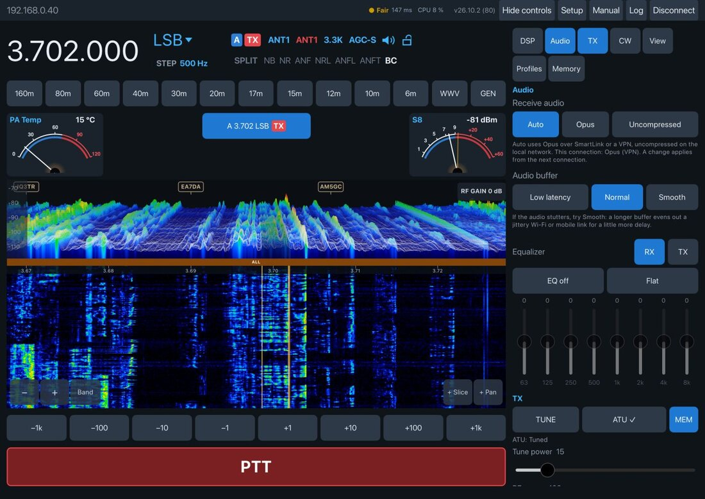
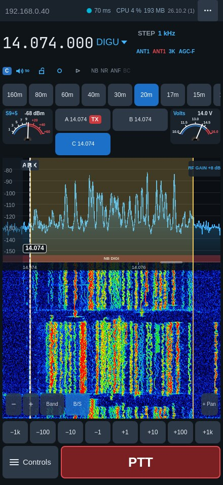
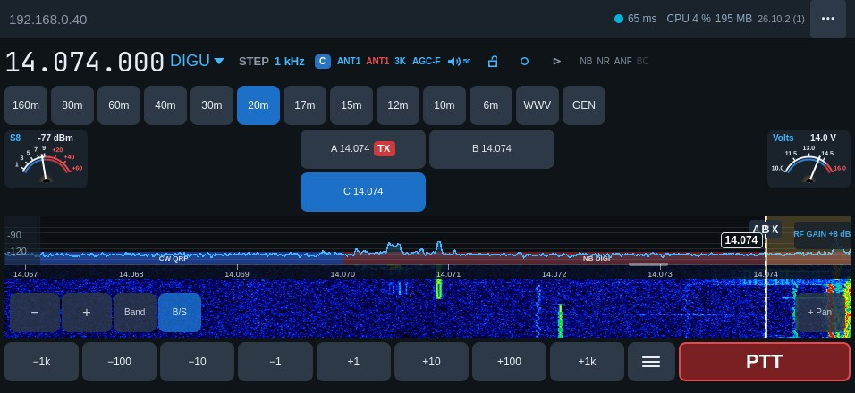
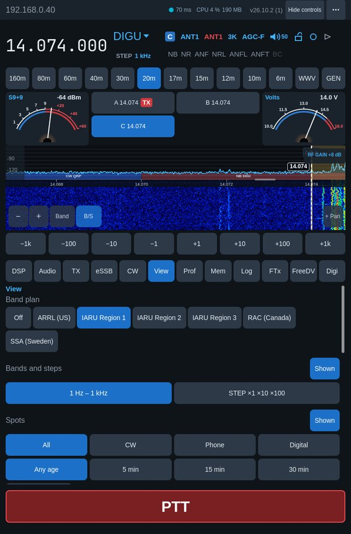
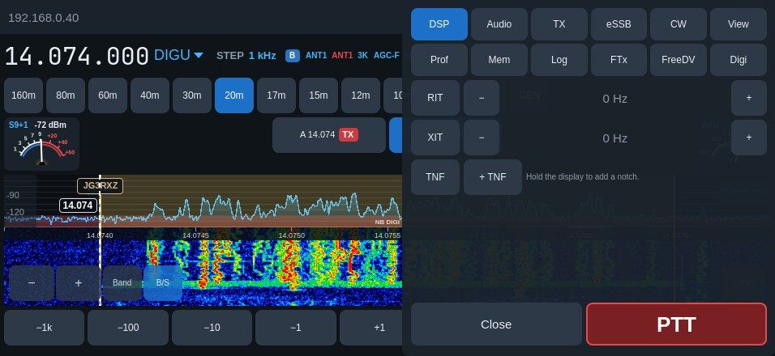
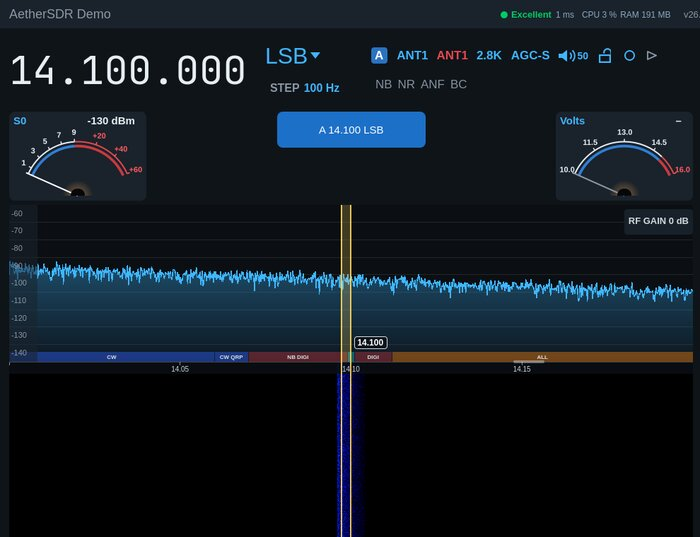
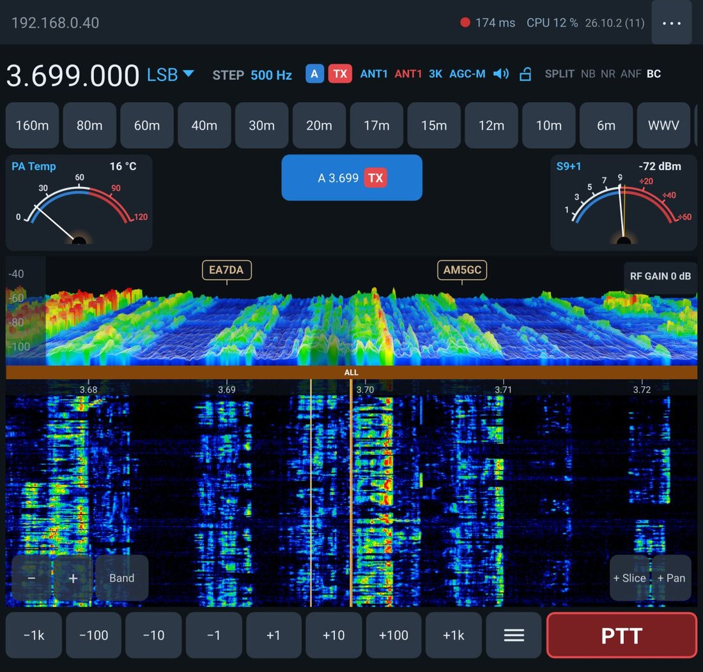
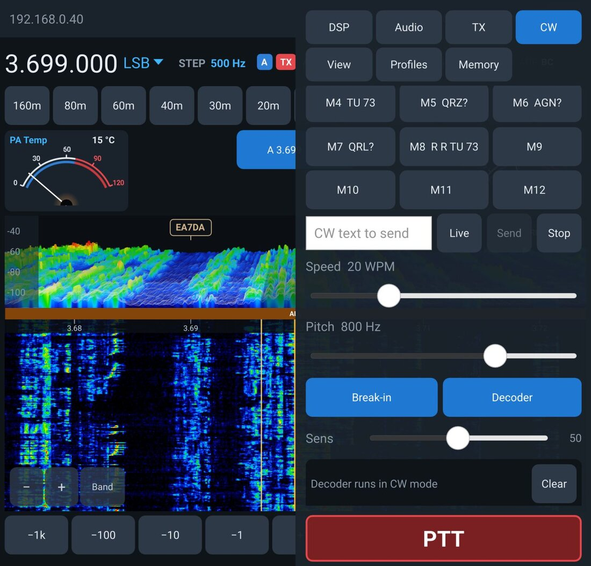
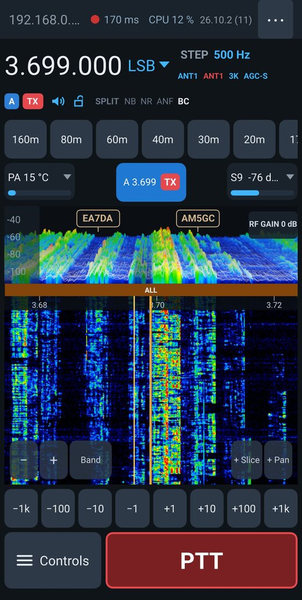

# OksaSDR

**A FlexRadio client for iPad, iPhone, Mac and Android, built on the [AetherSDR](https://github.com/aethersdr/AetherSDR) engine.**

[](https://github.com/OH6OKSA/OksaSDR/actions/workflows/mobile-ios.yml)
[](https://github.com/OH6OKSA/OksaSDR/actions/workflows/mobile-android.yml)
%20%7C%20Android%209%2B-blue)

[](LICENSE)

OksaSDR runs the AetherSDR engine (`libaethercore`) on the iPad, iPhone,
a Mac or an Android phone or tablet and talks to the radio directly. There is no PC, server, `aetherd` or
SmartSDR in between: at home on the same network, or from anywhere over
SmartLink (or your own VPN), it is a complete station control surface.

> OksaSDR is maintained by Niko Oksa, OH6OKSA, and was called *AetherSDR
> Mobile* until build 74. It is **not** an official AetherSDR app: the
> AetherSDR project plans its own mobile app. Engine work was offered
> upstream in
> [discussion #6409](https://github.com/aethersdr/AetherSDR/discussions/6409).

<p align="center">
  
  &nbsp;
  
</p>

**[Join the TestFlight test group](https://github.com/OH6OKSA/OksaSDR/blob/mobile/oksasdr/docs/mobile/TESTING.md)** (iPhone, iPad, Mac with Apple silicon): what you need and how to join.

**[Android beta: download the APK](https://github.com/OH6OKSA/OksaSDR/releases/latest)** (Android 9 or newer, 64-bit ARM): see the
[tester guide](https://github.com/OH6OKSA/OksaSDR/blob/mobile/oksasdr/docs/mobile/TESTING.md#android) for installing it.

**[User manual](docs/mobile/MANUAL.md)** — every function, with screenshots,
and how to operate each mode: SSB, CW, AM, FM, FT8 / FT4, RTTY, PSK31 / PSK63 and RADE
(also the app's *Manual* button).

**[OksaSDR Users on Facebook](https://www.facebook.com/groups/1468327561855382)** — questions, problem reports,
setups and news of new builds (for licensed radio amateurs; give your
callsign when you join).

## Support

<h1 align="center"><a href="https://www.paypal.me/NikoOksa">🍻 Buy me a beer 🍻</a></h1>

OksaSDR is free. If it is useful to you and you would like to buy
me a beer, you can do it through the link above. The desktop project that
makes all of this possible takes support through
[Open Collective](https://opencollective.com/aethersdr).

## About the author

I'm Niko Oksa, OH6OKSA, a licensed radio amateur since 18 July 1994, from
Finland. I build OksaSDR in my spare time and use it with my own FLEX.
By profession I run [Oksa Consulting Oy](https://oksa.fi), helping B2B
companies with strategy, sales and growth.

## Why

The desktop AetherSDR already runs on a Raspberry Pi. An iPad or iPhone has
more than enough CPU for the same engine, a better screen and a touch
interface. A tablet in the shack, or a phone on the couch, can be the whole
radio interface, with no computer running alongside.

## Features

**Receive**
- Live panadapter and waterfall, or the 3D stacked trace: the desktop's
  3DSS renderer and shaders, drawn on the GPU (Metal on Apple devices,
  OpenGL ES on Android). Spectrum,
  waterfall and 3D levels follow the noise floor as on the desktop. Tap to tune (snapped to the tuning step). Drag inside the
  filter passband to tune, anywhere else to move the view, as on the
  desktop; while tuning, holding the finger at either edge keeps scrolling,
  faster nearer the edge. Pinch or use −/+ (bottom left of the waterfall)
  to zoom around the slice. A frequency scale runs along the top of the
  waterfall, as on the desktop.
- Your own transmission shows in the waterfall.
- dBm scale on the spectrum: drag it up or down to move the trace, as
  the reference level in SmartSDR and AetherSDR.
- Waterfall black level and colour gain, the spectrum's reference level
  and range (or Auto), and the 3D floor, gain and smoothing in the View
  tab, remembered on the device; plus the radio's own FFT average, FFT
  frames/s and waterfall speed.
- **Band** beside −/+ zooms out to the whole band. View › Zoom buttons
  puts −/+, Band and B/S at the right for a right hand.
- RF gain; the radio's memory channels (recall, save, edit name,
  frequency and mode, delete).
- **Spots and DX cluster**: the radio's spots (from every program on it)
  as callsigns on the display, tap to tune; the app's own DX cluster
  connection sends its spots to the radio, as the desktop does; a status
  line says whether it is connected, to which server and as whom.
- **RTTY, received and sent**, on the Controls **Digi** tab: in the radio's
  RTTY mode (lower sideband, the standard) or as AFSK in DIGL or DIGU, the
  decoder following the sideband (on the upper sideband the mark is the
  upper tone); switching between them keeps the station tuned in. Macros
  as fldigi's (CQ, Answer, QSO, BTU, 73 SK...; tap sends, press and hold
  edits, F1-F8 or ⌘1-⌘8), a text field, Stop, the calls heard as buttons and Log
  (RTTY on the mark frequency). Shift, speed, reverse, mark, a squelch and
  the text so far, which also runs along the top of the waterfall. A tap
  on a signal, an RTTY spot or Autotune tunes it in.
- **PSK31 and PSK63, received and sent**, on the same **Digi** tab (Mode),
  in DIGU as the standard has them: a tap on a signal puts the decoder
  there (a green band marks it), AFC follows it, and the same macros, text
  field and Log (ADIF PSK31 / PSK63 on the signal's frequency) work; text
  goes out on the frequency received. A PSK spot tunes to the signal.
- **Amplifier: RF-KIT RF2K-S**: its address in Radio Setup › Amp, and
  Controls gets an **Amp** tab with what the amplifier reports over its
  own network port: Operate / Standby, forward power with a 3-second peak
  marker, reflected power, SWR, temperature, voltage, current, band,
  frequency, tuner, antenna and interface (twice a second, four times
  while transmitting); every meter can show its readings too. With
  *Control the amplifier* on (off by default): Operate / Standby, the
  internal antenna and the error reset, each confirmed first, none while
  the radio transmits, shown only as the amplifier reads it back; and
  **Tune**, the carrier the amplifier's own tuner needs (in STANDBY, 4-39
  W, kept while you open the amplifier's screen over VNC to press its
  Tune, stopping once it has tuned or after 20 s). The phone reaches the
  amplifier directly (same network or VPN).
- **Keying an amplifier from Radio Setup**, as in SmartSDR, so no other
  program is needed: on Transmit each keying output's delay after PTT
  (RCA TX1-TX3, ACC TX), the TX REQ inputs' polarity, the TX band
  settings (per band: RF and tune power, which outputs and TX REQ inputs
  work there, PTT inhibit, hardware ALC) and the outputs held open during
  TUNE; on USB the radio's USB-serial cables (CAT, BCD, Bit, LDPA,
  passthrough) that give an amplifier or antenna switch the frequency or
  band.
- **Notch filters (TNF)**: press and hold on the display (or *+ TNF*) for
  a new notch, set its width, depth and permanent and *Add* it, so a stray
  hold adds none; tap one for its settings or remove; drawn through
  spectrum and waterfall as on the desktop.
- The radio's global, TX and mic profiles: load, save and delete, as in
  SmartSDR and AetherSDR.
- Filter passband drawn on the display, on the correct side for USB/LSB and
  centred for CW/AM.
- Mode: tap the mode next to the frequency for the mode buttons.
- **STEP** under the mode: the tuning step, from the radio's step list.
- Info panel next to the frequency, after the slice flag of SmartSDR-style
  clients: the settings that are always there first (slice letter and TX
  tag, RX and TX antenna, filter width, AGC, speaker, tuning lock), then
  split and the DSP flags (lit when on). Each is a
  touch target with its choices behind it: the antennas open their
  chooser; the width and the flags the mode's eight filter widths and the
  radio's DSP (NR, NB, ANF, APF in CW, NRL/ANFL/ANFT and NRS/RNN/NRF where
  the radio has them, and WNB; every one the radio offers is listed, lit
  when on), with a level slider for each DSP that is on; AGC its modes, AGC
  threshold and RF gain; the speaker every slice's volume, mute and pan;
  the lock locks.
- Connected stations (multiFLEX): every program on the radio, and
  disconnecting one to free its slices.
- **Split**, as SmartSDR and AetherSDR: SPLIT on the info panel adds a TX
  slice 1 kHz (CW) or 5 kHz up, muted, with transmit and focus to tune the
  offset; tap again to end it. Press and hold SPLIT for +1, +5 or +10 kHz.
- RF gain shown at the top right of the spectrum; a preamp or attenuator
  step shows on the waterfall and trace, as on the desktop.
- **Beat cancel (BC)**, as on Kenwood rigs: the app finds steady carriers
  in the receive audio (someone tuning up on the frequency) and notches
  them out within ~0.15 s, leaving voice alone. Voice modes only.
- RIT and XIT −/+ run while held, faster the longer.
- Notices and refusals pop up in the middle of the display.
- Two meters on the slice row, SmartSDR style. Tap either one to choose S,
  Power, SWR, ALC, Mic, Compression, PA temperature or supply voltage,
  separately for receive and transmit (e.g. S, then SWR on the air). Each
  meter is **Analog** (arc, needle, S1–S9 and +20…+60 in red; also while
  transmitting), **Bar** or **Two bars**, each bar with its own receive and
  transmit choice, so up to four readings show at once. Bars carry the
  analog scale; peak hold is Off, Fast, Medium or Slow (an amber needle or
  marker). The choices are remembered.
- Band buttons (160 m … 6 m, WWV, GEN and the radio's transverter bands)
  use the radio's own band stack, so each band comes back to its last
  frequency and mode.
- Step buttons from ±1 Hz to ±1 kHz land on round frequencies: +10 Hz from
  14.100002 goes to 14.100010, not 14.100012.
- RIT and XIT, squelch (FM/AM).
- Several slices and panadapters: add, select, close, choose the TX slice
  (marked with a red TX tag). The active slice is a white dashed line with
  its frequency; other slices are marked with their letter and tap to
  select.
- Direct frequency entry from a keypad or a hardware keyboard.
- RX audio on the device, also in the background (home screen, other
  apps). The screen stays awake while connected.

**Transmit**
- TX audio passband (low and high cut) and the radio's 8-band RX and TX
  equalizer, as in SmartSDR.
- TUNE carrier with tune power, the radio's ATU (tune or bypass,
  memories) and the speech processor (PROC NOR/DX/DX+), VOX (level, delay)
  and DEXP when the radio's own microphone is in use, AM carrier, monitor
  and mic level (the device microphone's own gain, up to +30 dB, as the
  radio has no gain stage for its PC input).
- **Voice keyer**: twelve voice macros F1–F12. With SmartSDR+ they are the
  radio's DVK; without it the app records and plays them itself, kept on
  the device. *Listen* plays one back without transmitting.
- **Macros by PTT**: a button beside PTT opens the macros of the mode
  you are in over the display, buttons only, so no scrolling past the
  tabs' sliders: the CW memories with the call being worked, the RTTY /
  PSK macros or the voice keyer; a tap sends, Stop stops, and PTT stays
  in use while it is open.
- **eSSB**: the processing of the device's microphone, AetherSDR's
  client-side TX chain, on a tab of its own as on the desktop: gate, EQ
  (low cut, bass, presence) and compressor, with the Mic meter reading the
  processed audio on the air.
- Hold-to-talk PTT from the device's microphone (the radio's mic input is
  set to `PC` when the app connects), with RF power and mic level, plus forward power and SWR
  while transmitting. The microphone is open only while PTT is held, and
  the speaker goes quiet at the press, so receive never reaches the air.
- **Transmit lock** (TX tab, off by default): nothing transmits in
  standby until PTT, KEY, Space, TUNE or CQ is held for a second; then it
  stays armed for five minutes after the last transmission, counting down
  on PTT. With the lock off, **At start: Hold to arm** keeps PTT in
  standby at each start until held once.
- CW: in CW modes the PTT button is the straight key or two paddles (dit,
  dah) with the app's iambic keyer (A/B, squeeze; also [ ] or left/right
  Ctrl on a keyboard or USB paddle adapter), with the sidetone played on
  the device; editable memories ({CALL} = your callsign) and CWX
  text sent by the radio at the set speed, with sidetone too; speed, pitch and break-in, plus the CW decoder
  with the decoded text along the top of the waterfall (what you send shows
  there too). Twelve memories, also on F1–F12 from a keyboard (⌘1–⌘0 on an
  iPad's Magic Keyboard; Esc stops),
  and a Live mode that sends letters as you type; {CALL} sends the
  radio's callsign, set in Radio Setup.
- Safety first. Keying goes through AetherSDR's `TxController`, and every TX
  audio packet passes the engine's `TxCoordinator` dispatch fence. The
  transmitter unkeys on release, on disconnect, when the app loses focus,
  when the layout changes and when the mic input leaves the device.

**Digital modes and logging**
- **FT8 and FT4** in the app (Controls › FTx), no computer, DAX or
  WSJT-X: every slice in DIGU / DIGL decodes at once, rows marked with the slice
  and coloured as in WSJT-X (CQ, your call, new DXCC, CQ zone or
  continent, new call, worked before), with a filter (All, CQ, CQ POTA,
  New, New DXCC, New call). Tap a
  call to answer it (TX and the display move to its slice) or call CQ;
  the app runs the QSO and logs it. *Keep CQ* goes on calling; *Answer CQ*
  answers CQs by itself (the rarest first, five calls each, then the
  next); both stop after a time without a touch on the app, which you
  set. Drag the red TX band to a free
  frequency on the display. *List only* keeps the main buttons fixed and
  scrolls just the decodes.
- **RADE digital voice** (FreeDV's Radio Autoencoder) in the app, on any
  Flex (Controls › FreeDV): receive with the callsign each station sends,
  transmit with PTT as usual, report to FreeDV Reporter (qso.freedv.org)
  and see who is on it, on this band or all bands, with a tap to tune
  there.
- **Log** tab: quick QSO logging with QRZ.com lookup (or the country from
  the prefix), worked-before and dupe check, POTA / WWFF references, the
  calls the CW decoder heard offered for the Call field, and
  the log as an ADIF file in Files (iPhone, iPad) or Documents (Android,
  computer): share it to your logbook or LoTW, or import contacts from
  another logbook. Every QSO can also go straight to your **Wavelog** or
  **Cloudlog** logbook, queued while offline, and your **Wavelog** logbook
  can be read back so worked before, dupes, New call / DXCC and the FTx
  colours know every QSO in it, in every mode. The **QRZ.com Logbook** both
  ways (each QSO sent, its QSOs read back), and a **shared ADIF file** in
  iCloud Drive, Google Drive or OneDrive for a desktop logger without a
  cloud connection (read for worked before, each QSO added to it).
- **PSK Reporter**: report the stations you decode, as WSJT-X does (off by
  default).
- **Transverters** set up in Radio Setup (XVTR).

**Remote (SmartLink)**
- Sign in with your FlexRadio SmartLink account and connect to your radio
  from anywhere, with Opus-compressed audio. The sign-in is kept in the iOS
  Keychain or the Android Keystore on this device only; the password is
  never stored.

**Made for the device**
- A tablet layout and a phone layout. They switch live on rotation, Split
  View, Stage Manager and folding (iPhone Duo).
- The waterfall gets the screen. On iPhone, the controls (DSP, Audio, TX,
  eSSB, CW, View, Prof, Mem, Log, FTx, FreeDV) live in a drawer that slides in over it when needed. On iPad the side
  panel can be hidden into the same drawer. PTT/KEY always stays on screen:
  the drawer carries it at the bottom, never covering it.
- Apple Pencil drags tune 10× finer, for zero-beating.
- Magic Keyboard and trackpad: arrows tune, Space is PTT, +/− zoom, F opens
  frequency entry, scroll tunes and ⌘-scroll zooms; a slider, switch or
  list used on the page never keeps the keyboard from them.
- Safe-area aware: notch, Dynamic Island and the home indicator.
- VoiceOver and TalkBack: every control has a spoken name; a double tap
  acts and a swipe moves a slider one step.
- On a Mac with Apple silicon the iPad app runs from TestFlight; text
  fields take the Mac's keyboard (Backspace too, since build 142), and a
  field pressed and held opens a text box where a Mac's keys do not reach
  it.
- Network quality in the top row (as the desktop's indicator), with
  link timing, packet loss per stream and traffic on tap.
- **4O3A Power Genius XL and Tuner Genius XL** on the Amp tab: readings
  through the radio and directly, Operate / Standby, the fan, Tune, the
  tuner's relays and antenna switch (control off until turned on, each
  change confirmed). **APD** on a FLEX-8000 or Aurora.
- **Several radios by IP address or host name** on the Connect page, each
  with your name for it or the radio's own: a dynamic DNS or Tailscale
  MagicDNS name is looked up at each connect.
- **Radio Setup** (top row), as SmartSDR's: callsign, radio and station
  names, remote, multiFLEX, license, GPS, restarting the radio, transmit
  limits and timing, keying an amplifier (output delays, TX REQ, TX band
  settings), USB cables, microphone, CW keyer and sideband, the RTTY mark,
  the radio's audio outputs, receive (frequency calibration, the 10 MHz
  reference, filter sharpness) and the radio's network address (DHCP or
  static); offered once when a radio has no callsign yet (a new radio).
- App version and build in the top row; **Manual** opens the
  [user manual](docs/mobile/MANUAL.md).
- Built-in demo radio, so you can try it without a radio.
- In-app **Log** with Send to the developer and Share, so testers can report exactly what happened.

<p align="center">
  
  &nbsp;
  
</p>
<p align="center">
  
  &nbsp;
  
</p>

<p align="center">
  
  &nbsp;
  
  &nbsp;
  
</p>
<p align="center"><sub>Android beta 29 on a OnePlus Open: inner screen, controls open, outer screen. Taken from the device over the developer link.</sub></p>

<sub>The iPhone, iPad mini and passband screenshots are rendered by
[`mobile/tools/update-screenshots.sh`](mobile/tools/update-screenshots.sh)
against a FLEX and refreshed with every user-interface change; the iPad
landscape and Android pictures are taken from the devices.</sub>

## Status

| Area | State |
|---|---|
| Connect by IP, slice and panadapter, spectrum and waterfall, S-meter | ✅ Tested against a FLEX on SmartSDR API 1.4 |
| Mode, filters, DSP, AGC, band stack, RF power and mic level | ✅ Tested against a FLEX |
| iPad and iPhone builds, signing, TestFlight delivery | ✅ Automated in GitHub Actions |
| Android APK (arm64), signed, from the same code | 🧪 Beta in GitHub Releases, built in GitHub Actions |
| Android: background receive, Bluetooth headsets, SmartLink sign-in kept | ✅ Tested on a OnePlus Open (Android 16) |
| Android: USB-C headsets | 🧪 New in beta 55; reports with a USB-C headset welcome |
| RX audio on device | ✅ In daily use by testers, also with Bluetooth headsets |
| Voice transmit on air (device mic, Bluetooth headset) | ✅ Used on air by testers. Test at low power or into a dummy load first. |
| SmartLink remote (sign in, connect from anywhere, Opus audio) | ✅ Supported |
| Remote over your own VPN (connect by IP) | ✅ In use by testers (OpenVPN, WireGuard, Tailscale; also over 5G); several radios kept on a list since build 151 |
| FT8 / FT4 in the app | ✅ QSOs logged on the air from the iPad and a FLEX; 157 PSKReporter spots from two 10 W CQs; several slices decoding at once; Answer CQ worked three stations by itself (build 141) |
| RADE digital voice | 🧪 Built in; reports with RADE stations welcome |
| FreeDV Reporter (qso.freedv.org) | ✅ The app's RADE listed on qso.freedv.org (build 112) |
| PSK Reporter, Wavelog / Cloudlog | ✅ Spots on pskreporter.info; QSOs sent to a Wavelog logbook; Wavelog read back for worked before (tested with a 19 000-QSO logbook); QRZ.com Logbook both ways and a shared ADIF file (to test with real accounts and cloud folders) |
| Transverters (XVTR) in Radio Setup | 🧪 Built in; reports with a transverter welcome |
| Amplifier keying in Radio Setup › Transmit (output delays, TX REQ, TX band settings) | ✅ Every setting written from the page and read back on the FLEX-6600M (build 149); reports from stations with an amplifier welcome |
| USB cables in Radio Setup › USB (CAT, BCD, Bit, LDPA, passthrough) | 🧪 A real CAT cable's settings shown and one changed and set back on the FLEX (build 149); the other types tried with stand-in cables; reports with a cable plugged in welcome |
| Mac (Apple silicon), the iPad app from TestFlight | ✅ In use by testers; typing straight into the fields (the text box on press and hold since build 140, Backspace since 142) |
| Log tab, ADIF export and import, QRZ.com lookup | ✅ In use by testers |
| Several slices and panadapters, multiFLEX | ✅ Supported |
| Spots and DX cluster, TNF, memory editing | ✅ Tested against a FLEX-6600M (build 77; the notch panel with Add in build 139) |
| eSSB: TX processing (gate, EQ, compressor) | ✅ Measured on the FLEX with a test tone; testers' on-air reports welcome |
| VoiceOver / TalkBack names | 🧪 Every control named (build 139); reports from screen-reader users welcome |
| CWX (CW memories, CW text) on air | ✅ Used on air by a tester (POTA/WWFF replies); checked at 10 W with the sidetone in step |
| CW straight key and paddles on air | ✅ Checked on the FLEX at 10 W: straight key, paddles (elements on time at 30 WPM), iambic A and B squeeze |
| Transmit lock (SB / OA) | ✅ Checked on the FLEX without transmitting (build 141); the countdown back to SB and Hold to arm at start checked in build 151 |
| RTTY decoding and sending | ✅ Contest stations decoded live (build 141); DIGL / DIGU decoded live (IT9EJW, SV1EKI); sent at 10 W and decoded by RBN skimmers across Europe (OE9GHV 33 dB, GM0UDL 27 dB) |
| RF-KIT RF2K-S amplifier | ✅ Readings checked on a real RF2K-S (Sebastian Schu DG5CST, build 148). 🧪 Control (Operate / Standby, antenna, error reset) tested against a stand-in of its REST API: confirmations, a refusal (409), no answer, a lost link, never while transmitting (checked keyed on the FLEX); to verify on a real RF2K-S. 🧪 Tune's carrier (build 150) keyed on the FLEX at 5 W against the stand-in: STANDBY first, kept with the app in the background, off once tuned, after 20 s, on Stop, with the amplifier in OPERATE, on a lost link, and the radio unkeying by itself when the app was killed |
| 4O3A Power Genius XL / Tuner Genius XL (readings and control) | 🧪 Built in (build 152); tested against a stand-in that replays real devices' frames; reports from owners welcome |
| APD (FLEX-8000, Aurora) | 🧪 Built in (build 152); tested with the radio's status stood in; reports welcome |
| Macros panel by PTT (CW memories, Digi macros, voice keyer) | ✅ In use by a tester since build 150 (Tyler K0OTC: "It looks good"); checked on phones and tablets in USB, CW and RTTY without sending |
| Radio Setup › RX, Network and the rest of SmartSDR's Radio Setup (build 151) | 🧪 Each setting written from the page and set back on the FLEX-6600M (4.3.16); calibration, the reference, a static address and the restart only to their question so far; multiFLEX, binaural and the low-latency digital filters shown only (that firmware refuses their commands) |
| PSK31 / PSK63 | ✅ PSK31 decoded live (LZ1AEY's CQ on 14.071) and a PSK31 QSO at 25 W with F6FPU near Lyon, answering our first CQ (2026-11-02); the decoder tested to -12 dB SNR, AFC and a neighbour 100 Hz away |
| CW decoder | ✅ Decodes a strong signal cleanly and weak stations' calls (8–45 WPM, Sens filter against noise) |
| LAN discovery on iOS | ⏳ Needs Apple's multicast entitlement. Connect by IP for now. |
| LAN discovery on Android | 🧪 Built in; to be verified on the radio's own network |

**Next:** see the [roadmap](mobile/ROADMAP.md).

## Try it

- **TestFlight beta.** Ask for an invitation at oh6oksa@gmail.com; see
  **[how to join the test group](https://github.com/OH6OKSA/OksaSDR/blob/mobile/oksasdr/docs/mobile/TESTING.md)** for what to send.
  You need iPadOS or iOS 18 or newer (or a Mac with Apple silicon) and a FlexRadio: on the same network,
  through SmartLink from anywhere, or over your own VPN.
- **Android beta.** Download the APK from
  **[the latest release](https://github.com/OH6OKSA/OksaSDR/releases/latest)** and install it
  (Android 9 or newer, 64-bit ARM); the
  [tester guide](https://github.com/OH6OKSA/OksaSDR/blob/mobile/oksasdr/docs/mobile/TESTING.md#android)
  has the steps.
- **Build it yourself.** Linux or macOS works for development with the
  built-in demo radio; see [`mobile/README.md`](mobile/README.md):

  ```bash
  scripts/setup/setup-qt.sh
  cmake -B build-mobile -DAETHER_MOBILE=ON
  cmake --build build-mobile --target aether-mobile --parallel
  build-mobile/mobile/aether-mobile --demo
  ```

## How it is built

- **Same engine as the desktop.** The new CMake option `AETHER_MOBILE`
  builds `libaethercore` without QtWidgets or desktop peripherals. Desktop
  builds are unchanged, and the option is documented in
  [BUILD-OPTIONS.md](BUILD-OPTIONS.md).
- **New touch UI** in Qt Quick/QML under [`mobile/`](mobile/): the engine
  composition (`MobileEngine`), the spectrum and waterfall view (`SpectrumItem`), and the
  tablet and phone pages.
- **iOS support in core** is limited to platform guards. macOS-only
  IOKit/CoreAudio code sits behind `Q_OS_MACOS`, process helpers behind
  `QT_CONFIG(process)`, and the unused FFmpeg media plugin is excluded.
- **CI** ([`mobile-ios.yml`](.github/workflows/mobile-ios.yml)) builds on
  GitHub's macOS runners (the xcode-27 image, iOS 27 SDK). It cross-compiles
  FFTW, archives the app and signs it with cloud-managed distribution signing
  through an App Store Connect API key. Each push to `mobile/oksasdr` that
  changes the app uploads a build to TestFlight; the Android workflow
  ([`mobile-android.yml`](.github/workflows/mobile-android.yml)) builds the
  signed APK from the same code. No Mac is needed.
- Developed with Claude Code, following the upstream
  [constitution](CONSTITUTION.md) and [AGENTS.md](AGENTS.md) conventions.
  Commits are signed.

## Relationship to AetherSDR

The radio, DSP and protocol engine is AetherSDR's: this fork adds a mobile
build option, iOS platform guards and a new touch client on top, plus a few
engine additions that were offered upstream: beat cancel (BC) and
per-stream VITA packet-loss tracking. FT8 / FT4 use the MIT-licensed
[ft8_lib](https://github.com/kgoba/ft8_lib) (in `third_party/ft8_lib`). For the
desktop application (Linux, macOS, Windows), downloads, supported radios and
the full feature list, see the upstream project:
**https://github.com/aethersdr/AetherSDR**

Upstream issue [#3128](https://github.com/aethersdr/AetherSDR/issues/3128)
plans a mobile client (AetherLink). OksaSDR is a standalone alternative and
goes its own way, taking upstream engine changes when they are useful.

## Privacy, license, contact

- Privacy: the app collects no data. See [mobile/PRIVACY.md](mobile/PRIVACY.md).
- License: GPLv3, like AetherSDR ([LICENSE](LICENSE), [THIRD_PARTY_LICENSES](THIRD_PARTY_LICENSES)).
- Contact: Niko Oksa, OH6OKSA, oh6oksa@gmail.com. 73!
