# OksaSDR — User Manual

OksaSDR turns an iPad, iPhone or Android phone or tablet into a complete
FlexRadio client:
panadapter and waterfall, all receive controls, transmit (voice, CW, tune)
and SmartLink remote operation, with no computer alongside.

This manual describes every function and how it works. The screenshots are
taken from the app connected to a real FLEX radio. The app's **Manual**
button (top row) opens this page.

- [1. Connecting](#1-connecting)
- [2. The main screen](#2-the-main-screen)
- [3. Frequency, mode and the info panel](#3-frequency-mode-and-the-info-panel)
- [4. Meters and slices](#4-meters-and-slices)
- [5. Panadapter and waterfall](#5-panadapter-and-waterfall)
- [6. Split](#6-split)
- [7. Transmitting: PTT, KEY and TUNE](#7-transmitting-ptt-key-and-tune)
- [8. Controls](#8-controls)
- [9. Radio Setup](#9-radio-setup)
- [10. Notices and problems](#10-notices-and-problems)
- [11. Keyboard and Apple Pencil](#11-keyboard-and-apple-pencil)
- [12. Reporting a problem](#12-reporting-a-problem)
- [13. Android](#13-android)

---

## 1. Connecting

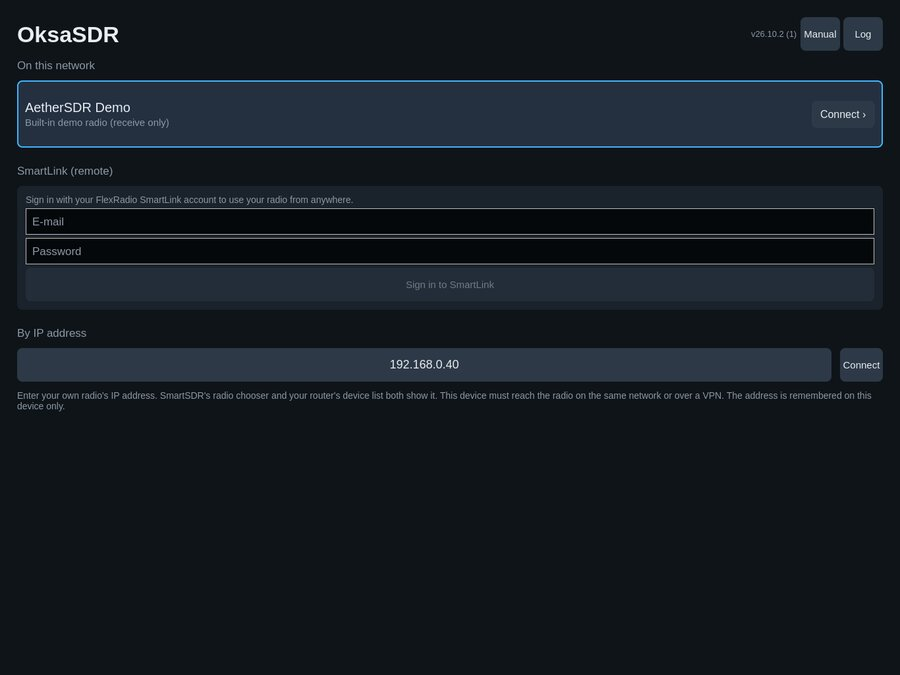

The first page lists the ways to reach a radio:

- **On this network** — FlexRadios found on the local network (on an
  iPhone or iPad, connect by IP address for now). Tap a radio's card, or its
  **Connect ›**, to connect. *AetherSDR Demo* is a built-in receive-only demo radio for trying
  the app without a radio.
- **SmartLink (remote)** — sign in with your FlexRadio SmartLink account
  to use your radio from anywhere. The sign-in is kept on this device only
  (the iOS Keychain; on Android, encrypted under a key in the Android
  Keystore); the password is never stored.
- **By IP address** — tap the address field and enter your radio's IP
  address on the keypad (SmartSDR's radio chooser and your router's device
  list both show it), then *Connect*. A hardware keyboard works in the
  keypad too.
  The device must reach the radio on the same network or over a VPN.

The top row shows the app version, **Manual** and **Log** (see
[Reporting a problem](#12-reporting-a-problem)).

When you connect, the radio's microphone input is switched to *PC* so the
device's microphone can be used for transmit.

## 2. The main screen

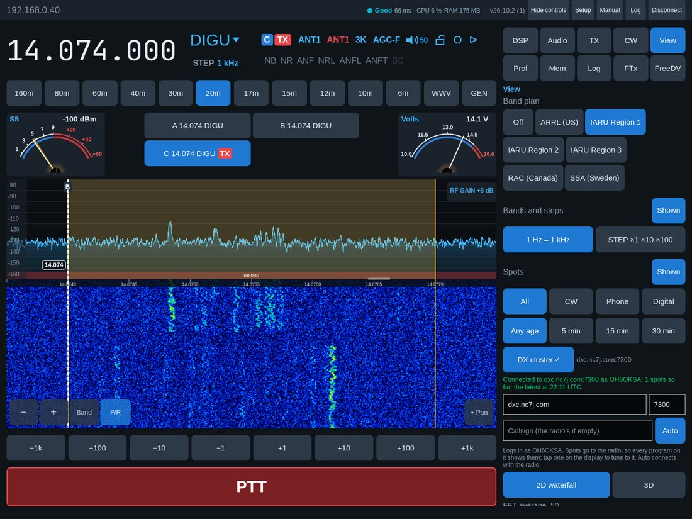

From top to bottom. Throughout the app a button that is **on** (a chosen
mode, a DSP that runs, the shown tab) is **lit blue**; the others are dark.

| Area | What it is |
|---|---|
| Top row | Radio name, [network quality](#network-quality), app version, **Controls** (open or hide the controls), **Setup** ([Radio Setup](#9-radio-setup)), **Manual**, **Log**, **Disconnect** (on a phone Setup, Manual, Log and Disconnect are behind **⋯**, and the controls open from the button beside PTT) |
| Frequency row | Frequency, mode, and the [info panel](#3-frequency-mode-and-the-info-panel) |
| Band buttons | 160 m … 6 m, the radio's transverter (XVTR) bands, WWV, GEN |
| Slice row | The two [meters](#4-meters-and-slices) at the ends, the slices in between |
| Panadapter and waterfall | The [spectrum display](#5-panadapter-and-waterfall) |
| Step buttons | Tune by −1 kHz … +1 kHz (with an FM step: the step, 100 kHz, 1 MHz, 10 MHz) |
| PTT / KEY | [Transmit](#7-transmitting-ptt-key-and-tune) |

On an iPad or tablet the controls can stay pinned at the side (as above) or
open as a drawer. On a phone they open as a drawer from the **Controls**
button beside PTT (three bars in landscape); the drawer carries its own PTT
in the same place.

| iPhone, portrait | iPhone, landscape |
|---|---|
| 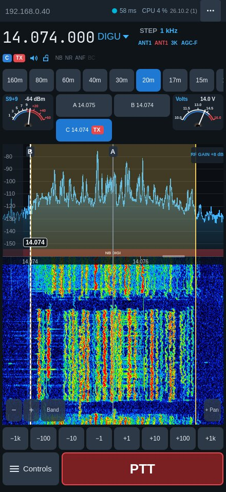 | 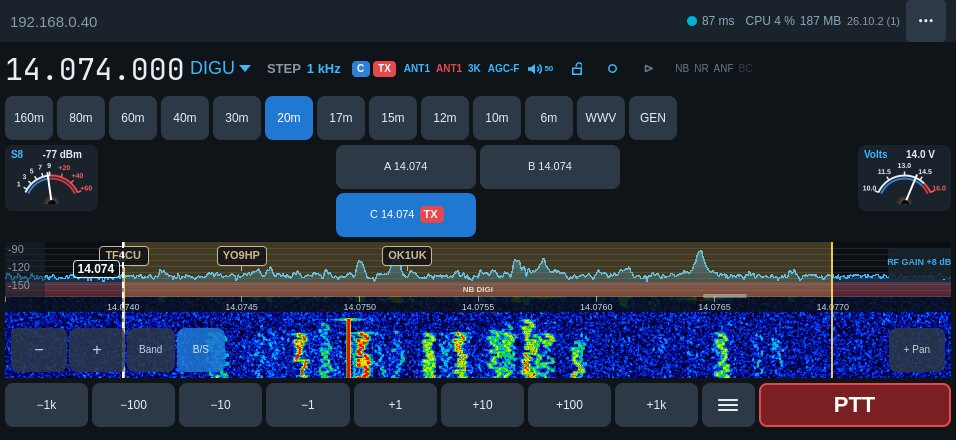 |

The layout follows the device: rotation, Split View, Stage Manager and
folding switch it live. On a very low screen in landscape (a phone's outer
screen, the smaller iPhones) the band buttons give way to the display; the
**Band** button on the waterfall picks bands there.

### Network quality

The dot in the top row (with the app's CPU next to it) rates the connection as the desktop AetherSDR does —
**Excellent / Very Good** (green), **Good** (blue), **Fair** (amber),
**Poor** (red) — with the round-trip time. On an iPhone only the dot and
the time show. Tap it for the details:

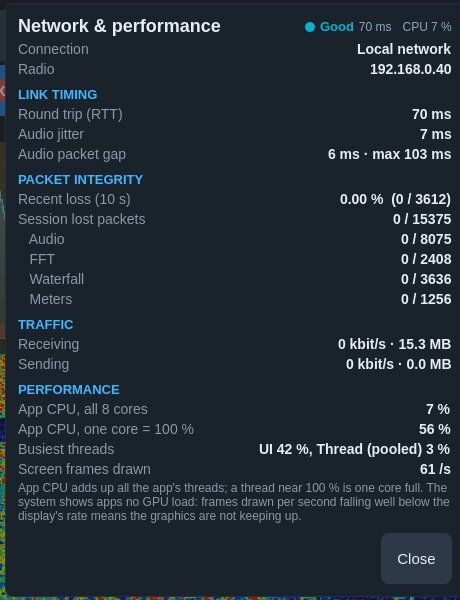

- **Link timing** — round trip to the radio, audio jitter, and the gap
  between audio packets (current and longest).
- **Packet integrity** — packets lost in the last 10 s and in the session,
  per stream (audio, spectrum, waterfall, meters). Packets that merely
  arrive out of order are not counted as lost.
- **Traffic** — receive and send rates and totals.
- **Performance** — the app's CPU as a share of all cores (also shown in the
  top row), the same added up over all its threads with one core = 100 %
  (102 % is about one core's worth spread over several threads, not one
  core full), on Android the **busiest threads** (UI, render, audio…; one
  near 100 % is a core at its limit), and the screen frames drawn per
  second. iOS and Android give apps no GPU load; frames drawn falling well
  below the display's rate means the graphics are not keeping up.

## 3. Frequency, mode and the info panel

**Frequency.** Tap the frequency for direct entry with a keypad (or type on
a hardware keyboard), then *Tune*. *14.074* and *14074* both tune
14.074 MHz; on a transverter band, *439.000* (or *439*) tunes 439 MHz.

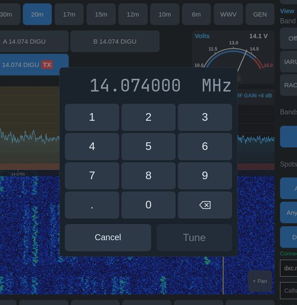

**Mode.** Tap the mode (e.g. *USB ▼*) and choose another.

**STEP** (under the mode, e.g. *STEP 100 Hz*) is the tuning step: tap it to
choose from the radio's list. Tap-tune, arrow keys and the Pencil use it.

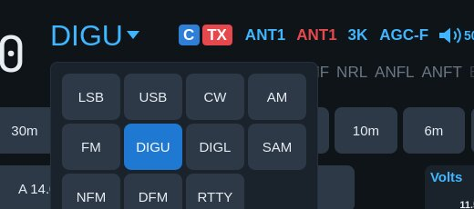

**Band buttons.** Each band returns to the frequency and mode you last used
there. The radio keeps these in its *band stack*, which is part of the
radio's global profile, so a different profile can bring a band back
elsewhere. **WWV** holds the time-signal frequencies and **GEN** general
coverage, each with its own band-stack memory. Transverters set up in the
radio (in SmartSDR or the AetherSDR desktop: Radio Setup → XVTR) get a
button of their own after 6 m, named as in the radio (for example 2m): the
radio tunes the RF frequency, uses the transverter port and does the IF
itself. On a phone the band row scrolls sideways.

**Step buttons.** ±1 Hz … ±1 kHz, landing on round frequencies: +10 Hz from
14.100 002 goes to 14.100 010, not 14.100 012. With an FM channel step of
5 kHz or more (STEP, e.g. 12.5 kHz on 70 cm) they become ±STEP, ±100 kHz,
±1 MHz and ±10 MHz, all on the step's grid. The band button of the band
you are on is lit.

### The info panel

The active slice at a glance, after the slice flag of SmartSDR. Every item
is a touch target with its choices behind it:

| Item | Shows | Tap |
|---|---|---|
| **A** (blue) | Slice letter | — |
| **TX** (red) | This slice transmits | — |
| **ANT1** (blue) | Receive antenna | Choose the RX antenna |
| **ANT1** (red) | Transmit antenna | Choose the TX antenna |
| **2.7K** | Receive filter width | Filters and DSP |
| **AGC-M** | AGC mode | AGC mode, AGC threshold and RF gain |
| Speaker | Audio on (blue) / muted (red) | Every slice's volume (AF gain), Mute and pan (left–right, read as C, L n or R n; it snaps to centre near the middle, and double-tap centres) |
| Lock | Tuning lock open / locked | Lock or unlock tuning (flashes when a tune is refused) |
| **SPLIT** | Split on (amber) or off (grey) | Start or end [split](#6-split); hold to pick the offset |
| **NB NR ANF NRL …** | Every DSP the radio offers, bright when on (on an iPhone the rarer ones only while on) | Filters and DSP |

The settings that are always there come first; split and the DSP flags
follow on a second row. On an iPhone in portrait STEP and the antennas, width and AGC sit beside the
frequency and the rest under it; in landscape it is one row, STEP first.

**Filters and DSP** — the mode's eight filter widths (the active one lit;
choosing one closes the window) and the radio's DSP: NR, NB, ANF, APF (CW),
and NRL, ANFL, ANFT, NRS, RNN, NRF where the radio has them, and **WNB**, the
panadapter's wideband noise blanker. **BC** is the app's own beat cancel
(below). DSP toggles leave the window open, so several can be set together.
Each DSP that is on and has a level (NR, NB, ANF, APF, NRL, ANFL, NRS, NRF,
WNB) gets a slider under the toggles, sent to the radio when released.

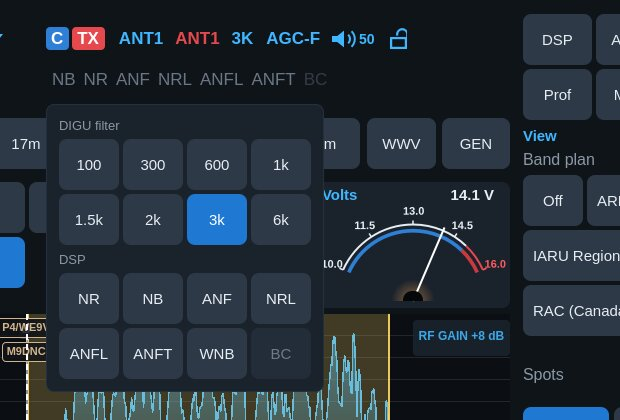

**BC — beat cancel**, as on Kenwood rigs: finds steady carriers in the
receive audio — someone tuning up on your frequency — and notches them out
within about 0.15 s, leaving voice alone; it adds no delay to the audio. Up
to four carriers at a time. Voice modes only: in CW and data modes (and
whenever another audible slice is in one) it is off and not offered, since it
would remove the signal itself; back in a voice mode it returns as you left
it.

**AGC** — off / slow / med / fast, the AGC threshold (AGC-T) and the
panadapter's RF gain (preamp or attenuator, in the radio's steps).

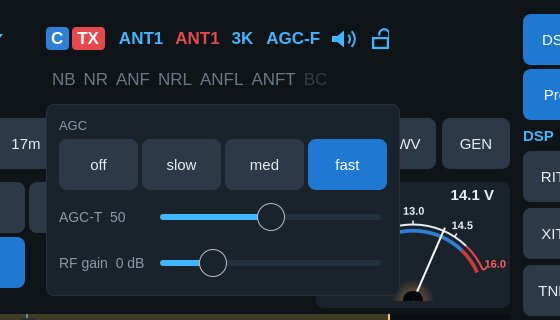

**Antennas** — the antenna ports the radio offers for receive or transmit.

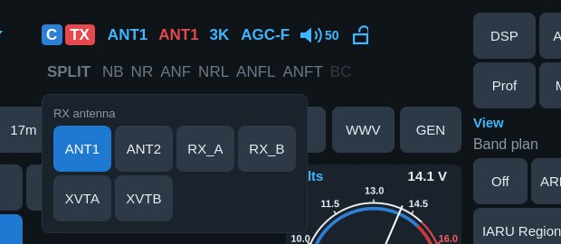

## 4. Meters and slices

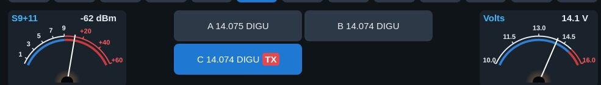

**Meters.** Two meters, at the ends of the slice row. Tap a meter to choose
what it shows — separately for receive and for transmit (e.g. S and Power,
then SWR and Power on the air) — and its style, bar or analog. Choices are
remembered.

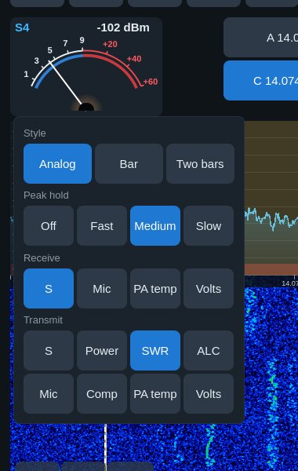

Receive offers S, Mic, PA temperature and supply voltage; transmit adds
Power, SWR, ALC and Compression, which the radio reads only while
transmitting. **Mic** is on the left meter only (on a tablet the side
panel covers the right one). With this device's microphone it shows the
level of the audio as it is sent (after the processing in Controls → TX):
while you transmit, and in receive too while Controls → TX is open, so the
level can be set before going on the air; with a microphone on the radio
it is the radio's own meter.

**Peak hold.** Each meter keeps its highest reading — an amber needle on
the analog meter, an amber tick on the bar — then lets it fall back, so a
voice peak or a burst of noise can be read. *Peak hold* in the meter's
chooser sets it for both meters, as the desktop S meter's decay: *Off*,
*Fast* (0.2 s, then 20 dB/s), *Medium* (0.5 s, then 10 dB/s; the
default) or *Slow* (1 s, then 5 dB/s); other scales fall in the same time
for their span.

**Slices.** Each slice is a button between the meters ("A 14.100 USB"); the
transmit slice carries a red **TX** tag. Two fit side by side, four make
2 × 2.

- Tap a slice to make it the active one (tuning, info panel and controls
  follow it).
- Press and hold for **Make TX slice** and **Close slice**.
- **+ Slice** and **+ Pan** (bottom right of the waterfall) add a slice or a
  panadapter.
- Closing the transmit slice hands transmit to the slice that stays, so PTT
  keeps working.

## 5. Panadapter and waterfall

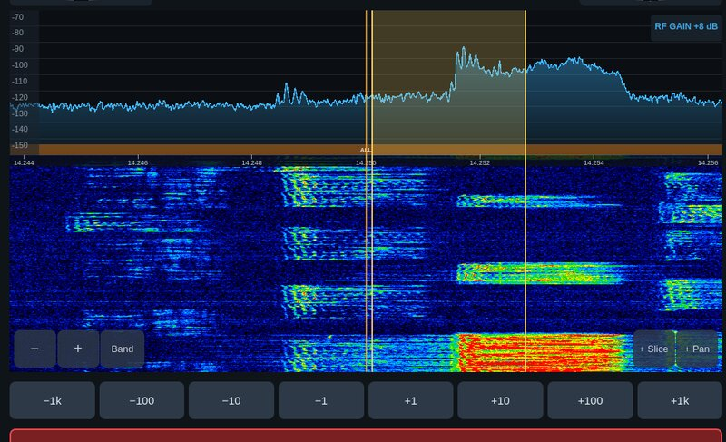

- **Tap** to tune to the touched point (on the tuning step).
- **Drag inside the filter passband** to tune; the slice follows the finger
  in tuning steps (STEP), so it stops on a round frequency.
- **Drag a passband edge** (a finger's width around either edge line) to
  set the filter in 10 Hz steps, for any width; the filter chooser's eight
  widths stay as they were.
  Holding the finger at either edge keeps tuning, faster nearer the edge.
- **Drag anywhere else** to move the view; the frequency stays.
- **Pinch**, or **− / +** (bottom left), to zoom around the slice.
- **Band** (beside − / +) zooms out to the whole band you are on; tap it
  again to return to the slice.
- The **frequency scale** runs along the top of the waterfall.
- The **dBm scale** at the left: drag it up or down to move the trace (the
  reference level). In 3D, as on the desktop, the 3D levels stay automatic:
  the floor (the 3D zero) follows the noise and the scale runs from it to
  the top. Dragging sets **3D floor**, how far under the noise the zero
  sits (0–24 dB, default 6): drag up and the noise rises, down and it
  sinks. The same setting is a slider in View.
- The **divider** between the spectrum and the waterfall (a short bar on
  the line, right of centre): drag it up or down to give the spectrum or
  the waterfall more room, as on the desktop. The new split applies when
  you lift your finger (a line shows where it goes; the waterfall starts
  over at its new size) and is remembered. Double-tap it for the
  automatic split.
- **RF GAIN +8 dB** (top right) shows the RF gain; tap it for AGC, AGC-T and
  RF gain. A gain step shows on the
  waterfall and trace, as on the desktop.
- The filter passband is drawn on the display, on the correct side for
  USB/LSB and centred for CW/AM. Other slices are marked; tap one to select it.
- Your own transmission shows in the waterfall.
- In CW, decoded text runs along the top of the waterfall.
- **Spots** — callsigns along the top of the spectrum at their frequency:
  the spots the radio holds, from this app's DX cluster connection and
  from any other program on the radio. Tap one to tune to it (the mode
  follows the spot, as on the desktop). Close ones stack in up to four
  rows; zoom in to see more. *Spots* in View turns them off and connects
  the DX cluster.
- **Notches (TNF)** — **press and hold** on the display to put a notch
  there, or *+ TNF* in Controls → DSP for one in the middle of the
  passband. A notch shows as a band through spectrum and waterfall
  (yellow, or green when permanent) with a handle on top outlined in black:
  filled while TNF is on, hollow while it is off. Tap it for its
  width (50–500 Hz), depth, *Permanent*, a 10 Hz nudge either way and
  *Remove*; *TNF on/off* there is the radio's switch for all notches —
  they only work while it is on. Drag a notch along the spectrum (not the
  waterfall) to move it.

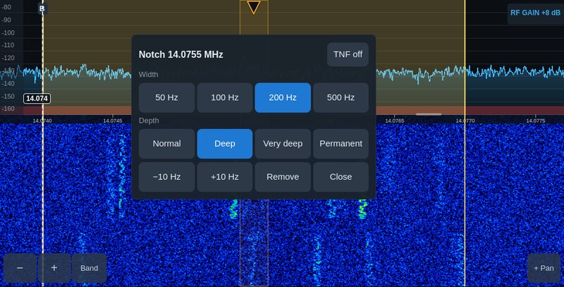

**View** (in Controls) switches between the 2D waterfall and the **3D**
stacked trace and sets the levels. They work as on the desktop AetherSDR:

- **Spectrum** — *Auto* keeps the noise floor a quarter of the way up and
  follows it calmly: it rises only once a change has lasted over a second
  (a lightning crash does not lift it), falls quickly, and re-locks after a
  retune or zoom. **Range** is the height of the scale, in Auto too; with
  Auto off, **Reference** is the top. The trace is lightly averaged.
- **Waterfall** — *Auto* puts black at the noise floor; **Black level**
  moves it (50 = at the noise, higher shows more of it). **Colour gain**
  sets how many dB the colours span, so the same signal looks the same on
  any band and a strong carrier does not darken the rest. During and just
  after a transmission the levels hold.
- **FFT average**, **FFT frames/s** and **Waterfall speed** are the
  radio's own panadapter settings (as in SmartSDR): averaging smooths the
  trace on the radio, frames/s sets how often the trace updates, and the
  waterfall speed how fast lines scroll. Each is sent when the slider is
  released and kept by the radio.
- **3D** — the surface takes a row with each waterfall line and glides
  between them. **3D smoothing**: *Off* draws the rows as live as the 2D
  trace, *Light* (default) blends a little with the previous row so the
  narrow dips (say, gaps in your own voice's spectrum) stay visible,
  *Desktop* smooths as the desktop does (no flicker from single spikes,
  a calm surface). Ridges
  are soft lines, the near rows widen over the side gaps where the radio's
  wider waterfall data reaches, and the slices' passbands and carriers are
  shaded into the surface in perspective. Its height is the spectrum's
  Range; **3D floor** sets how far under the noise its zero sits and
  **3D gain** how far down the colours reach. In portrait the 3D keeps
  landscape's shape and the waterfall gets the rest of the height. It keeps
  its history while you are in 2D.

## 6. Split

Tap **SPLIT** on the info panel. As on SmartSDR and AetherSDR, a second slice
is created on the same panadapter for transmit:

- 1 kHz above in CW, 5 kHz above in other modes, same mode;
- it is muted (you listen on the original slice) and takes transmit;
- it becomes the active slice, so you can tune the transmit frequency at
  once (drag its passband, or the step buttons).

Tap **SPLIT** again — or close either slice — to end split: the transmit
slice closes and transmit returns to the receive slice.

**Press and hold SPLIT** to choose the offset: **+1 kHz**, **+5 kHz** or
**+10 kHz** above the receive frequency. While split is on, the same menu
offers **Off**.

## 7. Transmitting: PTT, KEY and TUNE

- **PTT** — hold to transmit from the device's microphone; release to stop.
  The microphone is open only while transmitting. **Tap on / off** (Controls
  → TX → PTT) makes it a switch: tap to transmit, tap again to stop (TX ■
  while it is on); as a safety it stops by itself after 3 minutes. Space on
  a keyboard works the same way.
- **KEY** — in CW modes the same button is a straight key, or **paddles**
  (Controls → CW → Key: *Paddles*): dit and dah side by side in its
  place, each its own touch, so holding both gives iambic squeeze. The app
  times the elements itself, sends them to the radio and plays the
  sidetone in step. **Iambic** in the CW tab sets **A** or **B** (B adds
  one more element after a squeeze) and **Swap ⇄** (dah on the left); they
  are the radio's settings, also in [Radio Setup](#9-radio-setup) →
  Phone/CW. **Paddles on a keyboard** picks which two keys of a hardware
  keyboard are the paddles, the left one dit and the right one dah:
  left and right **Ctrl** (the default; what USB paddle adapters such as
  Vail and VBand send), left and right **Alt ⌥** (Option; for keyboards with no right
  Ctrl, such as Apple's Magic Keyboard), **[ ]** (on English layouts,
  where [ and ] are keys of their own; on Finnish or German layouts they
  need AltGr or Option, so pick Ctrl or Alt there), or **Off**.

  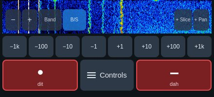

  For a straight key, the sidetone
  plays on this device as you key (at the radio's CW pitch and monitor
  level, when the radio's sidetone is on), without the round trip to the
  radio.
- **TUNE** (Controls → TX) sends a carrier at the tune power; while it is on,
  the big button reads TUNE and pressing it stops the carrier.

The button is always on top: an open controls drawer carries its own copy at
the bottom, so nothing ever covers it.

Safety: transmit goes through AetherSDR's TX controller. The transmitter
unkeys on release, on disconnect, when the app leaves the screen, when the
layout changes and when the microphone input leaves the device. If the radio
refuses to transmit, its reason pops up (for example *No transmit slice is
assigned* or *The selected TX antenna cannot transmit on this frequency*).

## 8. Controls

**Controls** (top row) opens the controls; on an iPad, *Pin Controls* keeps
them in the page (at the right in landscape, under the display in portrait),
with toggle buttons to show several sections at once; *Hide controls* puts
them back into the drawer.

| DSP | Audio | TX |
|---|---|---|
| 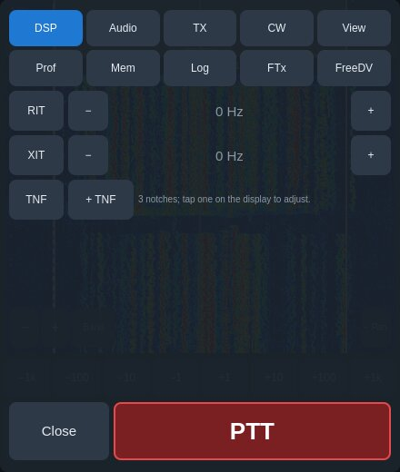 | 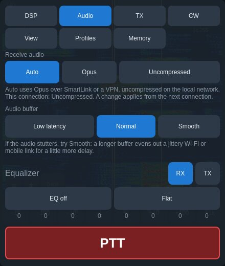 | 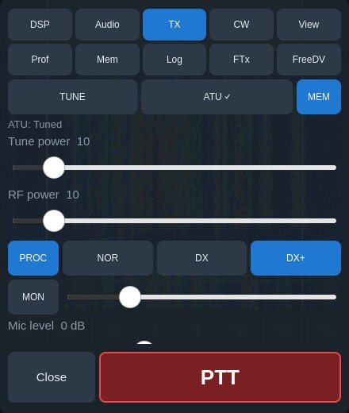 |

- **DSP** — RIT and XIT (on/off; − and + step 10 Hz and run while held,
  faster the longer: 10, then 50, then 100 Hz; tap the value to reset),
  squelch, and **TNF** (the radio's notch filters on/off, *+ TNF* for a
  notch in the passband; see [Panadapter and waterfall](#5-panadapter-and-waterfall)).
- **Audio** — **Receive audio**: *Auto* uses Opus (compressed, made for
  the internet) over SmartLink or when the radio is reached through a VPN,
  and uncompressed audio on the local network; *Opus* or *Uncompressed* fix
  it. It shows what the current connection uses; a change applies from the
  next connection. **Audio buffer**: *Low latency* (100 ms), *Normal*
  (200 ms, the default) or *Smooth* (400 ms) — a longer buffer evens out a
  jittery Wi-Fi or mobile link for a little more delay. Low latency is for a
  wired or very steady link only; on ordinary Wi-Fi it stutters. If Normal
  stutters, try Smooth. Every 10 s with stutter the log gets an
  "audio underrun" line (count, buffer, longest packet gap, buffer mode),
  and once a minute a "performance" line (CPU, frames drawn). Below, the radio's
  8-band receive and transmit equalizer
  (volume is on the info panel's speaker).
- **TX** — in FM modes first **FM repeater**: **Offset** *Simplex*, *−*
  (transmit below) or *+* (above), the **Shift** (0.6, 1.6, 5.0 or 7.6 MHz,
  or type any) and **Tone**: *CTCSS* on transmit with its tone. The radio
  transmits on the shifted frequency and sends the tone; receive stays on
  the frequency shown. Then TUNE and the
  ATU (tune, bypass, memories), tune power, RF power, speech processor (PROC
  NOR/DX/DX+), **VOX** (on/off, level and delay) and **DEXP** (the downward
  expander, on/off and level) in voice modes — shown only when the radio's
  own microphone input is selected, as they do nothing with this device's
  microphone — the AM **carrier** level in
  AM/SAM/DSB, monitor (MON), **Mic level**, microphone choice, **DAX**
  (on: the radio sends the audio of a digital-mode program on a computer
  instead of the microphone; left on after FT8, the microphone goes
  nowhere), **PTT**
  (*Hold to talk* or *Tap on / off*) and the transmit filter (low and high
  cut). **Mic level** with this device's
  microphone is the app's own gain, −20 to +30 dB: the radio has no gain
  stage for its PC input, so its mic level does nothing to this
  microphone. Choose Mic for the left meter and set it so speech peaks
  near −10 dB: while the TX tab is open the microphone is open and the
  meter moves in receive too (nothing is sent before PTT; not while VOX is
  on). Phone microphones often need +10 to +20 dB; a limiter at
  −1 dBFS keeps the loudest peaks from clipping. With a microphone on the
  radio it is the radio's mic level (0–100), as SmartSDR's MIC.
  - **This device's microphone: processing** (voice modes, with this
    device's microphone) — AetherSDR's client-side transmit chain, run on
    the phone or tablet before the audio is sent: **Gate** (mutes the
    background between words below the threshold), **EQ** (low cut
    100–300 Hz, bass and presence ±12 dB) and **Comp** (threshold, ratio
    2:1–8:1 and makeup; while you transmit, how much it is taking off shows
    beside the ratio). The radio's own 8-band transmit EQ is in Audio.
    Check the result with MON or a second receiver at low power first.

    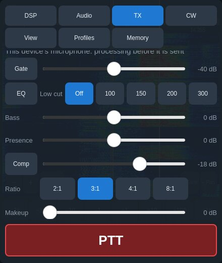
  - **Voice keyer** (voice modes) — twelve voice macros F1–F12. Tap one to
    transmit it, tap again to stop; press and hold to record (from this
    device's microphone; recording does not transmit), rename or clear. On a
    radio with SmartSDR+ these are the radio's own DVK slots (up to 10 s,
    shared with other programs); otherwise the app keeps them on this
    device (up to 15 s) and plays them into the transmit audio as if
    spoken. Either way **Listen** plays a recording to you without
    transmitting, so you can check it before naming it. Features that need
    SmartSDR+ appear only when the radio reports the subscription.

| CW | View | Profiles | Memory |
|---|---|---|---|
| 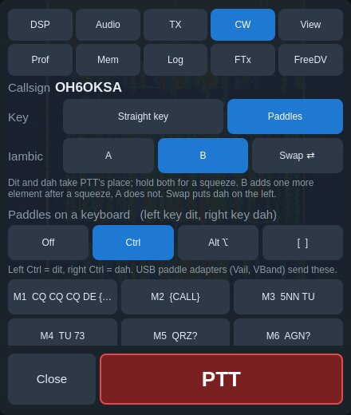 | 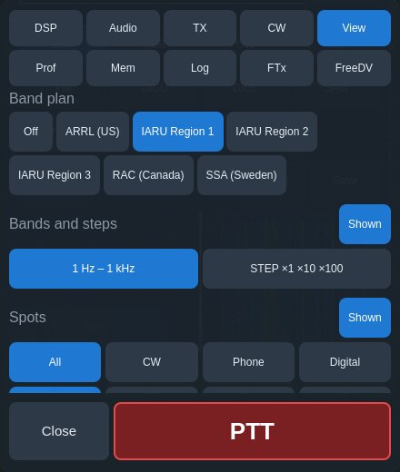 | 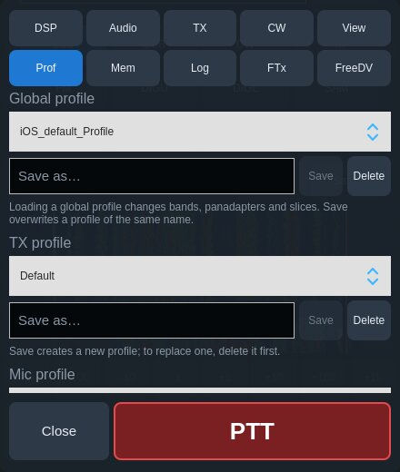 | 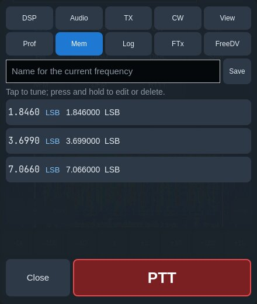 |

- **CW**
  - **Callsign** — the callsign `{CALL}` sends, the radio's own. Set or
    change it in [Radio Setup](#9-radio-setup) → Radio.
  - **Memories M1–M12** — tap to send (through the radio's CWX keyer at the
    set speed), press and hold to edit, or F1–F12 on a keyboard. `{CALL}`
    becomes your callsign. They are the app's own; the radio's stored CWX
    macros are left alone. What they send, and CW text below, plays as
    sidetone on this device too.
  - **CW text** — type and *Send*; with **Live** on, each letter goes as you
    type it (Return sends a space). *Stop*, or Esc, clears what is still
    queued.
  - **Key** — *Straight key* or *Paddles*; with paddles, **Iambic** A / B and
    **Swap ⇄**, and **Paddles on a keyboard** (see
    [KEY](#7-transmitting-ptt-key-and-tune)).
  - Speed, pitch, **Break-in** (QSK) and the **Decoder**. With Break-in off
    the key does not put the radio on air; the app says so when you key.
    The decoder has **Sens**
    (0–100, default 70): higher shows only the letters decoded with
    confidence, so band noise stays out. It reads hand-sent and keyer CW
    from 8 to 45 WPM. Decoded text shows
    here and along the top of the waterfall; what you send shows there too,
    marked `[TX]`.
- **View** — band plan, **Spots** (shown or hidden) and the **DX cluster**,
  2D waterfall or 3D, waterfall levels, spectrum range, 3D floor, smoothing
  and gain.
  - **Spot filters** — which spots show: *All*, *CW*, *Phone* or *Digital*
    (by the spot's mode, else its comment or the band plan, as on the
    desktop), and *Any age* or only those from the last 5, 15 or 30
    minutes.
  - **DX cluster** — tap to connect, again to disconnect. Set the server and
    port (default dxc.nc7j.com 7300) and the callsign it logs in with (the
    radio's own when left empty); **Auto** connects whenever the radio
    does. Its spots go to the radio, so SmartSDR and every other program
    on it show them too; they expire after 30 minutes.
- **Profiles** — the radio's global, TX and mic profiles: load, save,
  delete, as in SmartSDR.
- **Memory** — the radio's memory channels: tap to tune, *Save* stores the
  current frequency under the name typed. **Press and hold** one to edit
  its name, frequency (MHz) and mode — *Current* takes the slice's
  frequency and mode — or to *Delete* it. In FM modes it also holds the
  repeater: *Simplex*, *−* or *+* with the shift (0.6, 1.6, 5.0, 7.6 MHz
  or typed) and the CTCSS tone; the list shows them (e.g. "−7.6 88.5"),
  and tapping the memory transmits on the shifted frequency with the tone.
  *Save* with an FM repeater set on the TX tab stores it too.

  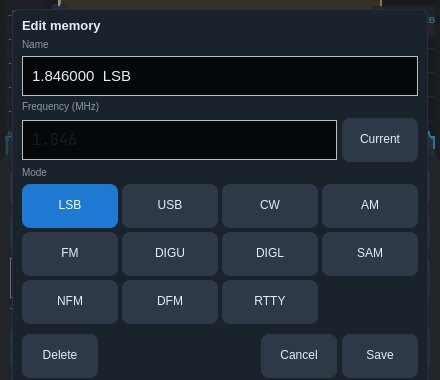

- **Log** — quick QSO logging into a log on this device (an ADIF file,
  `oksasdr-log.adi`). Type the **callsign**, or tap the call of the spot
  you tuned to last. A card shows who it is: with a **QRZ.com** account
  (user and password at the bottom; *Save* signs in and says below whether
  it worked; their full records need QRZ.com's XML subscription) the name, QTH, grid, distance and bearing and whether the
  station uses LoTW, eQSL or paper cards; without one, the country,
  continent and CQ zone from the callsign's prefix. It also says when the
  call was **worked before** and when it would be a **dupe** on this band
  and mode. The reports start at 59 (599 in CW and data) and follow the
  mode until you type one. Frequency, band, mode, power, the UTC time the
  call was typed and your own callsign come from the radio; your grid
  comes from the radio's GPS, or from *My grid*. **Their park** and **My
  park** (POTA or WWFF with the reference) go into ADIF's SIG / MY_SIG
  fields; your own park stays for every contact while you activate.
  **Log** writes the contact; the newest ten are listed. **Share the log
  (ADIF)** opens the share sheet with the whole log as an `.adi` file: mail
  it, save it to Files or Drive, AirDrop it, or open it in your logbook
  program or TQSL for LoTW. **Import contacts (ADIF)** adds the contacts of
  an ADIF file (from another logbook, or another device's OksaSDR log);
  those already in the log (same call, date, time, band and mode) are
  skipped. The QRZ.com password is kept in this device's secure store.
  **Where the log is** (shown on the Log tab): on an iPhone or iPad in
  Files › On My iPhone / iPad › OksaSDR › `oksasdr-log.adi`, from where it
  can be moved to iCloud Drive or opened in a logbook; on Android a copy is
  kept in Files › Documents › OksaSDR; on a computer in
  Documents/OksaSDR. A log from an earlier build moves there by itself.
- **Digi** — FT8 and FT4 in the app itself, no computer or DAX needed.
  **Decode** turns decoding on (*FT8* or *FT4*); the band buttons tune to the
  mode's dial frequency in DIGU. The bar shows where in the 15 s (FT4: 7.5 s)
  slot you are; the decodes come at the end of each slot, newest first: UTC,
  SNR, DT, audio frequency and the message, from every DIGU / DIGL slice, each row marked with its slice letter. The colours are WSJT-X's: green a CQ, red your call, yellow your own transmission, pink to magenta a new DXCC (on the band / at all), amber a new CQ zone, red-pink a new continent; a CQ from a station already in the log on this band and mode is grey. Tapping a call moves TX and the display to its slice and starts calling it. **Show** filters the list: **All**, **CQ** (CQ calls only), **New** (a new continent, CQ zone or DXCC, overall or on this band) or **New DXCC** (a DXCC not yet in the log, overall or on this band); your call, your own transmissions and the station you are working always show. Each slice decodes on a DAX channel of its own; a slice that shares one with another slice is moved to a free channel while it decodes.
  **Tap a decode** to answer that station; **CQ** calls CQ in the next slot.
  FT8 / FT4 run on the **TX slice** (the one with the red TX badge), as
  with SmartSDR and WSJT-X: whichever slice is active, and however many
  slices are open, decoding and transmitting stay there. That slice gets a
  DAX channel of its own if it had none, so other slices' audio stays out.
  To move FT8 / FT4, move the TX badge, press a band button with another
  slice active, or tap inside another DIGU / DIGL slice's passband; a QSO
  under way stops when TX moves.
  The app then runs the QSO as WSJT-X does (report, R-report, RR73 or RRR,
  73), stops after six tries without the reply it waits for, and writes the
  contact to the Log tab's log (MODE FT8, or MFSK / FT4). **Halt TX** stops at
  once (PTT is hidden while FT8 / FT4 decodes: the app keys the radio itself, and the display gets the room). *TX audio* sets the transmit tone (200–3000 Hz, default 1200; − / + step
  1 Hz and repeat while held). The red band on the display is the tone:
  **drag it** to any frequency, or **tap** the waterfall near the dial to
  put it there (while decoding a tap there sets the tone instead of
  retuning; the passband shading is left out in FT8 / FT4). A band button
  zooms the display to the 4 kHz audio band (again with *Zoom*). A
  callsign the standard messages cannot carry (such as OH6OKSA, with a
  four-letter suffix) is sent as WSJT-X sends it: in full in CQ and in
  RRR / RR73 / 73, as <CALL> in the messages with a report. The transmit
  audio goes to the radio past the TX processing (no gate, EQ or
  compression); power is the TX tab's power.
  **RADE digital voice** (FreeDV's Radio Autoencoder, in the app itself, no
  FreeDV waveform needed): *RADE* puts the slice in DIGU (DIGL where the
  band's voice mode is LSB) with a 750–2250 Hz filter, mutes its ordinary
  audio and plays the decoded speech instead; the line beside it shows
  *Synced* and the SNR when a RADE signal is heard, and the callsign each
  station sends at the end of its over. Talk with PTT as usual: this
  device's microphone goes through the RADE encoder to the radio's DAX
  transmit (turned on for RADE, off again after), and the end-of-over frame
  with your callsign plays out before the carrier drops. *RADE* again, or
  another mode, ends it and restores the mode and filter.

## 9. Radio Setup

**Setup** in the top row (on an iPhone: **⋯** → *Radio Setup*) holds the
radio's own settings — the ones a radio needs on first use, as in SmartSDR's
and the desktop AetherSDR's Radio Setup. Every change is written to the
radio.

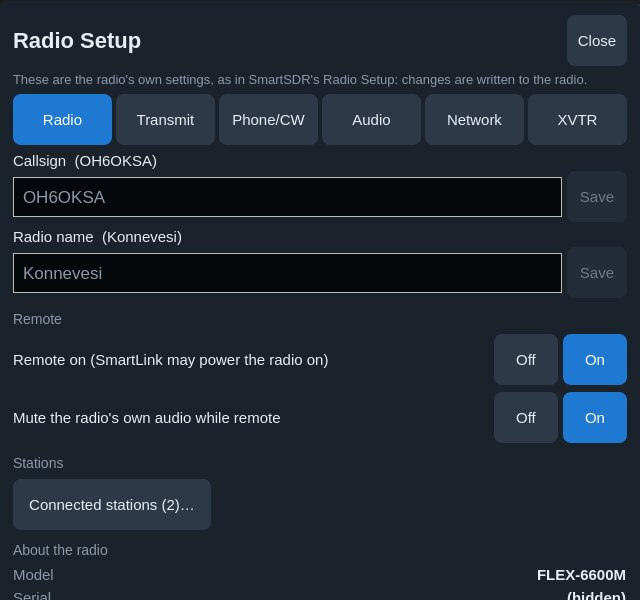

- **Radio** — callsign (what `{CALL}` sends), the radio's name in radio
  lists, *Remote on* (SmartLink may power the radio on), muting the radio's
  own audio while remote, **Connected stations** (every program on the radio,
  multiFLEX; *Disconnect* ends another station's session after asking, which
  frees its slices), and the model, serial, firmware, region and address.
- **Transmit** — maximum power, TX delay, transmit timeout (0 = off) and the
  TUNE signal (single or two tone).
- **Phone/CW** — microphone bias and boost (the radio's own microphone
  inputs; this device's microphone gain is the TX tab's Mic level); the CW
  keyer's break-in delay,
  iambic mode (off, A, B) and swapped paddles.
- **Audio** — the radio's line out and headphone levels and muting.
- **Network** — the network MTU: the largest packet the radio sends the app
  (1450 by default, as in SmartSDR and the desktop). Lower it if the
  waterfall or audio break up over a VPN or tunnel; over Tailscale at most
  1200 is used.

**A new radio.** When the app connects to a radio that has no callsign yet —
a new or reset radio — it offers *Set up* once, a few seconds after
connecting. *Later* skips it; Setup stays in the top row either way. A radio
that has a callsign never shows the offer.

## 10. Notices and problems

Notices and refusals pop up in the middle of the display; tap one, or wait
6 s, to close it. A tap elsewhere (PTT, tuning) never closes it by accident.

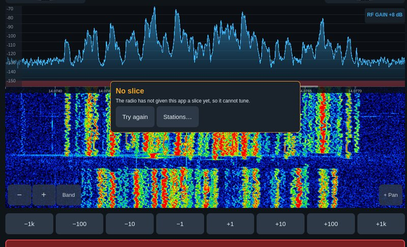

| You see | Why | What to do |
|---|---|---|
| **No slice** (frequency 0.000.000) | The radio did not give the app a slice. The app first retries once on a fresh panadapter; if it still fails, the radio's slices may all be in use by other programs | **Stations…** shows them; close a slice there or disconnect it, then **Try again** |
| *No slice transmits* | No slice has transmit | Press and hold a slice → **Make TX slice** |
| *Interlock / did not accept the transmit request* | The radio refused to transmit; its reason is shown | Check TX antenna, band, other clients |
| A band button opens another band | The radio's band stack (in its global profile) holds that frequency | Tune the band where you want it and save the profile |
| *The radio has no callsign for {CALL}* | No callsign in the radio | Setup → Radio → Callsign |

## 11. Keyboard and Apple Pencil

With a Magic Keyboard or trackpad:

| Key | Action |
|---|---|
| ← / → | Tune |
| Space | PTT (hold) |
| + / − | Zoom |
| F | Frequency entry |
| F1–F12 | CW memories (CW modes) or voice macros (voice modes) |
| Esc | Stop CW text or a voice macro |
| Scroll | Tune; ⌘-scroll zooms |

**Apple Pencil** drags tune ten times finer, for zero-beating.

## 12. Reporting a problem

Open **Log** right after the problem, tap **Copy** (or **Share**) and send
the text together with your device model. The log header shows the app
version and build.

## 13. Android

OksaSDR for Android is in beta. It is the same app as on the iPhone and
iPad, built from the same code; this section covers what is particular to
Android.

| Inner screen | Controls open | Outer screen |
|---|---|---|
| 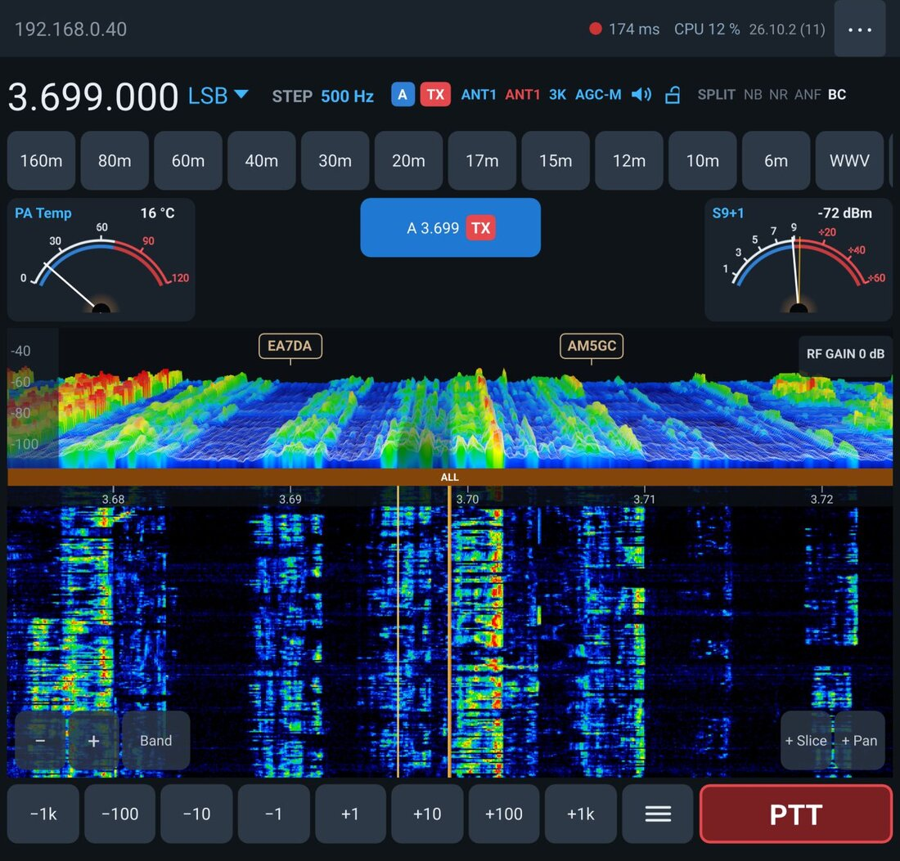 | 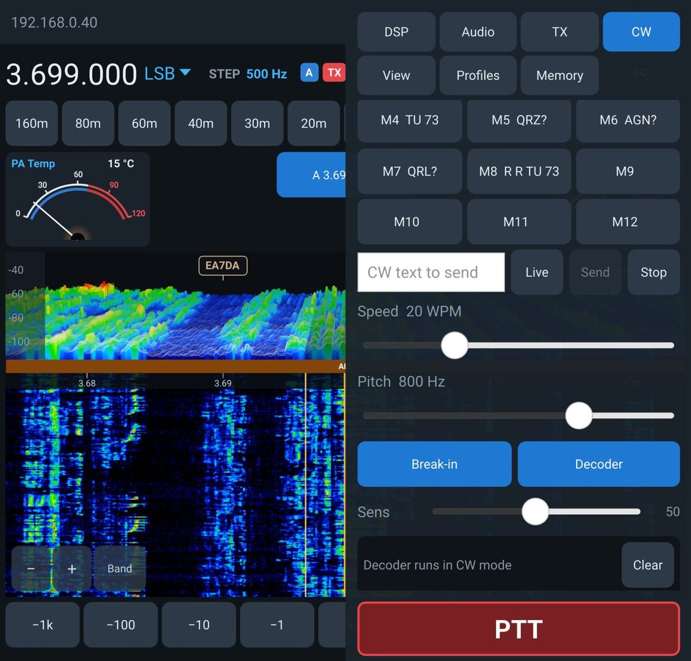 | 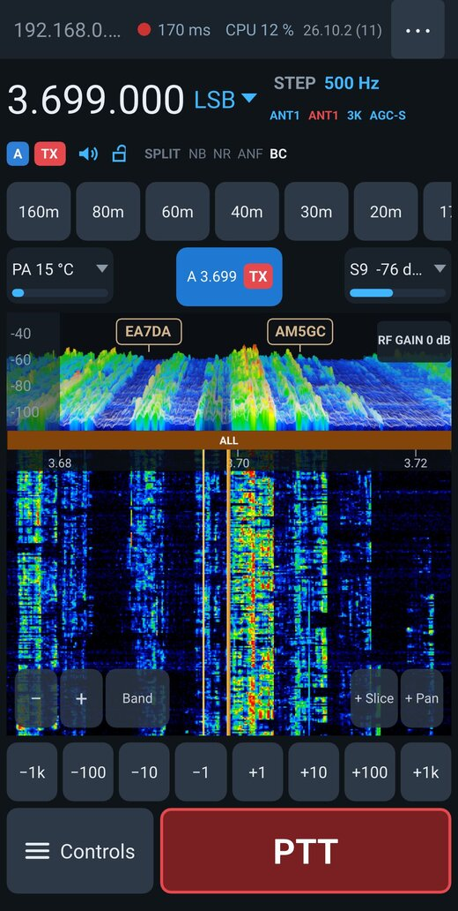 |

**Installing.** Download the newest APK from
[the latest release](https://github.com/OH6OKSA/OksaSDR/releases/latest) on the phone, open
it, and allow installing from your browser or file manager when Android
asks. A newer beta installs over the old one and keeps your settings.
Android 9 or newer, 64-bit ARM (practically every phone and tablet from the
last years).

**Permissions, asked once.**
- *Notifications*, *microphone* and *battery optimization* — the first
  time you connect. The microphone is used only while PTT is held (or a
  voice macro is recorded); if you refused it, PTT asks again, and when
  Android no longer asks, turn it on in Settings → Apps → OksaSDR →
  Permissions → Microphone.
- Allow notifications and battery: while connected, OksaSDR runs a service with a notification
  (*OksaSDR — Connected to the radio*) so receive audio and the connection
  keep going when another app is in front or the screen is off. Some phones
  (OnePlus, Xiaomi, Huawei) also have their own setting: Settings → Apps →
  OksaSDR → Battery → allow background activity.

**Bluetooth headsets.** With a headset connected when you connect to the
radio, receive audio and the microphone go through it (the hands-free link,
as on the iPhone). Without one, the phone's speaker and microphone are used.

**Finding the radio.** On the radio's own network, *On this network* lists
it. Over SmartLink or a VPN, use those sections instead (the radio's
broadcasts do not cross a VPN).

**Log.** *Log → Share* opens Android's share sheet (Gmail, Messages, …).
