# OksaSDR — User Manual

OksaSDR turns an iPad, iPhone, Mac or Android phone or tablet into a
complete FlexRadio client: panadapter and waterfall, all receive controls,
transmit (voice, CW, tune), FT8 / FT4 and RADE digital voice, a log, and
SmartLink or VPN remote operation, with no computer alongside.

This manual describes every function and how it works. The screenshots are
taken from the app connected to a real FLEX radio. The app's **Manual**
button (top row) opens this page.

- [Getting started: what each mode needs](#getting-started-what-each-mode-needs)
- [Operating by mode](#operating-by-mode): [SSB](#ssb-voice-usb-and-lsb), [CW](#cw), [AM and SAM](#am-and-sam), [FM and repeaters](#fm-nfm-dfm-and-repeaters), [FT8 / FT4](#ft8-and-ft4-digu), [RTTY](#rtty), [PSK31 / PSK63](#psk31-and-psk63-digu), [RADE](#rade-digital-voice-freedv), [in every mode](#in-every-mode)
- [1. Connecting](#1-connecting)
- [2. The main screen](#2-the-main-screen)
- [3. Frequency, mode and the info panel](#3-frequency-mode-and-the-info-panel)
- [4. Meters and slices](#4-meters-and-slices)
- [5. Panadapter and waterfall](#5-panadapter-and-waterfall)
- [6. Split](#6-split)
- [7. Transmitting: PTT, KEY and TUNE](#7-transmitting-ptt-key-and-tune)
- [8. Controls](#8-controls)
- [9. Radio Setup](#9-radio-setup)
- [10. Notices and problems](#10-notices-and-problems)
- [11. Keyboard and Apple Pencil](#11-keyboard-and-apple-pencil)
- [12. Reporting a problem](#12-reporting-a-problem)
- [13. Android](#13-android)

---

## Getting started: what each mode needs

What has to be set before each kind of operating, and where; the linked
sections tell the rest.

**Where things are.** **Controls** opens the control tabs (DSP, Audio, TX,
eSSB, CW, View, Prof, Mem, Log, FTx, FreeDV, RTTY): on an iPad, Mac or tablet in the
top row; on a phone the **Controls** button beside PTT at the bottom (in
landscape the ☰ button at the right end of the step row). **Setup** (Radio
Setup) is in the top row, on a phone and in a narrow window (most iPads in
portrait, a foldable's inner screen) behind **⋯**, as are **Manual** and
**Log**.

**Once, for everything**
- **Connect** ([1](#1-connecting)): by the radio's IP address or host name
  on the same network (several radios kept on a list), from anywhere over
  SmartLink, or over your own VPN or Tailscale.
- **A slice of its own**: the app opens one on the radio. When the radio's
  slices are all in use by other programs, *No slice* shows
  ([Notices](#10-notices-and-problems)).
- **Your callsign in the radio**: Setup → Radio → Callsign. FT8 / FT4, the
  CW memories' `{CALL}`, RADE's end of over, the DX cluster and the log
  take it from there. A radio without one offers *Set up* when you connect.
- **Your grid**: the Log tab's *My grid*, unless the radio has GPS. The
  FT8 / FT4 CQ, PSK Reporter, FreeDV Reporter and the log use it.

**Receive** needs nothing more: tap a band button. A band that stays
silent may have its slice muted: tap the speaker on the info panel.

**Transmit, in every mode**
- **A TX slice**: one slice carries the red **TX** tag; press and hold a
  slice for *Make TX slice*. The FTx band buttons set it themselves.
- **The radio's microphone input on PC** (this device): the app sets it
  when it connects. If another program switched it back, Controls → TX →
  **Use this device's microphone**.
- **RF power**: Controls → TX. Try low power or a dummy load first.
- When transmit is not possible, the reason shows above PTT
  ([7](#7-transmitting-ptt-key-and-tune)).

**Voice (USB, LSB, AM, FM)**
- **The mode**: tap the mode beside the frequency. PTT does not key in
  DIGU / DIGL.
- **Microphone access**: the app asks once, when transmit first becomes
  possible (Android: on the first connect). Refused: allow it in the
  device's settings › OksaSDR › Microphone.
- **Mic level**: Controls → TX, with Mic on the left meter: speech peaks
  near −10 dB (phone microphones often need +10 to +20 dB).
- **A Bluetooth headset**: Controls → Audio → Audio output (*Auto* takes
  its microphone too).
- Then hold **PTT**, or make it a switch: Controls → TX → PTT *Tap on / off*.

**CW**
- **The mode** CW, and **Break-in** on (Controls → CW): with it off the key
  does not put the radio on the air.
- **Key**: the big button is a straight key; *Paddles* (Controls → CW →
  Key) gives dit and dah. Speed and pitch are on the CW tab, and the
  memories M1–M12 send `{CALL}` from the radio's callsign.

**FT8 / FT4**
- **The callsign** (above): without it the app decodes but does not call
  or answer. **The grid**: without it the CQ goes out without a locator
  and PSK Reporter waits.
- **The time** within about a second: online the app takes it from a time
  server by itself; offline set the device's Date & Time to automatic.
- Then Controls → **FTx** → a band button: the active slice becomes the TX
  slice, tunes to the band's FT8 (or FT4) frequency in DIGU and decodes. Tap a
  decode to answer it, or **CQ** to call. The power out follows the TX
  tab's RF power (TX level 0 dB); **Halt TX** stops at once. No computer,
  WSJT-X, DAX or mode setting is needed ([FTx](#8-controls)).

**RADE digital voice**
- **Microphone access** and **Mic level** as for voice, and **the callsign**
  (sent at the end of each over).
- Then Controls → **FreeDV** → *RADE*, and talk with PTT. *Report to
  FreeDV Reporter* (optional) also needs the grid.

**Logging** (optional): the Log tab logs every contact; import your
logbook there (ADIF) so FTx and the log know what you have worked. A
QRZ.com account fills in who each station is; Wavelog / Cloudlog and
Logger32 get every QSO too ([Log](#8-controls)).

---

## Operating by mode

How each mode looks on the app and what you can do in it, step by step.
The pictures are a phone upright, connected to a FLEX; an iPad or a
tablet shows the same with the controls beside the display. Change the
mode with the mode button beside the frequency ([3](#3-frequency-mode-and-the-info-panel)).
What has to be set up first is in [Getting started](#getting-started-what-each-mode-needs).

### SSB voice: USB and LSB

| USB on 20 m | The TX tab |
|---|---|
| 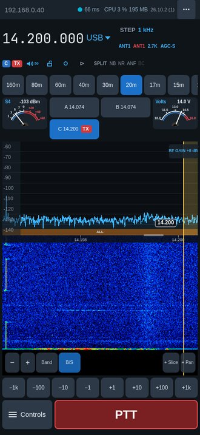 | 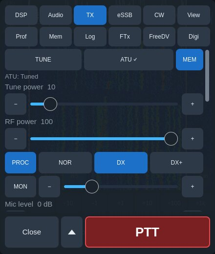 |

**Receive**
1. Pick the band (band buttons) and the mode: USB on 20 m and up, LSB on
   40 m and down, by custom. The yellow edges on the display show the
   passband, on the right side of the carrier for the mode. With the
   [band plan lock](#band-plan-lock) on (PLAN by the mode) the app sets
   USB / LSB as you tune into a phone part, and CW in a CW part.
2. Tune: tap a station on the display (snapped to the step), drag inside
   the passband, use the step buttons under the display, or type the
   frequency (tap the frequency).
3. Shape what you hear: the width on the info panel (the mode's eight
   widths, 2.7K here), **AGC** (S / M / F), and the DSP flags (NR, NB,
   ANF, NRL, ANFL and the rest the radio has; tap one for its level). **BC**
   cancels steady carriers. RF gain, squelch, RIT and XIT are on the DSP
   tab; a notch (TNF) by holding a finger on the display.

**Transmit**
1. Set **RF power** and **Mic level** on the TX tab: with Mic on the left
   meter, speech peaks near −10 dB.
2. Hold **PTT** and talk (or make it a switch: TX → PTT *Tap on / off*).
   The speaker goes quiet the moment you press, so receive never reaches
   the air; it comes back when you let go.
3. Optional: **PROC** (NOR / DX / DX+) for punch, **MON** to hear yourself,
   the **TX filter** (100-3100 Hz), the radio's TX equalizer (Audio) and
   this device's own processing on the **eSSB** tab (gate, EQ, compressor,
   de-esser, tube, exciter, reverb, in an order of your own).
4. **Voice keyer**: F1-F12 on the TX tab record and send voice macros
   (*Listen* plays one without transmitting). The **Macros** button by
   PTT opens them over the display, without scrolling the TX tab;
   **Repeat** there sends a slot again every few seconds (a CQ for a
   contest or POTA) until PTT, Stop or any key.
5. A headset: Controls → Audio → Audio output (Bluetooth, USB-C on
   Android, or the speaker).

### CW

| CW with the paddles | The CW tab |
|---|---|
| 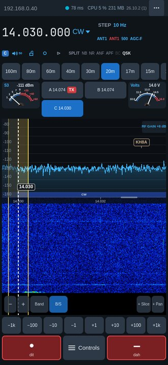 | 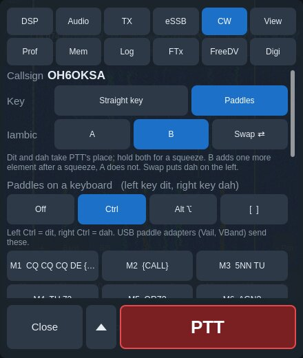 |

**Receive**
1. Mode CW; a narrow width (500, 250 …) on the info panel. **APF** sharpens
   a weak signal further.
2. Tap beside a CW signal: the slice lands on it to the hertz. **Autotune**
   on the CW tab does the same for the signal in the passband.
3. **Decoder** on (CW tab): the text runs along the top of the waterfall;
   the calls it hears are offered as *Heard in CW* on the Log tab.

**Transmit**
1. **Break-in** (QSK) on, on the CW tab: without it the key does not put
   the radio on the air. Set the **speed** and **pitch** there too, and
   the **Sidetone** (*On* and its level, apart from the receive volume:
   lower it when the key is too loud with the volume up for weak stations).
2. Key with the big button (a straight key) or choose **Paddles**: dit and
   dah take PTT's place (on a phone at the two edges, one per thumb);
   **Iambic** A or B, **Swap** for dah on the left. A hardware keyboard or
   a USB paddle adapter keys with Ctrl, Alt or [ ] (the CW tab says which).
3. **Memories** M1-M12 send text through the radio at the set speed
   (`{CALL}` is your callsign, `{HIS}` the call in the Log tab); on a
   keyboard F1-F12 (⌘1-⌘0 without F-keys), Esc stops. **Live** sends
   letters as you type. The **Macros** button by PTT opens the memories
   over the display, with the call being worked; **Repeat** there sends a
   memory again every few seconds until KEY, Stop or any key.

### AM and SAM

| AM on 40 m |
|---|
| 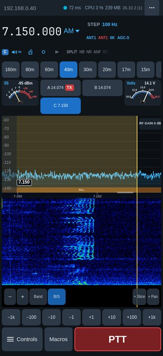 |

1. Mode **AM**, or **SAM** (synchronous AM: steadier under fading and with
   one sideband chosen). The passband sits centred on the carrier; pick a
   width up to the widest the radio offers (6K here).
2. Tune by a tap on the carrier; the step buttons move by the step.
3. Transmit with PTT as in SSB. The **carrier** level is on the TX tab in
   AM, SAM and DSB, with the mic level and power.

### FM, NFM, DFM and repeaters

| FM on 10 m | The TX tab's FM repeater section |
|---|---|
| 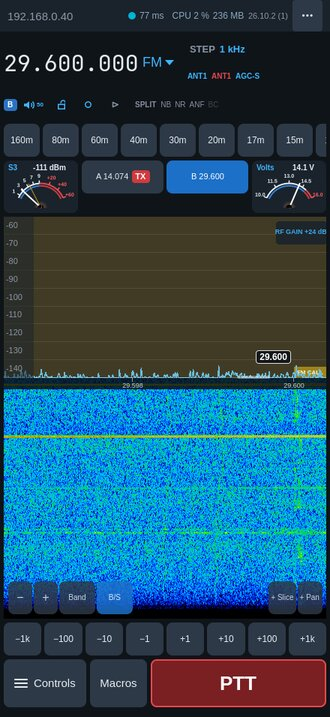 | 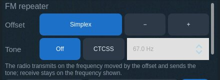 |

1. Mode **FM** (wide), **NFM** (narrow, 12.5 kHz channels) or **DFM**. On
   VHF and UHF use a transverter band (the band buttons after 6 m): type
   *439.000* to tune 439 MHz.
2. **Squelch** (DSP tab) keeps the speaker quiet between signals.
3. With an FM step (STEP, e.g. 12.5 kHz) the step buttons move by the
   step, 100 kHz, 1 MHz and 10 MHz, always on the channel grid.
4. **Repeaters** (TX tab, in FM modes): **Offset** Simplex / − / +, the
   **shift** (0.6, 1.6, 5.0, 7.6 MHz or your own) and **Tone** CTCSS with
   its frequency. The radio transmits on the frequency moved by the offset
   and sends the tone; receive stays on the frequency shown.
5. Talk with PTT as in SSB.

### FT8 and FT4 (DIGU)

| FT8 on 20 m | The FTx tab |
|---|---|
| 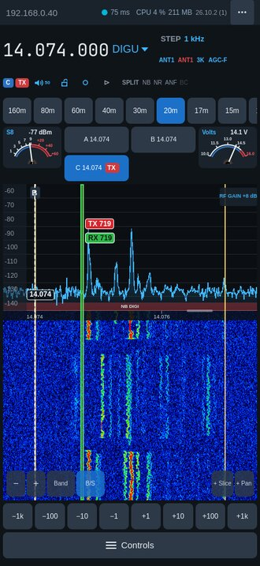 | 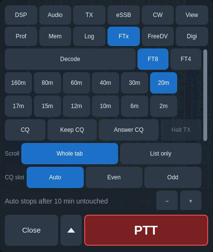 |

1. Controls → **FTx** → a band button: the active slice becomes the TX
   slice, goes to the band's FT8 (or FT4) frequency in DIGU and decodes.
   No computer, WSJT-X or DAX.
2. The decodes come at the end of each slot, coloured as in WSJT-X; **Show**
   filters them (CQ, CQ POTA, New, New DXCC, New call). Worked before
   counts the Log tab's log, and your Wavelog or QRZ.com logbook with
   **Worked before from the logbook** on, or a **Shared ADIF file** (Log tab).
3. **Answer**: tap a decode. The app calls, runs the QSO (report, R-report,
   RR73, 73) and logs it.
4. **Call CQ**: **CQ** (in the **CQ slot** you choose); **Keep CQ** goes
   back to CQ after each QSO. **CQ to** (FTx settings) directs it: *CQ DX*,
   *CQ NA*, *CQ EU* or your own.
5. **Answer CQ** answers CQs by itself: the rarest first, five calls a
   station, then the next. **Auto stops after … min untouched** (FTx
   settings) is how long Answer CQ and Keep CQ go on without a touch on
   the app.
6. **Halt TX** stops at once. Pick a clear TX frequency by dragging the red
   TX band on the display or with **Free**; **TX level** sets the drive
   (0 dB = the TX tab's power); **Report to PSK Reporter** shows where you
   are heard.
7. FT4 the same with **FT4**. PTT is hidden while decoding (the app keys
   the radio itself); voice PTT does not key in DIGU / DIGL. Details:
   [FTx](#8-controls).

### RTTY

| RTTY on 20 m | The RTTY panel |
|---|---|
| 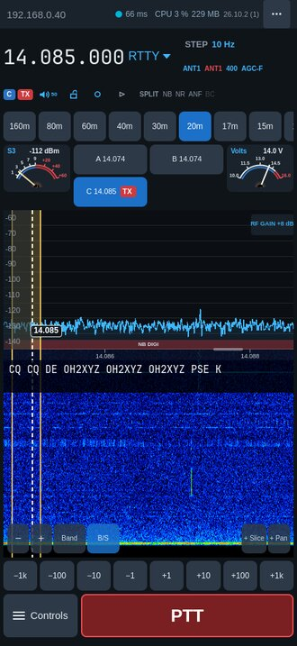 | 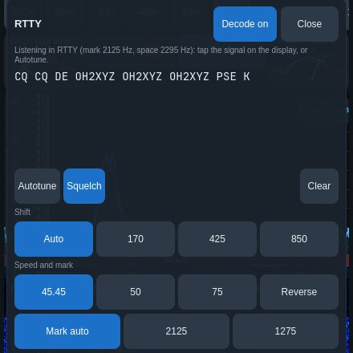 |

Amateur RTTY is 45.45 baud with a 170 Hz shift, the mark the higher radio
frequency. Received as audio tones (AFSK), the mark is 2125 Hz and the
space 2295 Hz on the lower sideband; on the upper sideband the same tones
come the other way round. Lower sideband is the tradition, but many
stations run AFSK on the upper sideband: on the air the signal is the same
as long as the mark stays the higher frequency, so either way receives it.

1. Controls → **Digi** → **Receive in**: **RTTY (LSB)** is the radio's RTTY
   mode, lower sideband, the frequency shown the mark (the standard; an
   RTTY spot uses it too). **DIGL** and **DIGU** receive AFSK RTTY on the
   lower or upper sideband, the frequency shown the carrier; on DIGU the
   decoder takes the mark from the upper tone by itself. DIGL and DIGU stop
   FT8 / FT4 decoding (they use the same modes), and starting FT8 / FT4, or
   another mode, ends RTTY there. Switching between the three keeps the
   station being received tuned in (the slice moves so its mark stays on
   the mark tone). An RTTY spot keeps DIGL / DIGU and tunes so its mark
   lands on the mark tone. Around 14.080-14.090 on 20 m.
2. **Tap the signal** on the display (either of its two traces, or between
   them): the slice tunes so the mark and space land on their tones (the
   mark on the shown frequency in the RTTY mode; 2125 Hz below it in DIGL;
   2295 Hz above it in DIGU) and the text runs along the top of the
   waterfall. **Autotune** on the tab does the same after tuning by the
   steps.
3. **Operating** (the Digi tab, under the text): **Call** shows the call
   being worked (the Log tab's, as on the CW tab) and the calls the text
   holds (after DE, or twice) as buttons; a tap picks one, ✕ clears it.
   The **macros** (F1-F8 or ⌘1-⌘8 on a keyboard, or the **Macros** button
   by PTT) follow fldigi's set and the QSO
   bpsk31.com describes: **CQ** ("CQ CQ CQ DE OH6OKSA x3 PSE K"),
   **Answer** ("HIS HIS DE OH6OKSA x3 KN"), **QSO** (the report and BTU),
   **BTU**, **73 SK**, **QRZ?**, **AGN?** and **Locator**. A tap sends one,
   press and hold edits it (its name and text, with a line showing what
   it sends to the call being worked; **Default** puts the original in
   the fields, **Save** keeps it). In a macro {CALL} is your call, {HIS} the call being
   worked, {NAME} its first name from the lookup, {RST} 599 and {GRID}
   your locator. **Text to send** and **Send** (or Return) send a line;
   sent while text is going out, a macro or a line follows without
   unkeying. **Stop** (or Esc) stops at once. **Log QSO** puts the call being
   worked into the log as RTTY on the signal's mark (599 both ways; the
   Log tab for anything more), starting when its call was picked.

   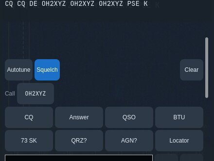

4. **Transmitting**: from this slice, which must be the TX slice, at the
   FTx tab's TX level, with the speech processor off while it sends. RTTY
   goes out as audio tones in all three ways, the mark always the higher
   radio frequency (Reverse is only for receiving); a short mark and two
   LTRS before the text, so the other station's decoder is in step. The
   transmitted text shows in the text as [TX] lines.
5. The receive settings below: **Decode on / off**, shift (*Auto* = the
   radio's in the RTTY mode, 170 Hz in DIGL / DIGU), speed (45.45 baud for
   amateur RTTY), **Reverse** for a signal sent the other way round, the
   mark tone, **Squelch** (holds back the letters noise makes), **Clear**.
   The status line says how it listens (e.g. *DIGU, mark 2295 Hz, space
   2125 Hz*), when it has locked on and when it transmits. A tap on the
   text line over the waterfall opens the receive settings over the
   display; with decoding off the line says so, and the tap still opens
   them.
6. **Logging** from the Log tab too: a QSO logged while RTTY is received
   goes in as RTTY on the signal's mark frequency, the same whichever way
   it is received (in DIGL / DIGU not DATA on the carrier, 2 kHz away).

### PSK31 and PSK63 (DIGU)

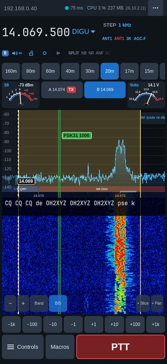

PSK31 (G3PLX's keyboard mode, 31.25 baud, about 60 Hz wide) and its faster
PSK63 run in DIGU, upper sideband, as the standard has them: around 14.070
on 20 m (7.040, 3.580, 10.142, 18.100, 21.070, 28.120 on the other bands).
Many signals share a few kilohertz, each on its own audio frequency in the
passband, so the slice stays put and the decoder is moved to the signal.

1. **Choose PSK31 or PSK63** on Controls › Digi (**Mode**): the slice goes to
   DIGU and FT8 / FT4 decoding stops (starting FT8 / FT4 again takes the
   slice back for them). Tune the slice about a kilohertz below the
   signals (e.g. 14.0695 for 14.070-14.073).
2. **Tap a signal** on the display: the decoder goes to its centre (a green
   band as wide as the signal marks where it listens, with its audio
   frequency, e.g. *PSK31 1590*), and **AFC** holds it within 25 Hz as it
   drifts; −10 / +10 under **Carrier** move it by hand. The text runs on
   the Digi tab and along the top of the waterfall; **Squelch** keeps band
   noise out of it between transmissions. A PSK spot on the display puts
   the Digi tab in PSK31 (or PSK63) and tunes so the signal sounds at the
   carrier, then onto the signal itself.
3. **Operating** is as in RTTY (above): the calls heard as buttons, the
   eight macros (F1-F8, ⌘1-⌘8, the **Macros** button by PTT), **Text to
   send**, **Stop**, **Log QSO**.
   PSK has lower case, and most PSK operators type in it.
4. **Transmitting**: on the frequency received (where AFC holds the
   station), as fldigi sends; from this slice, which must be the TX slice,
   at the FTx tab's TX level with the speech processor off. Keep the ALC at
   zero: an overdriven PSK signal splatters over its neighbours. A run of
   phase reversals before the text and a steady carrier after it let the
   other station's decoder lock on and off; the band turns red while
   sending.
5. **Logging**: Log QSO and the Log tab put PSK31 / PSK63 in the log on the
   signal's own frequency (ADIF mode PSK, submode PSK31 or PSK63).

### RADE digital voice (FreeDV)

| RADE on 20 m | The FreeDV tab |
|---|---|
| 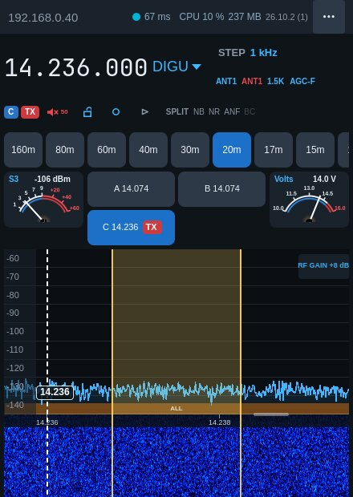 | 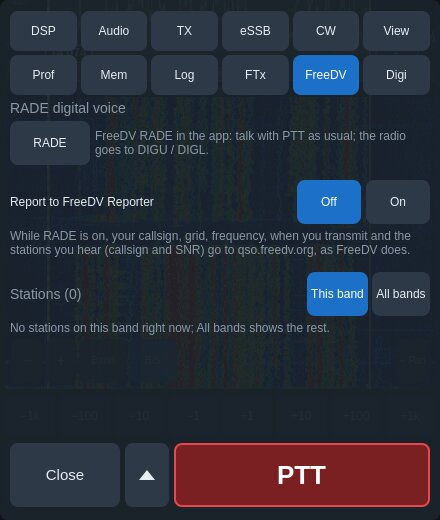 |

1. Controls → **FreeDV**: the list shows who is on RADE (from FreeDV
   Reporter); tap one to tune there (the view centres on the filter once
   RADE or the station's sideband is set), or tune 14.236 MHz yourself.
2. **RADE** on: the slice goes to DIGU and the app decodes; the callsign
   each station sends shows when they finish.
3. Talk with PTT as in SSB (mic level as for voice); your callsign goes out
   at the end of each over.
4. **Report to FreeDV Reporter** puts you on qso.freedv.org (needs your
   grid).

### In every mode

#### Band plan lock

For everyday operating the band plan can choose the mode: turn on **Band
plan lock** in the mode chooser (tap the mode by the frequency) or in
Controls → View. While it is on, **PLAN** shows by the mode (under it on
a phone); a tap on PLAN turns the lock off. It uses the band plan chosen
in Controls → View (*ARRL (US)*, *IARU Region 1* …; with the strip *Off*,
the one last chosen), on HF (below 30 MHz).

- Tuning into another part of the plan sets its mode: **CW** in a CW
  part, **LSB** below 10 MHz and **USB** above (and on 60 m) in a phone or
  all-mode part. E.g. 14.250 USB, then 7.210 LSB, then 7.030 CW. Also
  from a digital mode: DIGU tuned into the phone part becomes USB.
- A **CW part** allows only CW, a **phone part** (ARRL's PHONE, SSB) the
  voice modes (LSB, USB, AM, SAM, FM; DIGU / DIGL with RADE on). Another
  mode is dimmed in the mode chooser; choosing it, or a spot or memory
  bringing it, gives a notice and the part's mode.
- An **all-mode part** (IARU's ALL) sets the sideband but allows any mode
  (FT8 on 7.074 in Region 1 stays DIGU); data, beacon and mixed parts
  allow any mode and set none.
- Inside a part the mode you chose stays while you tune.
- For a contest that uses the whole band, turn the lock off (tap PLAN):
  any mode on any frequency.

| PTT and the transmit lock (TX tab) |
|---|
| 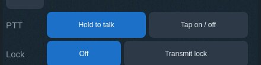 |

- **Transmit lock** (TX tab → Lock): in standby (SB) nothing transmits
  until you hold PTT, KEY, Space, TUNE or CQ for a second; then it stays
  armed (OA) for five minutes after your last transmission.
- **Macros** by PTT: the mode's memories or macros over the display
  ([7](#7-transmitting-ptt-key-and-tune)).
- **TUNE** and the **ATU** (TX tab) at the tune power; **Split**
  ([6](#6-split)); memories (Mem tab), spots and the DX cluster on the
  display; **REC** / **PLAY** of the slice in the info panel's row; the
  **Log** tab for every contact.
- **Worked before and dupes** in every mode count this app's log and,
  with **Worked before from the logbook** on (Log tab: Wavelog, QRZ.com
  Logbook) or a **Shared ADIF file** chosen, every QSO in those, each
  contact once: a call typed in the Log tab says how many times it was
  worked and whether it is a dupe on this band and mode (SSB, CW, AM, FM,
  RTTY, RADE, FT8 alike), and the FTx colours and New call / New DXCC know
  them too. Every QSO you log goes to each of them.

---

## 1. Connecting

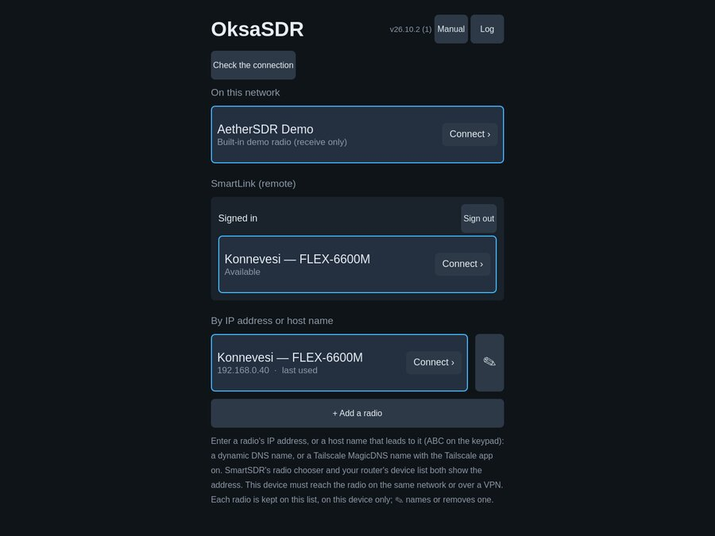

The first page lists the ways to reach a radio:

- **On this network** — FlexRadios found on the local network (on an
  iPhone or iPad, connect by IP address for now). Tap a radio's card, or its
  **Connect ›**, to connect. *AetherSDR Demo* is a built-in receive-only demo radio for trying
  the app without a radio.
- **SmartLink (remote)** — sign in with your FlexRadio SmartLink account
  to use your radio from anywhere. The sign-in is kept on this device only
  (the iOS Keychain; on Android, encrypted under a key in the Android
  Keystore); the password is never stored. The eye in the password field
  shows what you typed (dots again when you leave the field); the QRZ.com
  password and the Wavelog / Cloudlog API key have the same eye. **Sign out** takes two taps
  (the first turns it into *Sign out?* for three seconds), so a stray tap
  does not sign you out. Each radio's card says whether it is free
  (*Available*) or *In use by* and the station using it (e.g. another
  computer running SmartSDR).
- **By IP address or host name** — the radios you have entered, one card
  each: your name for it, or what the radio calls itself (its name and
  model, learned when you connect), with the address and *last used* on
  the one you connected to last. Tap a card to connect. **+ Add a radio**
  opens the keypad: enter the radio's IP address (SmartSDR's radio chooser
  and your router's device list both show it), then *Connect*; the radio
  joins the list. **ABC** switches to the device's keyboard for a host name
  instead: a name your home network's or VPN's DNS knows, a dynamic DNS
  name, or a Tailscale MagicDNS name (with the Tailscale app on, e.g. a
  friend's radio shared on your tailnet). A name is looked up at each
  connect, so it keeps following the radio. **✎** beside a card gives it a
  name of your own, changes its address (on the keypad, *OK*) or removes
  it (*Remove*, then *Remove it?*). The list is kept on this device only.
  A hardware keyboard types digits and letters on the keypad too. (Several
  radios asked by Mike Walker VA3MW.)
  The device must reach the radio on the same network or over a VPN. Do
  not forward the radio's ports to the internet: its connection has no
  password, so anyone who found it could control the radio and transmit,
  and the spectrum and audio (UDP) seldom get through a mobile network to
  the phone anyway. SmartLink or a VPN is the way from outside. (Host
  names asked by Sebastian Schu DG5CST.)

**Another station on the radio.** A radio with multiFLEX off takes one
station at a time. When another (SmartSDR, AetherSDR on a PC) is on it,
the app asks *Another station is on the radio* and names it: **Disconnect
it and connect** ends that station's session and connects this one,
**Cancel** stops. Over SmartLink the radio may refuse this app instead;
the page then says why, and the same question follows. To share the radio
between stations, turn multiFLEX on in SmartSDR's Radio Setup. (Reported
by Juho Kontio, whose app crashed when the radio refused it.)

**All station slots in use.** With multiFLEX on, the radio still takes
only as many stations as its licence allows (two on most). When all are
taken, the page says *All the radio's station slots are in use* and asks
which station to disconnect, the same way: **Disconnect it and connect**,
or **Cancel**. Two devices of yours both show as *OksaSDR*: give each its
own name under **Radio Setup › Radio › This station's name**. Each device
is its own station to the radio, also one set up from another's backup.

**Check the connection.** When a radio does not connect, **Why? Check the
connection** (or *Check the connection* any time) goes through the way to
the radio last tried, step by step, and says which step fails and what to
do: this device's network; a host name looked up; where the radio is from
here (this network, another private network that needs a route or a VPN
on, a Tailscale address, the internet with its port forwards); the radio's
own port (TCP 4992): answered, refused, or no answer (wrong network, the
VPN off, a firewall; on an iPhone or iPad also the Local Network
permission); and on an answer what the radio says: its firmware, the
stations on it and whether multiFLEX is on. For a SmartLink radio: signed
in, the radio listed and its status, its station slots. Nothing on the
radio is changed: the check reads and closes without connecting a station.
Each step also goes into the log.

The top row shows the app version, **Manual** and **Log** (see
[Reporting a problem](#12-reporting-a-problem)).

When you connect, the radio's microphone input is switched to *PC* so the
device's microphone can be used for transmit.

## 2. The main screen

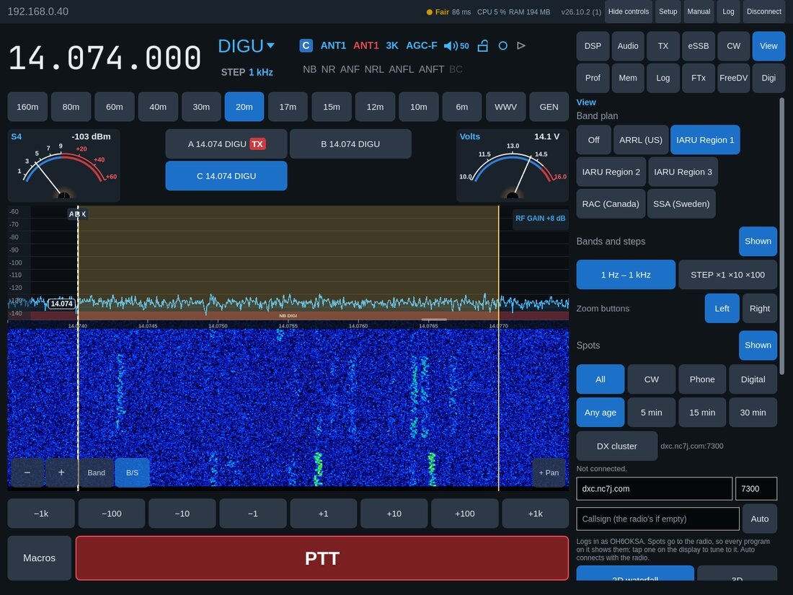

From top to bottom. Throughout the app a button that is **on** (a chosen
mode, a DSP that runs, the shown tab) is **lit blue**; the others are dark.


| Area | What it is |
|---|---|
| Top row | Radio name, [network quality](#network-quality), app version, **Controls** (open or hide the controls), **Setup** ([Radio Setup](#9-radio-setup)), **Manual**, **Log**, **Disconnect** (on a phone, and in a window under about 1000 points wide such as most iPads in portrait or a foldable's inner screen, Setup, Manual, Log and Disconnect are behind **⋯**; on a phone the controls open from the button beside PTT) |
| Frequency row | Frequency, mode, and the [info panel](#3-frequency-mode-and-the-info-panel) |
| Band buttons | 160 m … 6 m, the radio's transverter (XVTR) bands, WWV, GEN |
| Slice row | The two [meters](#4-meters-and-slices) at the ends, the slices in between |
| Panadapter and waterfall | The [spectrum display](#5-panadapter-and-waterfall) |
| Step buttons | Tune by −1 kHz … +1 kHz, or by the radio's STEP ×1, ×10, ×100 (with an FM step: the step, 100 kHz, 1 MHz, 10 MHz) |
| PTT / KEY | [Transmit](#7-transmitting-ptt-key-and-tune), with **Macros** beside it (the mode's memories or macros) |

On an iPad or tablet the controls can stay pinned at the side (as above) or
open as a drawer. On a phone they open as a drawer from the **Controls**
button beside PTT (three bars in landscape); the drawer carries its own PTT
in the same place. Upright, **▲** beside **Close** gives the drawer the whole
screen (FTx then lists about twice as many decodes) and **▼** takes it back
to half; the choice holds while the app runs. A tablet's drawer from the
bottom (upright on a screen lower than an iPad's, such as the iPhone Duo's
inner screen) has the same **Close** and **▲**. A swipe inside the open drawer
never tunes; the part of the display still in view tunes as usual.

| iPhone, portrait | iPhone, landscape |
|---|---|
| 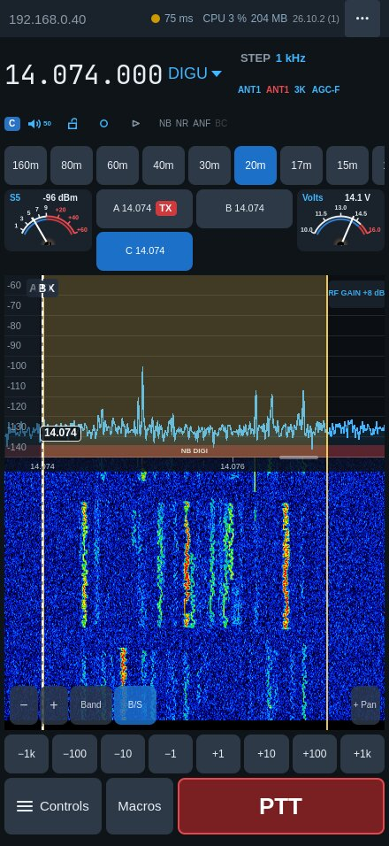 | 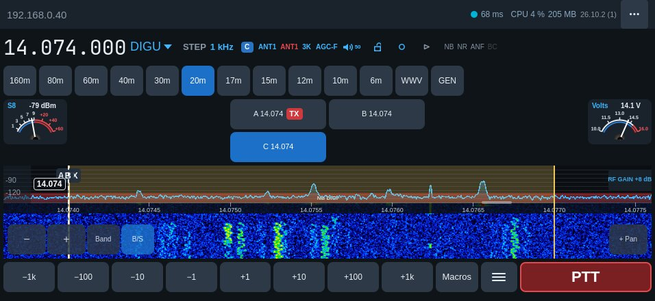 |

On a phone (and in a narrow tablet window), **⋯** at the top right holds
Radio Setup, Manual, Log and Disconnect:

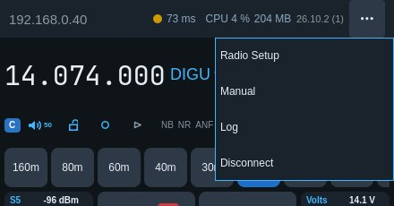

The layout follows the device: rotation, Split View, Stage Manager and
folding switch it live. A window at least 600 points wide and 500 high
gets the tablet layout, so a foldable's inner screen (the iPhone Duo's,
the OnePlus Open's) looks the same in both orientations: where the row is short of room, the frequency and the
info panel beside it shrink a little, and only in a narrow window does the
panel go under the frequency. In portrait the controls pin under the display only on a
screen about 1050 points tall (an iPad); on a lower one they open as the
drawer. On a very low screen in landscape (a phone's outer
screen, the smaller iPhones) the band buttons give way to the display;
there the **Band** button on the waterfall opens the bands, with *Whole
band* (the band zoom) and *Close* at the top. **B/S** (bands / steps) beside it hides the
band buttons and the step buttons on any device, so the waterfall gets
their height; Band then opens the bands the same way, and B/S brings the
rows back (also *View › Bands and steps*; remembered). While they are
hidden, B/S has an amber frame and reads **B/S ▲**.

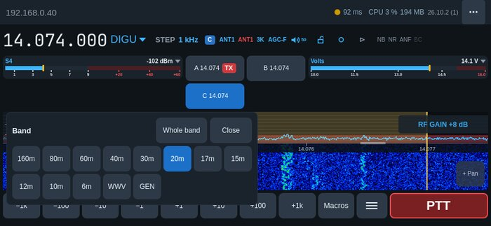

**Panels.** Every panel the app opens (AGC, volume, filters and DSP, the
meter, the bands, a notch, network, stations, a voice keyer slot) has its
name and **Close** at the top right; a tap outside closes it too. Where the
window is lower than the panel, the rows under the title scroll and a bar at
the right shows there is more; the title and Close stay in place. The
controls tabs, Radio Setup, the connect page and the log show the same bar
whenever they scroll.

**Hints.** A few seconds after the first connect (after the setup offer,
if that shows), four short cards show the gestures nothing on screen
shows: the hold for a notch, the dBm scale and divider drags, the slice
and SPLIT holds, the frequency tap and the memory holds. **Next** steps
through them, **Skip** closes them; they show once. **Controls → View →
Hints → Show again** brings them back.

**Felt taps.** On an iPhone or an Android phone, PTT's press and release,
the step buttons and − / + are felt as a light tap, as the phone's own
controls give, and a slider's drag as ticks (each step on a short scale,
else each tenth and the ends). **Controls → View → Felt taps** turns them
off in this app; when on, they follow the phone's own setting (iPhone:
*Settings › Sounds & Haptics › System Haptics*; Android: touch feedback
under the vibration settings). iPads and Macs have none.

**Screen reader.** With VoiceOver (iPhone, iPad, Mac) or TalkBack
(Android) every control says what it is and its value: the frequency in
kHz, the mode, the step, the antennas, filter width, AGC, volume, the
lock, the meters with their reading, each slice, PTT, the sliders and
fields. A double tap acts as a tap (hold PTT with a double tap and hold);
a swipe up or down on a slider moves it one step, sent at once.
Tuning with the screen reader, and dialogs and panels that keep the
screen reader inside them, are still to come.

### Network quality

The dot in the top row (with the app's CPU and memory next to it) rates the connection as the desktop AetherSDR does —
**Excellent / Very Good** (green), **Good** (blue), **Fair** (amber),
**Poor** (red) — with the round-trip time. On an iPhone and in a narrow
tablet window the dot, the time, the CPU and the memory (the number alone)
show. Tap it for the details:

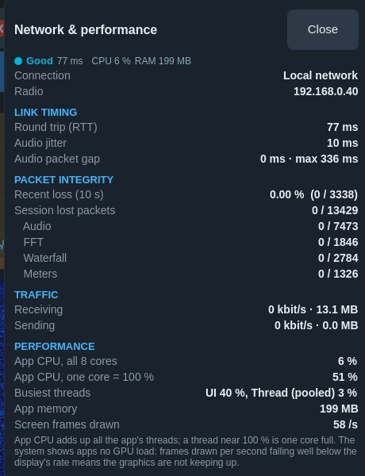

- **Link timing** — round trip to the radio, audio jitter, and the gap
  between audio packets (current and longest).
- **Packet integrity** — packets lost in the last 10 s and in the session,
  per stream (audio, spectrum, waterfall, meters). Packets that merely
  arrive out of order are not counted as lost.
- **Traffic** — receive and send rates and totals.
- **Performance** — the app's CPU as a share of all cores (also shown in the
  top row), the same added up over all its threads with one core = 100 %
  (102 % is about one core's worth spread over several threads, not one
  core full), on Android the **busiest threads** (UI, render, audio…; one
  near 100 % is a core at its limit), the app's memory (**RAM** in the top
  row: on iPhone, iPad and Mac the footprint the system's memory limit
  counts, on Android the memory the app holds), and the screen frames drawn
  per second. iOS and Android give apps no GPU load; frames drawn falling well
  below the display's rate means the graphics are not keeping up.

## 3. Frequency, mode and the info panel

**Frequency.** Tap the frequency for direct entry with a keypad (or type on
a hardware keyboard), then *Tune*. *14.074* and *14074* both tune
14.074 MHz; on a transverter band, *439.000* (or *439*) tunes 439 MHz.

**The filter in the middle.** A frequency you choose puts the filter in the
middle of the waterfall: a typed one, a band button, a memory (Mem tab), a
spot's call on the display and a station in the FreeDV list. The view
centres on the passband, not on the carrier: in USB about 1.4 kHz above
it, in LSB below, in CW, AM and FM about it, in DIGU / DIGL on the audio
band's middle. For a band, a memory and a spot the app waits until the
radio has set the slice's frequency, mode and filter, so the view moves
once, a moment after the tap. Tuning by hand moves the view only near an
edge, as before: a drag, a tap on the waterfall, the steps, the keys and
the knob. A drag on the display right after a choice keeps the view where
you put it.

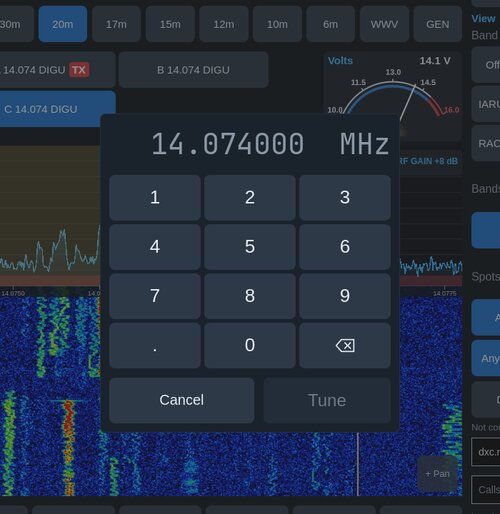

**Mode.** Tap the mode (e.g. *USB ▼*) and choose another.

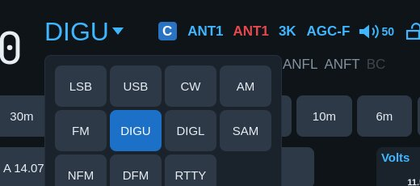

**STEP** (under the mode, e.g. *STEP 100 Hz*) is the tuning step: tap it to
choose from the radio's list. Tap-tune and the arrow keys use it; Apple
Pencil drags tune exactly, off the step's grid.

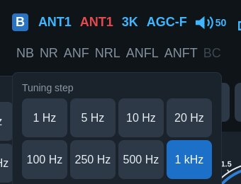

**Band buttons.** Each band returns to the frequency and mode you last used
there. The radio keeps these in its *band stack*, which is part of the
radio's global profile, so a different profile can bring a band back
elsewhere. The view then centres on the filter there. **WWV** holds the time-signal frequencies and **GEN** general
coverage, each with its own band-stack memory. Transverters set up in the
radio (in SmartSDR or the AetherSDR desktop: Radio Setup → XVTR) get a
button of their own after 6 m, named as in the radio (for example 2m): the
radio tunes the RF frequency, uses the transverter port and does the IF
itself. On a phone the band row scrolls sideways.

**Step buttons.** ±1 Hz … ±1 kHz, landing on round frequencies: +10 Hz from
14.100 002 goes to 14.100 010, not 14.100 012. *View › STEP ×1 ×10 ×100*
makes them the radio's STEP (as set with STEP at the top) and ten and a
hundred of it: with a 500 Hz STEP, ±500 Hz, ±5 kHz and ±50 kHz. With a step of 5 kHz or
more (STEP, e.g. an FM channel step of 12.5 kHz on 70 cm) they become ±STEP, ±100 kHz,
±1 MHz and ±10 MHz, all on the step's grid. Hold a step button to keep
stepping: after 0.4 s it repeats about eight times a second (also over
SmartLink, where every step counts from the last one, not from a frequency
the radio has not confirmed yet). The band button of the band you are on is lit.

### The info panel


The active slice at a glance, after the slice flag of SmartSDR. Every item
is a touch target with its choices behind it:

| Item | Shows | Tap |
|---|---|---|
| **A** (blue) | Slice letter | — |
| **TX** (red) | This slice transmits | — |
| **ANT1** (blue) | Receive antenna | Choose the RX antenna |
| **ANT1** (red) | Transmit antenna | Choose the TX antenna |
| **2.7K** | Receive filter width | Filters and DSP |
| **AGC-M** | AGC mode | AGC mode, AGC threshold and RF gain |
| Speaker | Audio on (blue) / muted (red), with this slice's volume beside it (0–100; a new slice starts at 50) | Every slice's volume (AF gain), Mute and pan (left–right, read as C, L n or R n; it snaps to centre near the middle, and double-tap centres) |
| Lock | Tuning lock open / locked | Lock or unlock tuning (flashes when a tune is refused) |
| Dot | Record: hollow, red and blinking while recording | Record this slice's receive audio in the radio (tap again to stop) |
| Triangle | Play: dim until something is recorded, filled while playing | Play the recording back; with PTT held during playback it goes on the air (the radio's quick record, as SmartSDR's REC / PLAY) |
| **SPLIT** | Split on (amber) or off (grey); shown while the radio can transmit and has a slice free for it (always with split by XIT) | Start or end [split](#6-split); hold to pick the offset |
| **QSK** | In CW modes: break-in on (bright) or off | — |
| **NB NR ANF NRL …** | Every DSP the radio offers, bright when on (on an iPhone the rarer ones only while on) | Filters and DSP |

The speaker opens every slice's volume, mute and pan:

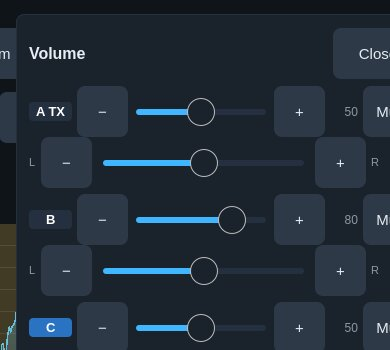

The settings that are always there come first; split and the DSP flags
follow on a second row. On an iPhone in portrait STEP and the antennas, width and AGC sit beside the
frequency and the rest under it; in landscape it is one row, STEP first.
Every word and icon in it is a finger-sized target, taller and wider than
it looks.

**Filters and DSP** — the mode's eight filter widths (the active one lit;
choosing one closes the window) and the radio's DSP: NR, NB, ANF, APF (CW),
and NRL, ANFL, ANFT, NRS, RNN, NRF where the radio has them, and **WNB**, the
panadapter's wideband noise blanker. **BC** is the app's own beat cancel
(below). DSP toggles leave the window open, so several can be set together;
*Close* at the top right (or a tap outside) closes it.
Each DSP that is on and has a level (NR, NB, ANF, APF, NRL, ANFL, NRS, NRF,
WNB) gets a slider under the toggles, sent to the radio when released.
NRS goes up to 50 on firmware 4.3.16 and later (the radio's own limit),
up to 100 on older firmware.

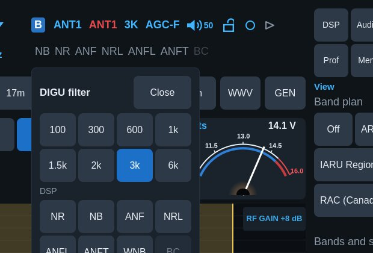

**BC — beat cancel**, as on Kenwood rigs: finds steady carriers in the
receive audio — someone tuning up on your frequency — and notches them out
within about 0.15 s, leaving voice alone; it adds no delay to the audio. Up
to four carriers at a time. Voice modes only: in CW and data modes (and
whenever another audible slice is in one) it is off and its button shows
dimmed, since it would remove the signal itself; back in a voice mode it
returns as you left it.

**AGC** — off / slow / med / fast, the AGC threshold (AGC-T) and the
panadapter's RF gain (preamp or attenuator, in the radio's steps). When
the app changes the mode (the mode chooser, a band button, an FTx band
button, RADE), AGC follows it: **fast** for CW and data (DIGU, DIGL,
RTTY, FreeDV), **slow** for voice. Pick another AGC and the app keeps it
for that kind of mode from then on. A mode change made by another program
on the radio leaves the AGC alone.

**Sliders with − and +.** AGC-T, RF gain, each slice's volume and pan, the
squelch level, the DSP levels, RF and tune power, the microphone and
monitor levels, the TX filter, the eSSB levels, CW
speed and pitch, and Radio Setup's levels have **−** and **+** at the ends
of their slider: drag near the value, then tap − or + for one step at a
time (hold to keep stepping). The display's own sliders (levels you set by
eye) and the equaliser's bands have none.
The AGC, volume, filter and meter panels stay open while you set them
(see [Panels](#2-the-main-screen)).

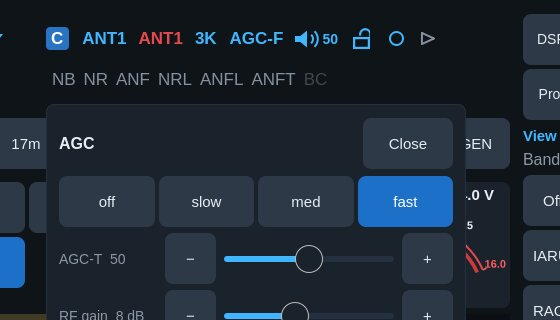

**Antennas** — the antenna ports the radio offers for receive or transmit.

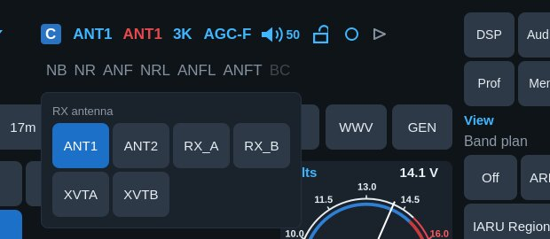

## 4. Meters and slices

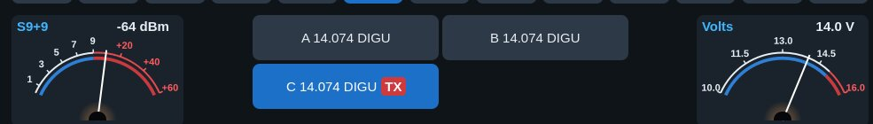

**Meters.** Two meters, at the ends of the slice row. Tap a meter to choose
its style and what it shows — separately for receive and for transmit (e.g.
S, then SWR on the air). In the chooser, receive's choices are in a box
of their own with a blue **RX** tag and transmit's in one with a red
**TX** tag. Choices are remembered. Each meter has one of
these styles:

- **Analog** — an arc and a needle; it stays analog while transmitting too.
- **Bar** — one bar.
- **Two bars** — two bars, one over the other, each with its own receive
  and transmit choice: tap the upper or the lower bar to choose what that
  bar shows. Two bars at the left give three readings on the air, e.g. SWR
  and Mic at the left and Power at the right (four with two bars at both
  ends).
- **2 analog** (iPad and Mac) — the same two readings as two analog meters
  side by side, the first at the outer edge: tap either one to choose what
  it shows. With 2 analog at both ends, transmit shows four needles, e.g.
  SWR and Mic at the left, ALC and Power at the right. Where the window
  leaves too little room for two faces, they show as two bars until there
  is room again.

Each bar has the analog meter's scale under it — S1…S9 then +20/+40/+60 in
red on the S meter, five values with the alarm range in red on the others —
and the reading's name and value above it. A low bar (iPhone landscape)
keeps the ticks and leaves out the numbers. Bar meters take the width the
slice buttons leave free: in landscape they reach up to the slice buttons,
and in portrait with one slice open they use the second slice column's room.
An analog meter keeps its size, as a wider face would also grow taller.

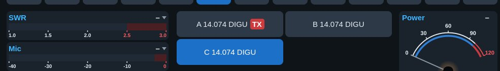

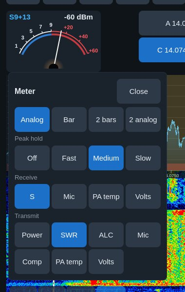

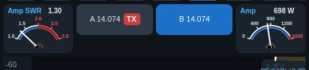

Receive offers S, Mic, PA temperature and supply voltage; transmit adds
Power, SWR, ALC and Compression, which the radio reads only while
transmitting, and leaves S out (it has nothing to read on the air).
**Power** has the radio's scale: 0-120 W red from 100 W, 0-600 W red from
500 W on an Aurora or a radio over 100 W, a QRP radio's own power times
1.2. With a Power Genius XL in OPERATE it shows the amplifier's output on
0-2000 W, red from 1500 W (in STANDBY the radio's own again).
With an amplifier set up ([Radio Setup › Amp](#9-radio-setup)), every
meter, in receive and in transmit, also offers its readings under
**Amplifier**: *Power* (0-1600 W), *Refl* (0-200 W, red from 2:1 at the
present power), *SWR* (red from 2:1, – below 1 W), *Temp* (0-100 °C, red
from 70: the RF2K-S goes to standby at 72 °C), *Volts* (40-60 V) and
*Current* (0-60 A). The meter names them *Amp Power*, *Amp Temp*… where
there is room and *Amp* where not (the value's unit and the scale tell
which). Forget the amplifier, and a meter showing one of them goes back
to its usual reading. A Power Genius XL the radio reports gives these
readings too when no RF2K-S is set up: Power on 0-2000 W red from 1500,
Current on 0-70 A. A Tuner Genius XL adds **Tuner**: *Power* (the power
through it, 0-2000 W) and *SWR* (red from 2.5, – below 5 W), so the four
meters can follow the amplifier and the tuner without the Amp tab open.
While [RADE](#8-controls) runs, receive also offers **SNR** (thanks Scott
L Stanford), the RADE decoder's own on 0-20 dB, *–* until it is synced;
a meter showing it goes back to its usual reading when RADE is off and
to SNR the next time RADE is on. **Mic** is on the left meter and its lower bar
(on a tablet the side panel covers the right one). With this device's microphone it shows the
level of the audio as it is sent (after the processing in Controls → eSSB):
while you transmit, and in receive too while Controls → TX or eSSB is open,
so the level can be set before going on the air; with a microphone on the radio
it is the radio's own meter.

**Peak hold.** Each meter keeps its highest reading — an amber needle on
the analog meter, an amber marker across the bar — then lets it fall back,
so a voice peak or a burst of noise can be read. *Peak hold* in the meter's
chooser sets it for all meters, as the desktop S meter's decay: *Off*,
*Fast* (0.2 s, then 20 dB/s), *Medium* (0.5 s, then 10 dB/s; the
default) or *Slow* (1 s, then 5 dB/s); other scales fall in the same time
for their span.

**Slices.** Each slice is a button between the meters ("A 14.100 USB"; on a
phone without the mode, which is beside the frequency); the
transmit slice carries a red **TX** tag. Two fit side by side, four make
2 × 2.

- Tap a slice to make it the active one (tuning, info panel and controls
  follow it).
- Press and hold for **Make TX slice** and **Close slice**.
- **+ Slice** and **+ Pan** (bottom right of the waterfall) add a slice or a
  panadapter.
- Closing the transmit slice hands transmit to the slice that stays, so PTT
  keeps working.

## 5. Panadapter and waterfall

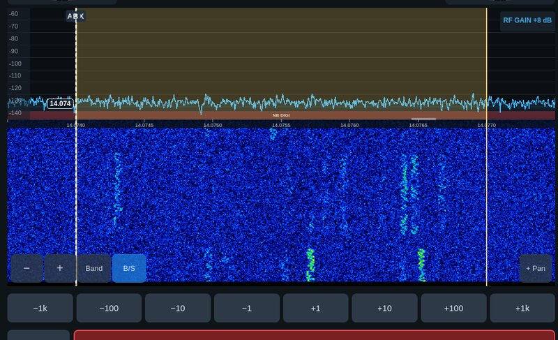

- **Tap** to tune to the touched point (on the tuning step). In CW a tap
  lands on the CW signal nearest the touch, within about a finger's width,
  so you hear it at your pitch even when the tap misses it a little; where
  there is none it tunes to the touched point, to the hertz.
- **Drag inside the filter passband** to tune; the slice follows the finger
  in tuning steps (STEP), so it stops on a round frequency.
- **Drag a passband edge** (a finger's width around either edge line) to
  set the filter in 10 Hz steps, for any width; the filter chooser's eight
  widths stay as they were.
  Holding the finger at either edge keeps tuning, faster nearer the edge.
- **Drag anywhere else** to move the view; the frequency stays.
- **Pinch**, or **− / +** (bottom left), to zoom around the slice.
- **Band** (beside − / +) zooms out to the whole band you are on; tap it
  again to return to the slice. Off every band (the view dragged or tuned
  outside one), it goes back to the slice's band, or else the nearest one.
  With the band buttons hidden (B/S, or a very low landscape screen) it opens
  the bands instead.
- **B/S** (bands / steps) hides the band buttons and the step buttons, or brings them back; while they are hidden it has an amber frame and reads *B/S ▲*.
- The **frequency scale** runs along the top of the waterfall.
- The **dBm scale** at the left: drag it up or down to move the trace (the
  reference level; this turns the spectrum's *Auto* off, View gives it
  back). In 3D, as on the desktop, the 3D levels stay automatic:
  the floor (the 3D zero) follows the noise and the scale runs from it to
  the top. Dragging sets **3D floor**, how far under the noise the zero
  sits (0–24 dB, default 6): drag up and the noise rises, down and it
  sinks. The same setting is a slider in View.
- The **divider** between the spectrum and the waterfall (a short bar on
  the line, right of centre): drag it up or down to give the spectrum or
  the waterfall more room, as on the desktop. The new split applies when
  you lift your finger (a line shows where it goes; the waterfall starts
  over at its new size) and is remembered. Double-tap it for the
  automatic split.
- **RF GAIN +8 dB** (top right) shows the RF gain; tap it for AGC, AGC-T and
  RF gain. A gain step shows on the
  waterfall and trace, as on the desktop.
- The **slice** is a white dashed line at its frequency in data, CW and
  RTTY modes, with the frequency beside it at the foot of the spectrum; in
  voice modes (USB, LSB, AM, FM) the line is left out, as the passband's
  edge marks the carrier there, and the frequency stays beside it. The
  **filter passband** is the shaded band between two solid yellow edges,
  on the correct side for USB/LSB (in LSB the carrier is at its right edge,
  in USB at its left) and centred for CW/AM. Other slices are marked with their letter;
  tap one to select it.
- Your own transmission shows in the waterfall when *Radio Setup ›
  Transmit › Show my transmission in the waterfall* is on (the radio's own
  setting, the same as SmartSDR's Show TX in waterfall). Off, the waterfall
  waits while you transmit and goes on after.
- In CW, decoded text runs along the top of the waterfall.
- **Spots** — callsigns along the top of the spectrum at their frequency:
  the spots the radio holds, from this app's DX cluster connection and
  from any other program on the radio. Tap one to tune to it (the mode
  follows the spot, as on the desktop, and the view centres on the
  filter). Close ones stack in up to four
  rows; zoom in to see more. In View, *Spots* shows or hides them, and
  *DX cluster* connects the app to a cluster of your choice.
- **Notches (TNF)** — **press and hold** on the display where a notch
  should go, or tap *+ TNF* in Controls → DSP for one in the middle of the
  passband: the notch panel opens for the new notch, drawn on the display
  but not yet on the radio, with its width (50–500 Hz, 100 Hz to start),
  depth, *Permanent* and a 10 Hz nudge either way. **Add** puts it on the
  radio; *Close* or a tap outside the panel leaves none, so a stray hold
  no longer adds a notch. A notch shows as a band through spectrum and
  waterfall (yellow, or green when permanent) with a handle on top
  outlined in black: filled while TNF is on, hollow while it is off. Tap
  it for the same settings and *Remove*; *TNF on/off* there is the radio's
  switch for all notches — they only work while it is on. Drag a notch
  along the spectrum (not the waterfall) to move it.

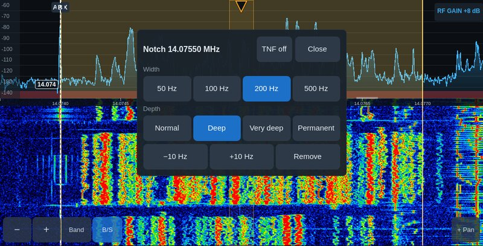

**RTTY.** With the slice in **RTTY** (the mode button, or a tap on an RTTY
spot), the app decodes it itself: the text runs along the top of the
waterfall in the same two lines as decoded CW. Before the first letter the
line says what it listens for. The signal's mark tone (the upper of its two
traces, 170 Hz apart) must sit on the dial frequency (the white line; the
radio's RTTY filter is around it): **tap the signal** on the display, on
either trace or between them, and the slice goes onto its mark. A tap on
an RTTY spot does the same (spots give the mark or the signal's centre;
while the station is listening, the app looks again for a few seconds). A
tap on the line opens the **RTTY** panel: the text so far (newest at the
bottom, *Clear*), **Decode on / off**, the **Shift** (*Auto* takes the
radio's, 170 Hz for amateur RTTY, 425 or 850 for others), the speed
(**45.45** baud for amateur RTTY, 50, 75), **Reverse** for a signal with
mark and space swapped, the **Mark** tone (*Mark auto* takes the radio's,
normally 2125 Hz), whether it has **locked on** (with the SNR),
**Autotune** (the slice onto the mark of the signal in the passband, after
tuning by the knob or the steps) and **Squelch** (on by default: the
letters band noise makes between transmissions are held back; off, a weak
signal can be read letter by letter). The decoder receives only; the app
does not transmit RTTY.

**View** (in Controls) switches between the 2D waterfall and the **3D**
stacked trace and sets the levels. They work as on the desktop AetherSDR:

- **Spectrum** — *Auto* keeps the noise floor a quarter of the way up and
  follows it calmly: it rises only once a change has lasted over a second
  (a lightning crash does not lift it), falls quickly, and re-locks after a
  retune or zoom. **Range** is the height of the scale, in Auto too; with
  Auto off, **Reference** is the top. The trace is lightly averaged.
- **Waterfall** — *Auto* puts black at the noise floor; **Black level**
  moves it (50 = at the noise, higher shows more of it). **Colour gain**
  sets how many dB the colours span, so the same signal looks the same on
  any band and a strong carrier does not darken the rest. During and just
  after a transmission the levels hold.
- **FFT average**, **FFT frames/s** and **Waterfall speed** are the
  radio's own panadapter settings (as in SmartSDR): averaging smooths the
  trace on the radio, frames/s sets how often the trace updates, and the
  waterfall speed how fast lines scroll. Each is sent when the slider is
  released and kept by the radio.
- **3D** — the surface takes a row with each waterfall line and glides
  between them. **3D smoothing**: *Off* draws the rows as live as the 2D
  trace, *Light* (default) blends a little with the previous row so the
  narrow dips (say, gaps in your own voice's spectrum) stay visible,
  *Desktop* smooths as the desktop does (no flicker from single spikes,
  a calm surface). Ridges
  are soft lines, the near rows widen over the side gaps where the radio's
  wider waterfall data reaches, and the slices' passbands and carriers are
  shaded into the surface in perspective. Its height is the spectrum's
  Range; **3D floor** sets how far under the noise its zero sits and
  **3D gain** how far down the colours reach. In portrait the 3D keeps
  landscape's shape and the waterfall gets the rest of the height. It keeps
  its history while you are in 2D. If the app stopped while the 3D view was
  on, or the 3D view runs too slowly on the device, the app starts or goes
  on with the 2D waterfall and says so; turn 3D on again in View.

**Panadapters.** The display shows one panadapter at a time: the one of
the active slice. Selecting a slice on another panadapter (its chip in the
slice row) switches the display to it. With more than one open, **Close N
other pans** on the display closes the others.

## 6. Split

Tap **SPLIT** on the info panel. As on SmartSDR and AetherSDR, a second slice
is created on the same panadapter for transmit:

- 1 kHz above in CW, 5 kHz above in other modes, same mode;
- it is muted (you listen on the original slice) and takes transmit;
- it becomes the active slice, so you can tune the transmit frequency at
  once (drag its passband, or the step buttons).

Tap **SPLIT** again — or close either slice — to end split: the transmit
slice closes and transmit returns to the receive slice.

**Press and hold SPLIT** to choose the offset: **+1 kHz**, **+5 kHz** or
**+10 kHz** above the receive frequency. While split is on, the same menu
offers **Off**.

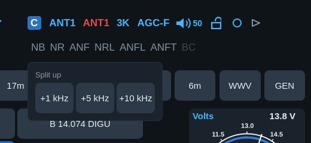

**Split by XIT** (Controls → TX → Split *XIT*): no second slice, for a
radio whose slices other programs hold (as a Maestro user splits). **SPLIT**
then turns on the XIT of the slice you are on: it transmits 1 kHz up in CW,
5 kHz in voice, and keeps receiving where it is. Hold SPLIT for **+1**,
**+2** or **+5 kHz** (XIT reaches ±9.999 kHz). The **XIT** row on the RX
tab shows the offset and moves it; SPLIT again (or XIT off there) ends it.
*Second slice* is the way above.

## 7. Transmitting: PTT, KEY and TUNE

- **PTT** — hold to transmit from the device's microphone; release to stop.
  PTT is for voice: with the TX slice in DIGU or DIGL it says so and does
  not key (the radio refuses voice there); switch to USB / LSB, or use the
  FTx tab for FT8 / FT4 and the FreeDV tab for RADE. When the radio refuses transmit, its own reason
  is shown.
  The microphone is open only while transmitting, and the speaker goes
  quiet from the press until the release, so the band noise still playing
  as the radio keys does not reach a phone's microphone and go out at the
  start of the transmission (with **MON** on, the speaker comes back a
  moment after the radio keys, for the monitor). **Tap on / off** (Controls
  → TX → PTT) makes it a switch: tap to transmit, tap again to stop (TX ■
  while it is on); as a safety it stops by itself after 3 minutes. Space on
  a keyboard works the same way.
- **Transmit lock** — Controls → TX → Lock *Transmit lock* (off by
  default), for a finger that touches PTT or the paddles by mistake. With
  it on, nothing transmits in standby: PTT says **SB** (*hold to arm*),
  TUNE and CQ say *· SB*, and a tap there, the paddles, a CW memory, a
  voice macro or a tapped FT8 decode only show how to arm. Hold PTT, KEY
  (or Space), TUNE or CQ for a second to arm it: PTT turns red with **OA**
  and the time left, five minutes after the last transmission, and the
  next press transmits. **Standby** beside the line in the TX tab locks it
  again at once.
- **KEY** — in CW modes the same button is a straight key, or **paddles**
  (Controls → CW → Key: *Paddles*): dit and dah side by side in its
  place, each its own touch, so holding both gives iambic squeeze. On a
  phone they sit at the two edges, one for each thumb: dit at the left,
  Controls between, dah at the right (in landscape the step buttons are
  between). The app
  times the elements itself, sends them to the radio and plays the
  sidetone in step. **Iambic** in the CW tab sets **A** or **B** (B adds
  one more element after a squeeze) and **Swap ⇄** (dah on the left); they
  are the radio's settings, also in [Radio Setup](#9-radio-setup) →
  Phone/CW. **Paddles on a keyboard** picks which two keys of a hardware
  keyboard are the paddles, the left one dit and the right one dah:
  left and right **Ctrl** (the default; what USB paddle adapters such as
  Vail and VBand send), left and right **Alt ⌥** (Option; for keyboards with no right
  Ctrl, such as Apple's Magic Keyboard), **[ ]** (on English layouts,
  where [ and ] are keys of their own; on Finnish or German layouts they
  need AltGr or Option, so pick Ctrl or Alt there), or **Off**.

  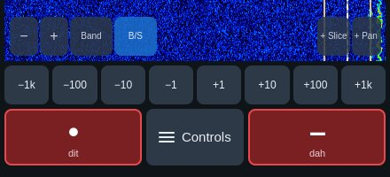

  For a straight key, the sidetone
  plays on this device as you key (at the radio's CW pitch and the CW
  tab's Sidetone level, when its Sidetone is on), without the round trip
  to the radio.
- **TUNE** (Controls → TX) sends a carrier at the tune power; while it is on,
  the big button reads TUNE and pressing it stops the carrier.
- **Macros** — the button beside Controls in a phone's PTT row (beside
  PTT on a tablet, before the controls button at the end of a phone's
  landscape row) opens the macros of the mode you are in over the
  display, so reaching them takes no scrolling past the tabs' sliders: in
  CW the memories M1-M12, with the call being worked (`{HIS}`) and the
  calls heard; in RTTY and PSK the Digi tab's macros; in the voice modes
  the voice keyer F1-F12 (the slot sending is lit; an empty one says to
  record it on the TX tab). A tap sends, **Stop** stops; editing stays on
  the tabs (press and hold there). PTT, the paddles and the display stay
  in use while it is open; ✕ or the button again closes it, and so does
  opening the controls. It is the same set F1-F12 send on a keyboard, and
  it never takes the keyboard. With the CW decoder on (or RTTY / PSK
  received) its latest two lines show at the top of the panel, since the
  panel covers the strip at the top of the waterfall.

  **Repeat** (voice keyer and CW memories; thanks Robin Bishop): with the
  switch on, the slot you tap next is sent again after each send, the gap
  set with − / + (2-60 s, 5 s at first, remembered), until PTT, KEY or the
  paddles, **Stop**, any key on a keyboard, typed CW text or another slot
  (which then repeats instead). While it repeats the panel's title says
  which and when (*F2 again in 4 s*), the slot has an amber frame, and the
  **Macros** button reads *⟳ F2* in amber, also with the panel closed, so
  a repeat never runs unseen. The switch is off at every start and goes
  off when the radio disconnects; a mode change ends the repeat.

  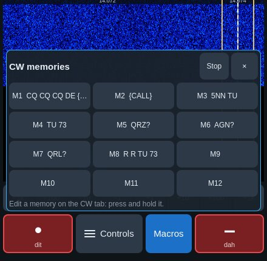

The button is always on top. On a phone an open controls drawer carries its
own copy at the bottom, beside **Close** (which closes the drawer) and **▲**
(full screen), and so does a tablet's drawer from the bottom; on a
tablet on its side the drawer stops above the page's PTT, so nothing ever covers it.
When transmit is not possible (no TX slice, the radio's mic input not
this device, a refusal), the reason shows above PTT and under the
controls; on a phone the power and SWR show beside PTT while you
transmit.

Safety: transmit goes through AetherSDR's TX controller. The transmitter
unkeys on release, on disconnect, when the app leaves the screen (but the
amplifier's tune carrier, [Amp](#8-controls) › Tune, for 20 s at most),
when the layout changes and when the microphone input leaves the device. If the radio
refuses to transmit, its reason pops up (for example *No transmit slice is
assigned* or *The selected TX antenna cannot transmit on this frequency*).

## 8. Controls

**Controls** (top row) opens the controls; on an iPad, *Pin Controls* keeps
them in the page (at the right in landscape, under the display in portrait),
with toggle buttons to show several sections at once; *Hide controls* puts
them back into the drawer. The buttons are all one size, in rows of six:
**DSP**, **Audio**, **TX**, **eSSB** (this device's microphone
processing), **CW**, **View**, **Prof** (profiles), **Mem** (memory),
**Log**, **FTx** (FT8 / FT4), **FreeDV** (RADE digital voice and FreeDV
Reporter) and **Digi** (RTTY, PSK31, PSK63). With an amplifier set up
([Radio Setup › Amp](#9-radio-setup)), or a 4O3A Power Genius XL or Tuner
Genius XL connected to the radio, an **Amp** tab joins them, in rows of
seven.

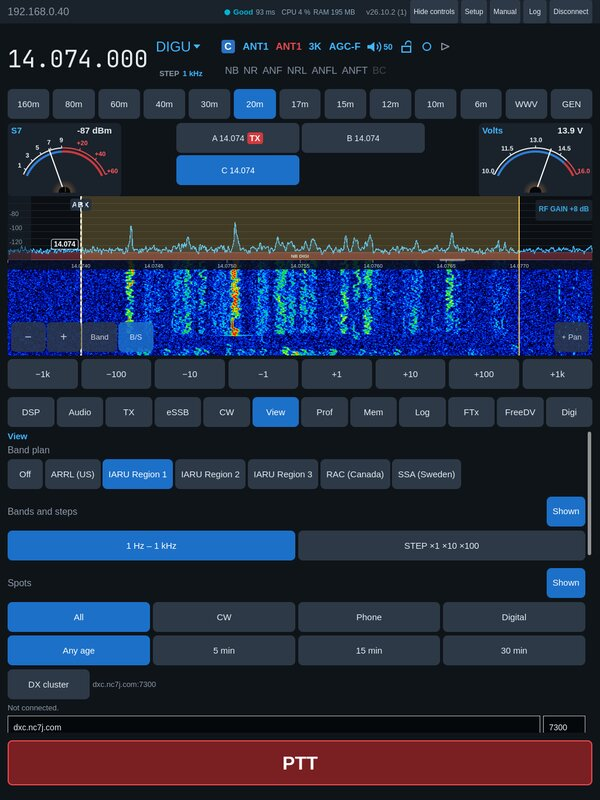

| DSP | Audio | TX | eSSB |
|---|---|---|---|
| 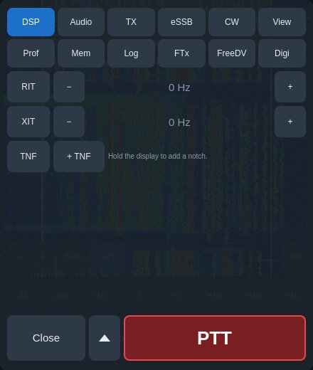 | 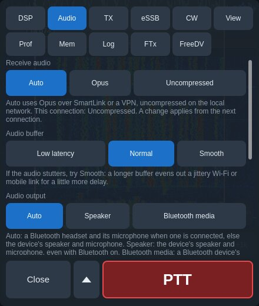 |  | 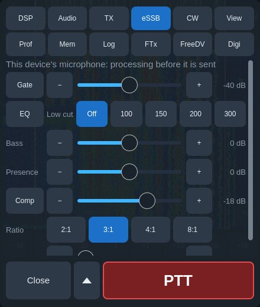 |

- **DSP** — RIT and XIT (on/off; − and + step 10 Hz and run while held,
  faster the longer: 10, then 50, then 100 Hz; tap the value to reset;
  not in FM), squelch (where the radio has it: not in CW, the digital modes, RTTY or DFM, whose data an audio squelch would cut; − / + and the level beside the slider), and **TNF** (the radio's notch filters on/off, kept when off; *+ TNF*
  opens a new notch in the middle of the passband to set and *Add*; see
  [Panadapter and waterfall](#5-panadapter-and-waterfall)).
- **Audio** — **Receive audio**: *Auto* uses Opus (compressed, made for
  the internet) over SmartLink or when the radio is reached through a VPN,
  and uncompressed audio on the local network; *Opus* or *Uncompressed* fix
  it. It shows what the current connection uses; a change applies from the
  next connection. **Audio buffer**: *Low latency* (100 ms), *Normal*
  (200 ms, the default) or *Smooth* (400 ms) — a longer buffer evens out a
  jittery Wi-Fi or mobile link for a little more delay. **Sound from**:
  *This device* (the default) or *The radio*, which plays receive audio on
  the radio's own speaker, headphones and line out instead, e.g. with a
  headset on the radio; switched at once, without reconnecting, and
  remembered. The microphone does not switch with it, as the radio's mic
  input is shared by every station on it: for the radio's microphone too,
  TX tab › **Use the radio's microphone**, then key with the radio's PTT
  or VOX (the app's PTT sends this device's microphone). **Audio output**
  (with the sound on this device):
  *Auto* (the default) plays through a Bluetooth headset, with its
  microphone, when one is connected, else through the device's speaker
  and microphone; *Speaker* keeps receive audio and the microphone on the
  device even with Bluetooth on (e.g. a car or a watch that takes the
  sound); *Bluetooth media* plays through a Bluetooth device's music link,
  which sounds better than a headset's call link, and the device's own
  microphone transmits (without a Bluetooth device, the speaker plays). The
  choice applies at once and is remembered. Low latency is for a
  wired or very steady link only; on ordinary Wi-Fi it stutters. If Normal
  stutters, try Smooth. Every 10 s with stutter the log gets an
  "audio underrun" line (count, buffer, longest packet gap, buffer mode),
  and once a minute a "performance" line (CPU, frames drawn, memory). When the app
  stops answering for a second or more, a "GUI thread stalled" line says
  for how long and what was going on (transmit, the last touch, the last
  frame); if Android closed the app during it, the next start logs it as
  "previous run". Below, the radio's
  8-band receive and transmit equalizer
  (volume is on the info panel's speaker).
- **TX** — in FM modes first **FM repeater**: **Offset** *Simplex*, *−*
  (transmit below) or *+* (above), the **Shift** (0.6, 1.6, 5.0 or 7.6 MHz,
  or type any) and **Tone**: *CTCSS* on transmit with its tone. The radio
  transmits on the shifted frequency and sends the tone; receive stays on
  the frequency shown. Then TUNE and the
  ATU (tune, bypass, memories), tune power, RF power, speech processor (PROC
  NOR/DX/DX+), **VOX** (on/off, level and delay) and **DEXP** (the downward
  expander, on/off and level) in voice modes — shown only when the radio's
  own microphone input is selected, as they do nothing with this device's
  microphone — the AM **carrier** level in
  AM/SAM/DSB, monitor (MON), **Mic level**, microphone choice (when the
  radio's mic input is not this device, **Use this device's microphone**
  sets it and the line beside it says why PTT waits), **DAX**
  (on: the radio sends the audio of a digital-mode program on a computer
  instead of the microphone; left on after FT8, the microphone goes
  nowhere), **PTT**
  (*Hold to talk* or *Tap on / off*), **Split** (*Second slice* or
  *XIT*, [6](#6-split)) and the transmit filter (low and high cut). On a FLEX-8000 or Aurora, **APD** *Off* / *On*: adaptive
  pre-distortion, where the radio measures its own transmission and
  pre-distorts it so the amplifier's IMD falls; the line under it says
  whether it is correcting (*active*) or learns from the next transmission
  (*ready*). Its sampler ports are in Radio Setup › Transmit. **Mic level** with this device's
  microphone is the app's own gain, −20 to +30 dB: the radio has no gain
  stage for its PC input, so its mic level does nothing to this
  microphone. Choose Mic for the left meter and set it so speech peaks
  near −10 dB: while the TX tab is open the microphone is open and the
  meter moves in receive too (nothing is sent before PTT; not while VOX is
  on). Phone microphones often need +10 to +20 dB; a limiter at
  −1 dBFS keeps the loudest peaks from clipping. With a microphone on the
  radio it is the radio's mic level (0–100), as SmartSDR's MIC.
  - **Voice keyer** (voice modes) — twelve voice macros F1–F12. Tap one to
    transmit it, tap again to stop; press and hold to record (from this
    device's microphone; recording does not transmit), rename or clear. On a
    radio with SmartSDR+ these are the radio's own DVK slots (up to 10 s,
    shared with other programs); otherwise the app keeps them on this
    device (up to 15 s) and plays them into the transmit audio as if
    spoken. Either way **Listen** plays a recording to you without
    transmitting, so you can check it before naming it. Features that need
    SmartSDR+ appear only when the radio reports the subscription.
- **eSSB** — this device's microphone processing: AetherSDR's client-side
  transmit chain (the desktop's Aetherial TX chain), run on the phone or
  tablet before the audio is sent, in voice modes with this device's
  microphone: **Gate** (mutes the background between words below the
  threshold), **EQ** (low cut 100–300 Hz, bass and presence ±12 dB) and
  **Comp** (threshold, ratio 2:1–8:1 and makeup; while you transmit, how
  much it is taking off shows beside the ratio), and the desktop's other
  stages, each off until turned on: **De-ess** (tames the S sounds:
  threshold and the band, 4–7 kHz), **Tube** (warm saturation: drive,
  model A / B / C and the mix), **EVO** (the exciter: *Air* adds high
  harmonics, *Bass* the low end; *Even* / *Odd* harmonics) and **Reverb**
  (mix and decay). **Order** shows the order the microphone goes through
  them; **Change** moves each stage up or down (a stage that is off is
  passed by). The radio's own audio
  settings stay where they are: its 8-band transmit EQ in Audio, PROC and
  the TX filter in TX. While the tab is open the microphone is open, so the
  Mic meter moves as you set the gate and compressor (nothing is sent
  before PTT). In CW the tab says it is not used. Check the result with
  MON or a second receiver at low power first.

| CW | View | Prof | Mem |
|---|---|---|---|
|  | 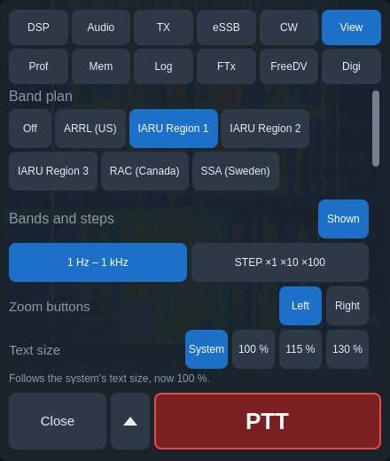 | 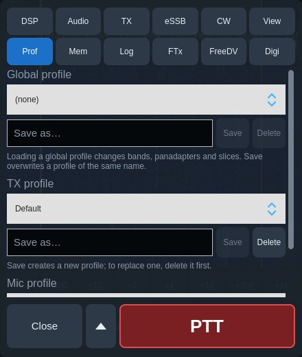 | 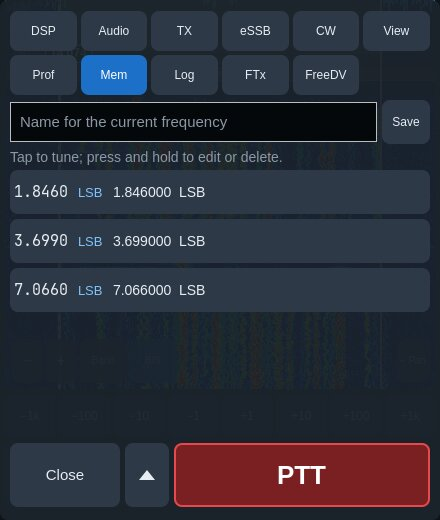 |

- **CW**
  - **Callsign** — the callsign `{CALL}` sends, the radio's own. Set or
    change it in [Radio Setup](#9-radio-setup) → Radio.
  - **Call** — the station you are working: the calls the decoder heard
    (after *DE*, or twice) as buttons; a tap picks one, ✕ clears it. It is
    the same call as the Log tab's Call field (typed or picked there shows
    here too), and memories send it for `{HIS}`.
  - **Memories M1–M12** — tap to send (through the radio's CWX keyer at the
    set speed), press and hold to edit, or F1–F12 on a keyboard. `{CALL}`
    becomes your callsign and `{HIS}` the call being worked (e.g.
    `{HIS} 5NN TU`). They are the app's own; the radio's stored CWX
    macros are left alone. What they send, and CW text below, plays as
    sidetone on this device too.
  - **CW text** — type and *Send*; with **Live** on, each letter goes as you
    type it (Return sends a space). *Stop*, or Esc, clears what is still
    queued.
  - **Key** — *Straight key* or *Paddles*; with paddles, **Iambic** A / B and
    **Swap ⇄**, and **Paddles on a keyboard** (see
    [KEY](#7-transmitting-ptt-key-and-tune)).
  - Speed, pitch, **Sidetone** (*On* and its level 0–100: the radio's CW
    sidetone, on this device too, apart from the receive volume),
    **Break-in** (QSK), the **Decoder** and **Autotune**:
    pressed, it puts the strongest CW signal in the passband on your pitch
    (tune close to one first); with none there it says so. With Break-in off
    the key does not put the radio on air; the app says so when you key.
    The decoder has **Sens**
    (0–100, default 70): higher shows only the letters decoded with
    confidence, so band noise stays out. It reads hand-sent and keyer CW
    from 8 to 45 WPM. Decoded text shows
    here and along the top of the waterfall, under its frequency scale (two lines, filled as writing
    is: the top line first, then the bottom one, broken between words); what you send shows there too, marked `[TX]`. The
    decoder keeps listening with the app in the background: `[away 20:55]`
    and `[back 21:12]` mark what came while you were away. A callsign the decoder hears after *DE*, or twice, is
    offered above the memories (*Call*) and on the Log tab (*Heard in CW*).
- **View** — **Band plan** (the strip at the foot of the spectrum: *Off*,
  *ARRL (US)*, *IARU Region 1 / 2 / 3*, *RAC (Canada)* or *SSA
  (Sweden)*), **Band plan lock (mode)** (see
  [Band plan lock](#band-plan-lock)), **Felt taps (phones)** (on / off, see
  *Felt taps* above), **Hints** (*Show again*, see *Hints* above), **Text size** (*System* follows the system's text size —
  iOS Settings › Display & Brightness › Text Size, Android's font size —
  or a fixed *100 % / 115 % / 130 %*; the panels', dialogs' and setup
  pages' text grows, the operating screen's dense controls and the
  buttons keep their size so they still fit; the app stops at 135 %;
  a 13" iPad, a Mac window or an external display shows larger type
  throughout; an iPhone with Display Zoom set to *Larger Text* gets the
  whole app, scaled to its screen),
  **Spots** (shown or hidden) and the **DX cluster**,
  2D waterfall or 3D, waterfall levels, spectrum range, 3D floor, smoothing
  and gain.
  - **Spot filters** — which spots show: *All*, *CW*, *Phone* or *Digital*
    (by the spot's mode, else its comment or the band plan, as on the
    desktop), and *Any age* or only those from the last 5, 15 or 30
    minutes.
  - **DX cluster** — tap to connect, again to disconnect. Set the server and
    port (default dxc.nc7j.com 7300) and the callsign it logs in with (the
    radio's own when left empty); **Auto** connects whenever the radio
    does. Its spots go to the radio, so SmartSDR and every other program
    on it show them too; they expire after 30 minutes. The line under the
    button tells whether it is on: green *Connected to … as …* with the
    spots so far and the latest one's time (UTC), *Connecting…*, or red
    with the reason when it could not connect. The same callsign from two
    devices: a cluster lets one on at a time, and each knocks the other
    off; the app then waits longer between tries and says so. Give each
    device its own SSID in the callsign, e.g. *OH6OKSA-2*.
- **Prof** (profiles) — the radio's global, TX and mic profiles: load, save,
  delete, as in SmartSDR. Under them, **App setups** (thanks Larry
  Averbeck W9FLA) do the same for this app's own settings: type a name in
  *Save as…* and tap **Save** (an existing name asks before replacing it);
  pick a setup in the list to switch to it at once. A setup holds the
  display, meters, panels, DSP, audio and the TX chain, macros and CW
  memories, the logbooks, the devices and the radio list, with their
  passwords and keys; the voice keyer's recordings stay on the device.
  Settings a setup did not have go back to their defaults. What reads its
  setting only at start (the amplifier, the 4O3A devices, the DX cluster,
  the developer link) follows at the next start, and the line under the
  buttons says so. Not while transmitting or with FT8 / FT4 running.
  **Export** shares a setup as a file (Mail, Files, AirDrop, Drive): it
  asks first, as the file holds its passwords and keys as plain text, so
  keep it to your own devices. **Import** adds a setup from such a file,
  e.g. on your other iPhone, iPad or Android device; one with a name
  already used gets *(2)*. **Delete** removes the selected setup.

  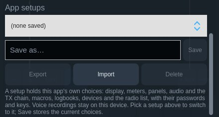
- **Mem** (memory) — the radio's memory channels: tap to tune (the view centres on the memory's filter once the radio has set it), *Save* stores the
  current frequency under the name typed. **Press and hold** one to edit
  its name, frequency (MHz) and mode — *Current* takes the slice's
  frequency and mode — or to *Delete* it. In FM modes it also holds the
  repeater: *Simplex*, *−* or *+* with the shift (0.6, 1.6, 5.0, 7.6 MHz
  or typed) and the CTCSS tone; the list shows them (e.g. "−7.6 88.5"),
  and tapping the memory transmits on the shifted frequency with the tone.
  *Save* with an FM repeater set on the TX tab stores it too.

  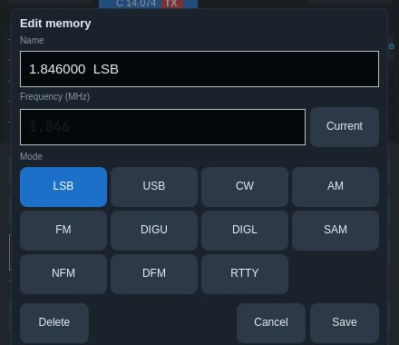

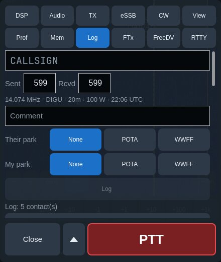

- **Log** — quick QSO logging into a log on this device (an ADIF file,
  `oksasdr-log.adi`). Type the **callsign**, or tap the call of the spot
  you tuned to last. With the CW decoder on, **Heard in CW** offers the
  calls it heard (after *DE*, or twice; the newest first, up to three):
  a tap puts one in the field, handy when a park activator sends
  `CQ POTA DE` and the call. A card shows who it is: with a **QRZ.com** account
  (user and password at the bottom; *Save* keeps them and signs in, and the
  line below says how it went: green signed in, red when QRZ.com refuses the
  user name or password, amber when QRZ.com does not answer, the account
  saved all the same and lookups signing in again by themselves; their full
  records need QRZ.com's XML subscription) the name, QTH, grid, distance and bearing and whether the
  station uses LoTW, eQSL or paper cards; without one, the country,
  continent and CQ zone from the callsign's prefix. The same goes into
  every logged QSO, however the call got there: typed, a heard CW call, a
  spot, or an FT8 / FT4 QSO the app logs by itself (it waits a few seconds
  for QRZ.com, then logs it with what it has). It also says when the
  call was **worked before** and when it would be a **dupe** on this band
  and mode. The reports start at 59 (599 in CW and data) and follow the
  mode until you type one. Frequency, band, mode, power, the UTC time the
  call was typed and your own callsign come from the radio; your grid
  comes from the radio's GPS, or from *My grid*. **Their park** and **My
  park** (POTA or WWFF with the reference) go into ADIF's SIG / MY_SIG
  fields; your own park stays for every contact while you activate.
  *Sent* and *Rcvd* hold the reports and *Comment* a note for the
  contact. **Log CALL** (the button names the call) writes the contact;
  the newest ten are listed. **Share the log
  (ADIF)** opens the share sheet with the whole log as an `.adi` file: mail
  it, save it to Files or Drive, AirDrop it, or open it in your logbook
  program or TQSL for LoTW. **Import contacts (ADIF)** adds the contacts of
  an ADIF file (from another logbook, or another device's OksaSDR log) to
  this log, so worked-before colours and New call count them too;
  those already in the log (same call, date, time, band and mode) are
  skipped. A logbook kept on a computer comes over first: export it as
  ADIF there and put the file where the device sees it (Drive, iCloud,
  mail, a USB cable to Downloads); in the picker, the menu or Browse
  leads to those places. A big logbook (tens of thousands of contacts, tested with
  120 000) imports in a few seconds while the display goes on, and the log
  is read in the background at start (worked-before colours follow when
  it is in); the line under the button says
  *Importing…* and then how many came in. The QRZ.com password is kept in this device's secure store.
  **Wavelog / Cloudlog**: with your logbook's address (as its API page
  shows it, e.g. `https://log.example.com/index.php`), a read & write
  **API key** (Wavelog: *API* › *Legacy API Keys (API v1)*, starting
  `wl…`; Cloudlog: *API Keys*) and the **station ID** (the number of your
  station location there), *Save* checks the key and says whether the
  logbook accepted it; from then on every QSO you log, by hand or from FT8 /
  FT4, also goes to the logbook. QSOs that cannot be sent (offline, server
  away) wait on the device and go with the next QSO or start; the line
  under the fields says how many wait. Clear the address to stop.
  **Worked before from the logbook** (Wavelog 1.8 or newer; *On*) reads
  your Wavelog logbook back: every station location's QSOs, all of them
  the first time (about 20 000 QSOs take half a minute), then at each
  start only the new ones; **Read now** reads what is new at once. They
  count for worked before, dupes, New call / New DXCC and the FTx colours
  in every mode, but stay apart from this app's own log: they are not
  added to its ADIF file nor sent to the logbooks again, and a QSO that
  came from this app is counted once (the same call, band and mode within
  15 minutes, Wavelog's own rule). The line beside Read now says how many
  QSOs count and how many the last read brought. *Off*, a cleared
  address or another logbook's address forgets them. A read-only API key
  is enough for reading; sending needs read & write. Cloudlog cannot send
  its QSOs.
  **QRZ.com Logbook** (both ways; QRZ's Logbook API needs a QRZ
  subscription): paste the logbook's **API key** (QRZ.com › *Logbook* ›
  *Settings*) and *Save*; the app checks it, and from then on every QSO you
  log also goes to your QRZ.com logbook (queued while offline; one QRZ.com
  already has, sent by Wavelog for example, counts as sent). **Worked
  before from the logbook** (*On*) reads the logbook's QSOs back, all of
  them the first time (250 at a time, as QRZ.com asks), then at each start
  only the new ones, and **Read now** at once; they count as Wavelog's do,
  each contact once with this app's log and Wavelog's. **Remove** forgets
  the key, the queue and the QSOs read back.
  **Shared ADIF file** (both ways, for a logging program without a cloud
  connection: Log4OM, N1MM, DXKeeper, MacLoggerDX…): put an ADIF file in
  iCloud Drive, Google Drive, OneDrive, Dropbox or Nextcloud (export one
  from the program, or *Share the log* there) and **Choose…** it. Its QSOs
  count as worked before (read at each start and with **Read now**), and
  every QSO you log is added to its end for the program to import; the app
  only adds, never changes what is in the file, and never makes a new one
  in its place: when the file is away (a cloud file not yet on the device),
  the QSOs wait and the QSOs of its last read still count. **Change** picks
  another file, **Remove** forgets it (the file stays).
  **Logger32**: with your PC's address (e.g. `192.168.1.10`, or
  `192.168.1.10:52001` for another port than Logger32's 52001), *Save*
  checks that Logger32 answers there; from then on every QSO you log also
  goes to Logger32 as an ADIF record over TCP. Away from home the phone
  reaches the PC through your VPN; Windows' firewall must let the port in.
  Logger32 may listen on the PC itself only (127.0.0.1): if *Save* says it
  does not answer, forward the port to it and let the phone in, in a
  PowerShell run as administrator (Juho Kontio's steps; `192.168.1.5` is
  the PC, `192.168.2.6` the phone's VPN address, or the whole VPN as
  `192.168.2.0/24`):

  ```
  netsh interface portproxy add v4tov4 listenaddress=192.168.1.5 listenport=52001 connectaddress=127.0.0.1 connectport=52001
  New-NetFirewallRule -DisplayName 'Logger32 TCP 52001 (portproxy)' -Direction Inbound -Protocol TCP -LocalPort 52001 -RemoteAddress 192.168.2.6 -Action Allow -Profile Any
  ```

  Coming in a later Logger32 version, not in a released one yet (a test
  version from its developer works for Juho Kontio): the address in
  `logger32.ini`,

  ```
  [TCP Server Settings]
  TCP Server LocalIP=192.168.1.5
  ```

  with which Logger32 listens on all the PC's networks and the port
  forward (`netsh`) is not needed; Windows' firewall must still let the
  phone in (the `New-NetFirewallRule` line, if the firewall is on). Until
  that version is out, use the port forward above.
  QSOs that cannot be sent wait on the device and go with the next QSO, the
  next start or every two minutes; the line under the field says how many
  wait. Clear the address to stop. (Asked by Juho Kontio.)
  **Where the log is** (shown on the Log tab): on an iPhone or iPad in
  Files › On My iPhone / iPad › OksaSDR › `oksasdr-log.adi`, from where it
  can be moved to iCloud Drive or opened in a logbook; on Android a copy is
  kept in Files › Documents › OksaSDR; on a computer in
  Documents/OksaSDR. A log from an earlier build moves there by itself.
- **FTx** — FT8 and FT4 in the app itself, no computer, DAX or WSJT-X
  needed.

  | FTx tab | Decodes in WSJT-X colours |
  |---|---|
  |  | 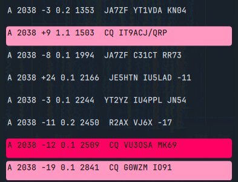 |

  **Decode** turns decoding on (*FT8* or *FT4*); a band button makes the
  active slice the TX slice, tunes it to the mode's dial frequency in DIGU,
  starts decoding and zooms the display to the 4 kHz audio band (again with
  *Zoom*). The bar shows where in the 15 s (FT4: 7.5 s) slot you are.

  **Scroll** (in the drawer): *Whole tab* scrolls the tab in one piece, as
  before; *List only* keeps the main buttons at the top (Decode, the
  bands, the slot bar, CQ, Keep CQ, Answer CQ, Halt TX, the QSO's state
  and Show) and scrolls only the decode list under them, with its own
  scroll bar. The rest (CQ slot, the presence limit, PSK Reporter, the
  time line, TX Hz and TX level, the
  colours) folds under **More**. Where the drawer is lower than about
  520 px (a phone on its side, the drawer at half height), the whole tab
  scrolls anyway. (Michael Whaley's request.)

  **Every slice in DIGU / DIGL decodes at once** (say 40 m on slice A and
  20 m on slice B), each on a DAX channel of its own so the other slices'
  audio stays out: a slice without one, or one sharing its channel with
  another slice, gets a free channel while it decodes and its old one back
  after. The decodes come at the end of each slot, newest first: slice
  letter, UTC, SNR, DT, audio frequency and the message. When a slice
  moves to another band, its decodes from the old band leave the list (the
  other slices' stay), and the slot it was hearing is dropped.

  The colours are WSJT-X's: green a CQ, red your call, yellow your own
  transmission, magenta a new DXCC (light pink: new on this band), amber a
  new CQ zone (light amber: on this band), red-pink a new continent (light
  pink-red: on this band), cyan a call never worked (light cyan: not on
  this band; WSJT-X's New Call and New Call on Band); a CQ
  from a station already in the log on this band and mode is grey. "New"
  is counted from the Log tab's log, so import your logbook there (ADIF)
  or turn on **Worked before from the logbook** (Wavelog, QRZ.com) or a
  **Shared ADIF file** to see what you still need. **Show** filters the list: **All**, **CQ**
  (CQ calls only), **CQ POTA** (park activators calling `CQ POTA`; a
  contact with one goes into the log with SIG POTA, the park itself is not
  in the message), **New** (a new continent, CQ zone or DXCC, overall or on
  this band), **New DXCC** (a DXCC not yet in the log, overall or on
  this band) or **New call** (a call not yet in the log, or not on this
  band); your call, your own transmissions and the station you are
  working always show. The line above the list says how many of the last
  decodes the filter shows.

  **Tap a decode** to answer that station: the row flashes yellow, TX,
  the active slice and the display move to the slice it was heard on, and
  the app starts calling.
  **CQ** calls CQ on the **TX slice** (the one with the red TX badge), in
  the slot set by **CQ slot**: *Auto* (the next one), *Even* (FT8: 0 and
  30 s, FT4: 0, 15, 30, 45 s) or *Odd* (15 and 45 s; FT4: 7.5, 22.5 …).
  **CQ to** directs the CQ: *All* is a plain CQ, *DX*, *NA* or *EU* send
  *CQ DX K1ABC FN42* and so on, and the CQ button then reads *CQ DX*.
  **+** adds your own: 1 to 4 letters (a continent, a country, POTA) or 3
  digits, what FT8 and FT4 carry after CQ; a press and hold on one removes
  it. Only a standard callsign can send a direction: with a nonstandard
  one (OH6OKSA, a call with a prefix) the CQ goes out plain, as WSJT-X
  sends it, and the row says so.
  **Keep CQ** (between CQ and Halt TX) goes back to CQ after every QSO your CQ brought (and after a
  station that answered goes quiet), until **Halt TX**; a CQ nobody
  answers still stops after its tries.
  **Answer CQ** (beside Keep CQ) answers CQs by itself while you are not
  in a QSO or calling CQ: after each slot it picks a CQ heard on the TX
  slice that **Show** lets through and that is not from a station already
  in the log on this band and mode, the rarest first in WSJT-X's colour
  order (a new continent, CQ zone, DXCC, then a new call), the strongest
  among equals. It calls that station up to five times; when they answer,
  the QSO runs and is logged as usual, and when they don't, it moves on to
  another station (one called is left alone for 30 minutes). A CQ to some
  (`CQ DX`, `CQ EU`) is answered only where you are them, `CQ POTA`, `SOTA`,
  `WWFF`, `IOTA` and `QRP` always, contest CQs (`CQ TEST`, `CQ WW`) never.
  It is on for this session only: **Halt TX**, decoding off, TX moving to
  another slice or the transmit lock going back to SB switch it off.
  (Kurt DL5EAG's request.)
  **Auto stops after … min untouched** (the presence limit, with the
  CQ slot setting; 1 to 60 minutes, 10 by default) is how long Answer CQ
  and Keep CQ go on without a touch, a click or a key on the app: after
  that Answer CQ switches off and Keep CQ ends after its QSO, so the app
  never runs a station unattended for long. While either runs, the state
  box counts the time down; any touch on the app starts it again.
  Timing and transmitting follow the TX slice: move the TX
  badge, press a band button with another slice active, or tap inside
  another DIGU / DIGL slice's passband to move it; a QSO under way stops
  when TX moves, and adding slices does not take TX away.

  While a QSO or CQ runs, its state is a box under TX level: amber while
  waiting (*Calling K1ABC*, *Next (odd): …*), red while transmitting. The
  same state also shows at the top of the display, where it stays in view
  however far the decode list is scrolled. On
  the display the red band is your TX tone and a green **RX** band shows
  where the station you work is heard, as WSJT-X's markers (below, FT8
  decoding on 20 m: the 4 kHz FT8 view, the TX and RX bands, and Controls
  in PTT's place).

  

  RX is
  always shown: after a QSO it stays on the last station worked; before
  the first one, and while you call CQ, it sits on your own TX tone; both labels sit on solid grounds over the
  waterfall.

  **Report to PSK Reporter** (off by default) sends the stations this
  device decodes, with their locators, frequency and SNR, to
  pskreporter.info under your callsign and grid (set the grid on the Log
  tab if the radio has no GPS), as WSJT-X does: each station at most once
  per band in five minutes, sent every five minutes and when decoding stops.
  The line under it counts what was reported.

  A QSO between two **nonstandard calls** (yours with a four-letter suffix,
  and theirs with a / suffix such as /QRP) has no FT8 message for a report:
  the app makes it with the calls and RR73 only, and logs it without RST.

  FT8 needs the time within about a second. When decoding starts, and every
  30 minutes while it runs, the app asks a time server (time.cloudflare.com,
  or else pool.ntp.org or time.google.com) and
  runs FT8 / FT4, and the times in the log, on that time whatever the
  device's clock says (an app cannot set the device's clock). A line under
  PSK Reporter names the time server and how far off the device's clock
  is, in milliseconds, or says that no time server has answered yet. The
  line stays dim while a server is in use, however far off the device's
  clock is (the app runs on the server's time); without one it turns amber
  when the decodes' DT says the clock is 0.3 s or more off. Without the internet, if the decodes' DT is off by more than
  0.8 s on average, a red notice says this device's clock looks off: set
  Date & Time to automatic.

  The app then runs the QSO as WSJT-X does (report, R-report, RR73 or RRR,
  73), stops after six tries without the reply it waits for, and writes the
  contact to the Log tab's log (MODE FT8, or MFSK / FT4) with the
  frequency of the slice it was made on. As soon as a QSO starts, the Log
  tab shows its call (lookup and worked before), FT8 / FT4 as the mode and
  the reports as they are exchanged; the app logs the QSO itself at the
  end, so the Log button there is not needed. **TX power** in the log is
  the last transmission's measured peak (an amplifier's output when a
  linked PGXL or RF2K-S is in Operate), not the RF power setting. **Halt TX** stops at once. PTT is
  hidden while FT8 / FT4 decodes (the app keys the radio itself), and the
  display gets the room. Switching the FT8 slice to a voice or CW mode
  (by hand, or with a band button on a band the radio remembers in LSB /
  USB) ends decoding: PTT comes back and the display returns from the
  4 kHz FT8 view to the width it had before.

  **TX … Hz** sets the transmit tone (200–3000 Hz, default 1200; − / + step
  1 Hz and repeat while held). The red band on the display is the tone:
  **drag it** to any frequency, or **tap** the waterfall near the dial to
  put it there (while decoding, a tap there sets the tone instead of
  retuning; the passband shading is left out in FT8 / FT4, the filter edges
  stay). A callsign the standard messages cannot carry (such as OH6OKSA,
  with a four-letter suffix) is sent as WSJT-X sends it: in full in CQ and
  in RRR / RR73 / 73, as <CALL> in the messages with a report. The transmit
  audio goes to the radio past the TX processing (no gate, EQ or
  compression), and the radio's speech processor (PROC) is switched off
  for each FT8 / FT4 transmission and back on right after it, so a PROC
  left on cannot distort the tones. **TX level** (0 to −20 dB, default 0 dB, as WSJT-X's
  Pwr) sets how hard that audio drives the radio: at 0 dB it is fully
  driven and the power out follows the TX tab's RF power; lower it to back
  off. Under it, **Last TX** shows the last transmission's peak power and
  SWR beside the band's RF power: well below it means the drive (TX level)
  or the SWR; equal means the band's RF power is the limit. On an Aurora
  (AU-510 / AU-520) the RF power is a percentage of its 500 W, so it shows
  as % (29 % is about 145 W out). **Free** moves
  the TX tone to the clearest spot between 200 and 2800 Hz among the
  stations heard in the last minute on the TX slice (in the CQ slot's
  period when Even or Odd is chosen); the status line says where. Decoding copes with audio
  that arrives in bursts (SmartLink, a VPN over a mobile link).

- **FreeDV** — RADE digital voice and FreeDV Reporter.

  

  **RADE digital voice** (FreeDV's Radio Autoencoder, in the app itself, no
  FreeDV waveform needed): *RADE* puts the slice in DIGU (DIGL where the
  band's voice mode is LSB) with a 750–2250 Hz filter, mutes its ordinary
  audio and plays the decoded speech instead; the line beside it shows
  *Synced* and the SNR when a RADE signal is heard (a meter can show it
  too: SNR in the meter chooser), and the callsign each
  station sends at the end of its over. Talk with PTT as usual: this
  device's microphone goes through the RADE encoder to the radio's DAX
  transmit (turned on for RADE, off again after), and the end-of-over frame
  with your callsign plays out before the carrier drops. While RADE is on,
  the filter chooser's widths centre on RADE's 1500 Hz (the chooser says
  so), not on the radio's DIGU / DIGL offset, so a narrower or wider filter
  stays on the signal. *RADE* again, or another mode, ends it and restores
  the mode and filter (unmuted; when the mode before RADE is not known, the
  band's voice mode with a 2.7 kHz filter); a band button, a frequency on
  another band, an FTx band button, *Decode* and *Disconnect* end it first
  too, so the radio remembers the band as it was before RADE (not muted).
  If the app was closed or the link lost while RADE was on, the next
  connection unmutes the slice RADE had muted. When a band comes back muted
  anyway (the radio remembers each band's slice), the app says so: tap the
  speaker on the info panel.

  

  **Report to FreeDV Reporter** (off by default) puts this station on
  [qso.freedv.org](https://qso.freedv.org), as FreeDV does, while RADE is
  on: your callsign and grid (the Log tab's *My grid* or the radio's GPS),
  the frequency, when you transmit, and the stations RADE hears with their
  SNR. The line under it says whether it reports (green: *Reporting as …*)
  or what it needs; the text field sets the short message shown there.

  **Stations** lists who is on FreeDV Reporter now, on this band or on all
  bands, the stations on the air first: those transmitting now (*TX now*
  in red), then the most recently heard (*TX 3 min ago*), then the others
  by frequency. Each shows its callsign, grid and distance, frequency,
  mode, whom it hears and the message it shows. Your own station is
  outlined. A tap tunes there; for a RADE station (mode RADEV1) RADE comes
  on too, and for an SSB station (LSB / USB) RADE goes off and the slice
  takes the station's sideband, so you hear it. The list is fetched only while the tab
  is open.

- **Digi** — the keyboard digital modes: RTTY, PSK31 and PSK63, received
  and sent, as in [Operating by mode › RTTY](#rtty) and
  [PSK31 / PSK63](#psk31-and-psk63-digu).

  

  **Mode**: **RTTY**, **PSK31** or **PSK63** (PSK in DIGU; FT8 / FT4 stop).
  For PSK: the status (where it listens, the quality), the text, **AFC**,
  **Squelch**, **Clear**, the operating rows below, and **Carrier** −10 /
  +10. For RTTY, **Receive in**: **RTTY (LSB)** (the radio's RTTY mode, the standard),
  **DIGL** or **DIGU** (AFSK; DIGU's mark is the upper tone, which the
  decoder follows; both stop FT8 / FT4). Then **Decode on / off**, the
  status (how it listens, whether it has locked on, when it transmits), the
  text so far (sent text as [TX] lines), **Autotune**, **Squelch** and
  **Clear**; **Call** with the calls heard; the eight **macros** (tap sends,
  press and hold edits; F1-F8); **Text to send** with **Send** and
  **Stop**; **Log QSO**; then **Shift**, speed, **Reverse** and the mark tone.
  The text also runs along the top of the waterfall, where a tap opens the
  receive settings over the display.

- **Amp** — an RF-KIT **RF2K-S** amplifier, over its own network
  interface (its REST API), once its address is set in
  [Radio Setup › Amp](#9-radio-setup). The tab shows what the amplifier
  reports; with **Control the amplifier** on (Radio Setup › Amp, off until
  you turn it on) it also switches Operate / Standby and the antenna and
  resets an error, each after asking you.

  

  At the top the amplifier's name and its state, **OPERATE** (red) or
  **STANDBY**, as the amplifier reports it, and the link: *Read from
  192.168.1.60:8080, every half second*, *Connecting…*, or *not reached*
  with the reason (the app keeps trying every 5 s). Then **Forward**
  (0-1600 W) and **Reflected** (0-200 W) power and **SWR** (red from 2:1;
  held at – in receive), on the amplifier's own scales. Forward has an
  amber peak marker: the highest reading of the last 3 seconds, falling
  back slowly, as on the desktop's amplifier panel, so the peaks of speech
  or CW show between readings. Then the PA's **Temperature**, **Voltage**
  and **Current**; the **Band** and **Frequency** the amplifier is on; the
  active **Antenna** (1-4, EXT for the external one); the **Tuner** (mode
  and network); the **Interface** the amplifier follows the radio with
  (UNIV, CAT, UDP or TCI); its **Status** text and **Firmware**. An error
  the amplifier reports shows in red under them. A reading not received
  yet shows as –, never 0.

  The amplifier is read while the app is on screen and connected to a
  radio: twice a second in receive, four times a second while the radio
  transmits, so the power follows the keying. It stops in the background
  (but during Tune, below).

  **Control** (with Control the amplifier on), under the readings:
  - **Mode** — *Standby* and *Operate*, the amplifier's present mode dark;
    tap the other one to switch.
  - **Antenna** — the internal antennas *1*-*4*, the active one dark; one
    the amplifier has not set up is dim. *EXT* lights while the
    amplifier's external antenna is in use: shown, not switched from the
    app.
  - *Reset error* — clears the amplifier's error state (it latches to
    protect the amplifier); deal with the cause first.

  

  Each asks first, naming the change (*Put the amplifier in OPERATE?*,
  *Switch the amplifier to antenna 2?*, *Reset the amplifier's error?*),
  and goes only with the button that names it; *Cancel* or a tap beside
  the question sends nothing. Before Operate, check that the radio's power
  suits the amplifier. None of them works while the radio transmits
  (*Not while transmitting.*: the amplifier's relays must not switch with
  RF on them), and a question still open closes by itself when the radio
  keys, the link drops or Control is turned off. One change at a time:
  *Asking the amplifier…* until it answers. The tab changes only when the
  amplifier reads the new state back. If it refuses, its reason shows in
  red (*The amplifier did not take it: Function currently disabled (HTTP
  409)*); if no answer comes, *No answer from the amplifier: it may or may
  not have done it*, and the tab shows its state again once it is read.

  

  **Tune** (with Control on) is for the amplifier's own tuner. RF-KIT's
  API reads the tuner but cannot start a tune, so its Tune is pressed on
  the amplifier's screen (at the amplifier, or over VNC) while the radio
  sends a carrier; on a phone the carrier used to stop as the app left
  the screen for the VNC app. Tune asks first (*Send a tune carrier for
  the amplifier?*), puts the amplifier in STANDBY if it is in OPERATE (the
  RF2K-S tunes in standby), then sends the radio's TUNE carrier at the TX
  tab's Tune power and keeps it on while the app is away, for 20 s at
  most; the button shows *Stop* and the seconds left. Open the
  amplifier's screen and press its Tune: the carrier stops by itself once
  the amplifier reports the tune done (*The amplifier tuned (SWR 1.15).
  Put it in OPERATE when you are ready.*); then put it in OPERATE with
  Mode. The carrier also stops when the amplifier goes to OPERATE, the
  radio sends more than 45 W, the link to the radio or the amplifier
  drops, TUNE is pressed elsewhere, on *Stop*, and after 20 s (*No tune
  seen in 20 s*). The RF2K-S tunes with 4-39 W in, 10 W or more best:
  outside that, or with the transmit lock in standby, Tune says why and
  sends nothing. If the app is closed or stops, the radio ends the carrier
  itself as the connection drops. The amplifier's TCI interface does not
  help here: the RF2K-S takes only the frequency over TCI.

  

  **4O3A Power Genius XL and Tuner Genius XL.** A PGXL or TGXL connected to
  the radio shows on the Amp tab by itself: the radio reports it and relays
  its state, power, SWR and Operate / Standby (over SmartLink too), and
  this device also reads it directly at its address (the PGXL's port 9008,
  the TGXL's 9010; on the same network or your VPN) for more. A line under
  each name says how it is read.
  - **Power Genius XL**: its state (*OPERATE*, *STANDBY*, *TRANSMIT A* /
    *B*, a fault), **Forward** (0-100 W, past 100 W 0-2000 W, red from
    1500), **SWR** (red from
    2.5, – below 5 W) and **Drive** (the radio's power into it, 0-100 W),
    current, supply (the PA's volts and the mains), PA and harmonic-load
    temperatures, the bands and bias of its ports A and B, an alert when it
    shows one; **Mode** *Standby* / *Operate* and **Fan** *Standard* /
    *Contest* / *Broadcast* (until the amplifier restarts).
  - **Tuner Genius XL**: its state (*OPERATE*, *BYPASS*, *STANDBY*,
    *TUNING*), forward power (0-100 W as for the amplifier, so a tune
    carrier reads) and SWR, **Mode** *Standby* / *Bypass* / *Operate*, **Tune** (it keys the radio for its tune carrier itself, and
    keys or holds its amplifier as its own utility says; *Stop tuning*
    ends it), the relays **C1**, **L** and **C2** a step at a time with − /
    +, on a 1x3 model **Antenna** 1-3, and on an SO2R model **Channel**
    *A* / *B* (the radio port its meters and Tune belong to, with each
    side's frequency); an alert such as *Tuned SWR 1.13:1*.
  - **Antenna Genius** (at the address set in Radio Setup › Amp): each
    radio port's band, RX and TX antenna, *auto* or *manual*, *TX* while
    it transmits, *inhibited*; and the antennas the Antenna Genius allows
    on that band as buttons (one only for receive marked *(RX)*). A tap
    switches the port to it (asked first): receive, and transmit where the
    antenna may transmit on the band (else the TX antenna stays). Not
    while that port or the radio transmits. OksaSDR sends the Antenna
    Genius nothing else: it and a Tuner Genius keep their own antenna for
    each band.

  The buttons change a device only with **Control** on in Radio Setup ›
  Amp, and each change asks first (stopping a tune does not). A command
  the radio refuses says *The radio refused it:* with the radio's own
  words. A tuner the radio does not report, reached at its address alone,
  takes Standby / Bypass / Operate directly. The devices
  guard their own SWR, power and temperature, and the radio waits for the
  amplifier before it transmits; the tuner's relays and antenna switch wait
  while the radio transmits.

  

## 9. Radio Setup

**Setup** in the top row (on an iPhone: **⋯** → *Radio Setup*) holds the
radio's own settings — the ones a radio needs on first use, as in SmartSDR's
and the desktop AetherSDR's Radio Setup. Every change is written to the
radio.


- **Radio** — callsign (what `{CALL}` sends), the radio's name in radio
  lists (letters, digits and . , / - only, as the radio takes it), **This
  station's name** (how this device shows in the radio's
  station list and to other stations, sent at once and on every connect;
  spaces become dashes), *Remote on* (SmartLink may power the radio on),
  muting the radio's own audio while remote, whether **multiFLEX** is on
  (several stations at once), **Connected stations** (every program on the
  radio; *Disconnect* ends another station's session after asking, which
  frees its slices), and the model, serial, firmware, region, address and
  options. **License**: the subscription, when it expires, the highest
  licensed SmartSDR version and the radio ID. **GPS** (a radio with GPS
  fitted): its status, satellites tracked and visible, grid, position,
  altitude, frequency error and UTC. **Restart the radio…** restarts it
  after asking: every station loses the radio for about a minute; over
  SmartLink, connect again by hand.
- **Transmit** — maximum power, TX delay, transmit timeout (0 = off) and the
  TUNE signal (single or two tone). On a FLEX-8000 or Aurora, **APD**: the
  sampler port for each TX antenna that has a choice (*INTERNAL*, sampled
  inside the radio, or *RX_A*, *RX_B*, *XVTA*, *XVTB* for a coupled sample
  of an external amplifier's output) and the **Equalizer** *Reset*. Then what an amplifier, a sequencer or
  a preamp needs, as in SmartSDR's Radio Setup (so no other program is
  needed), kept in the radio's TX profile (its name is shown):
  - **Keying outputs: delay after PTT** — *RCA TX1*, *RCA TX2*, *RCA TX3*
    and *ACC TX* (the accessory connector's TX): how long after PTT each
    output closes, in ms. The radio's signal waits for **TX delay**, so set
    the amplifier's output early enough for its relays (about 20 ms): for
    example TX1 20 ms and TX delay 30 ms.
  - **TX REQ inputs** — *RCA TX REQ* and *ACC TX REQ*: a footswitch or
    sequencer there keys the radio on the bands where the input is on.
    *Active low* (a contact to ground transmits) is the usual; *Active high*
    asks first, as an open input then keys the radio. **PTT mic override**
    (a radio with SmartSDR 4.3 or later): on, a hardware PTT (the RCA PTT,
    ACC or the mic jack) sends the analog mic whatever the TX source.
  - **Inhibit during TUNE (this device)** — *RCA TX1*, *TX2*, *TX3*, *ACC
    TX*: the outputs held open while TUNE or the ATU transmits, so tuning
    at low power does not key the amplifier. Only the outputs TUNE itself
    turned off close again after: one that was off on the band stays off,
    and an output you change in the TX band settings during TUNE is left as
    you set it. This device's setting (as the desktop's), not the radio's.
  - **TX band settings** — pick a band (the one the radio is on is
    picked first), then for that band: **RF power** and **Tune power** (%),
    which outputs close there (**RCA TX1 / TX2 / TX3**, **ACC TX**: e.g.
    the amplifier's PTT only on the bands it covers), the **TX REQ inputs**
    that work there, **PTT inhibit** (no transmitting on that band) and
    **Hardware ALC** (the amplifier's ALC at the ALC jack). Turning a TX
    REQ input on while it is set active high asks first. On a radio with
    SmartSDR 4.3 or later, **RCA TX1-3 held off during TUNE (the radio's
    own)**: the radio itself keeps the RCA outputs open while it tunes on
    that band, kept in the radio for every program. It works alongside
    *Inhibit during TUNE* above; either alone is enough. It is shown only
    when the radio reports it.

  
- **Phone/CW** — microphone bias and boost (the radio's own microphone
  inputs; this device's microphone gain is the TX tab's Mic level), and
  **Mic level meter in receive too**; the CW keyer's break-in delay,
  iambic mode (off, A, B) and swapped paddles, the **CW sideband** (*CWU*,
  upper, as usual, or *CWL*, lower) and **CWX text at the keyer's speed**
  (CW memories and typed CW at the radio's keyer speed). **RTTY**: the
  radio's default RTTY mark (2125 Hz as usual), the mark a new RTTY slice
  starts with.
- **Audio** — the radio's line out and headphone levels and muting, and on
  a model with a front speaker (an M model) muting that speaker.
- **RX** — what the radio's receiver is set to, as SmartSDR's Receive and
  Filters pages:
  - **Frequency calibration** — the radio measures a steady carrier of known
    frequency and sets its own frequency offset from it. Enter the carrier's
    frequency (MHz: a GPS-locked source, or a time station such as WWV on
    10 or 15 MHz, strong and in the clear) and press **Calibrate**: it asks
    first, says the offset now, then shows *Calibrating…* and the result in
    ppb. If the radio refuses, the old offset is put back; if it reports no
    end in 20 s, the page says what the offset was, to enter it back.
    **Frequency offset** sets the offset by hand (parts per billion).
  - **10 MHz reference** — the radio's frequency reference: *Auto*, *TCXO*,
    *GPSDO* (with one fitted) or an *External* 10 MHz input. A change asks
    first: on an input with no signal the radio unlocks and drifts. Below it
    the source in use and whether the radio is locked.
  - **Binaural receive** — on or off, as the radio reports it.
  - **Filters: low latency 0 … 3 sharp** — the radio's filter sharpness for
    *Voice*, *CW* and *Digital*: 0 the least delay, 3 the sharpest skirts,
    or *Auto* (the radio chooses). **Low-latency digital filters** (for
    PACTOR and the like) shows as the radio reports it.

  

  FLEX firmware 4.3 refuses the commands that change multiFLEX, binaural
  receive and the low-latency digital filters ("could not parse"), so the
  app shows them as the radio reports them.
- **Network** — the radio's address as it reports it (IP address, netmask,
  gateway, MAC), and how it gets one: **DHCP**, or **Static** with the IP
  address, netmask and gateway and **Apply the static address…**. Either
  change asks first: the radio restarts with it (every station loses it for
  about a minute), so connect again at the new address. A wrong static
  address can leave the radio out of reach until it is set back at the
  radio. **Private addresses only** shows whether the radio takes stations
  only from private network addresses. Then the network MTU: the largest
  packet the radio sends the app (1450 by default, as in SmartSDR and the
  desktop). Lower it if the waterfall or audio break up over a VPN or
  tunnel; over Tailscale at most 1200 is used.
- **XVTR** — the radio's transverters, as the desktop's XVTR tab: *Add
  transverter* creates one; for each, its name (shown on the band buttons),
  RF frequency (the band, MHz), IF frequency (the radio's, MHz; LO = RF −
  IF is shown), LO error (MHz, for the converter's offset), RX gain (dB),
  max power (dBm of drive to the transverter at its IF, kept within what the
  radio allows) and *Receive only*; *Remove* deletes it. The radio says when
  a transverter is valid.
- **Amp** — not a setting of the radio: the amplifier this device reads
  for the [Amp tab](#8-controls) and the meters, kept on this device.
  First **Manufacturer**: tap **4O3A** (Power Genius XL, Tuner Genius XL,
  Antenna Genius) or **RF-KIT** (RF2K-S) to show its devices; tap again to
  hide them. A maker whose device is set up reads *· in use*, always shows
  and comes first. More makers are planned (Elecraft, SPE).
  **RF-KIT RF2K-S**: its **Address** (the IP address or host name of the
  amplifier's network port, `:port` after it when not 8080) with *Save*;
  **Read the amplifier** on or off; **Control the amplifier** on or off
  (off until you turn it on: then nothing that changes the amplifier is
  ever sent; on: the Amp tab's Mode, Antenna, Reset error and Tune, each
  asking first); the link's state; *Forget the amplifier* removes it, the Amp tab
  and Control (a new address starts read only). This device reaches the
  amplifier directly: on the same network, or over your VPN when away —
  not through the radio, and not over SmartLink.
  **4O3A Power Genius XL** and **Tuner Genius XL**: each one's state (found
  by the radio and read directly at its address, read directly at an
  address you set, or through the radio only),
  **Control the amplifier / tuner** (off until you turn it on; the buttons
  it allows are on **Controls › Amp**: Standby / Operate and the fan, the
  tuner's Standby / Bypass / Operate, Tune, relays and antenna), the
  **Address** — the device's own address, not the radio's: the radio
  reports it (it shows in the empty field); enter one when the radio
  reports none or your VPN shows the device at another address, and
  *Use the address the radio reports* (or *Clear the address*) goes back —
  and **Remote code** when the device asks for one: the device's
  *Authorization code* (set in its utility's Network settings), asked when
  this device reaches it from outside its own network (a VPN or the
  internet; until then it works through the radio only; kept in this device's secure store once the
  device has accepted it). Away from home the device is reached over a VPN
  that routes your station's network, e.g. WireGuard or a Tailscale subnet
  router (a PC, Raspberry Pi or Apple TV at the station sharing its
  network), or, as FlexRadio's guide to remote Genius devices, without a
  VPN: TCP port 9008 (PGXL) or 9010 (TGXL) forwarded to the device in the
  station's router, the station's public address or DDNS name entered as
  the Address, and the Remote code set (the device then asks for it).
  SmartLink carries only what the radio relays (state, power, SWR,
  Operate / Standby).
  **4O3A Antenna Genius**: the radio does not report one, so it is read
  at the **Address** set here (its own, TCP 9007; on the station's network
  or a VPN), with its state, name and version; **Control the antenna
  switch** (off until turned on: the Amp tab's antenna buttons) and its
  **Remote code** when it asks, as for the PGXL and TGXL.

  
- **USB** — USB-serial (FTDI) cables in the radio's USB ports, as
  SmartSDR's *USB Cables*: they give an amplifier, a tuner or an antenna
  switch the frequency or the band without a computer. A cable shows once
  plugged into the radio (one it remembers but is unplugged says so;
  *Forget this cable* drops its settings after asking). For each: its
  **Name**, **Enabled**, and its **Type**:
  - **CAT** — the frequency as CAT text (e.g. to an ACOM or SPE amplifier):
    **Frequency from** (none, the TX pan, the TX slice, the active slice,
    a transmit or receive antenna, or a slice by letter), **auto report**
    (sent as it changes, not only when asked), and the serial port:
    speed, data bits, parity, stop bits, flow control, as the amplifier
    wants them.
  - **BCD** — the band as BCD lines (HF, VHF or both), active high or low,
    for an amplifier's or antenna switch's band input.
  - **Bit** — eight lines (*Bit 0-7*), each on for a band or a frequency
    range, active high or low, from a source as above, and if wanted only
    while transmitting, with a PTT delay and a TX delay (ms): e.g. an
    antenna relay per band.
  - **LDPA** — a FlexRadio 2 m / 4 m LDPA amplifier: its band and preamp.
  - **Pass** (passthrough) — a serial port through the radio, with its
    port settings.

  The radio keeps these settings; it answers each change with an OK
  rather than a status, so the page shows a change once the radio has
  taken it.

  

**A new radio.** When the app connects to a radio that has no callsign yet —
a new or reset radio — it offers *Set up* once, a few seconds after
connecting. *Later* skips it; Setup stays in the top row either way. A radio
that has a callsign never shows the offer.

## 10. Notices and problems

Notices and refusals pop up in the middle of the display; tap one, or wait
6 s, to close it. A tap elsewhere (PTT, tuning) never closes it by accident.


| You see | Why | What to do |
|---|---|---|
| **No slice** (frequency 0.000.000) | The radio did not give the app a slice. The app first retries once on a fresh panadapter; if it still fails, the radio's slices may all be in use by other programs | **Stations…** shows them; close a slice there or disconnect it, then **Try again** |
| *No slice transmits* | No slice has transmit | Press and hold a slice → **Make TX slice** |
| *Interlock / did not accept the transmit request* | The radio refused to transmit; its reason is shown | Check TX antenna, band, other clients |
| A band button opens another band | The radio's band stack (in its global profile) holds that frequency | Tune the band where you want it and save the profile |
| *The radio has no callsign for {CALL}* | No callsign in the radio | Setup → Radio → Callsign |
| *No call for {HIS} …* | A memory with `{HIS}` and no call being worked | Pick a heard call on the CW tab or type it in the Log tab's Call field |
| *The TX slice is in DIGU: PTT is for voice …* | PTT pressed with the transmit slice in DIGU / DIGL | Switch it to USB / LSB to talk; FT8 / FT4 run from the FTx tab, RADE from the FreeDV tab |
| *Break-in is off …* | CW keyed with Break-in off: the key does not put the radio on air | Controls → CW → Break-in |
| *This slice is muted on this band …* | The radio remembers the band's slice muted | Tap the speaker on the info panel |
| *The radio's CW pitch was 0 Hz …* | The radio had a CW pitch of 0 stored for this app, so CW at zero beat was silent | Nothing: the app set 600 Hz; change it under Controls → CW → Pitch |
| *Microphone access is off …* | The device does not let the app use the microphone | Allow it in the device's settings (Settings › OksaSDR › Microphone) |
| *Host unreachable* or *timed out* to a home-network address (iPhone, iPad, Mac) | iOS keeps the app off the home network until it may use it (Local Network permission); the error then names where | Settings › Privacy & Security › Local Network › OksaSDR on; also check the address and that this device is on the radio's network or VPN |
| *No free slice for the transmit side of a split* | All the radio's slices are in use | Close a slice (press and hold its chip, or Stations…) |
| *Set the radio's callsign first* / *The DX cluster needs a callsign* | FT8 / FT4, or the DX cluster, needs a callsign | Setup → Radio → Callsign (the DX cluster can also take one under Spots) |
| *The radio takes transmit audio from its … input* | PTT would send the radio's own microphone | Controls → TX → **Use this device's microphone** |
| *The 3D view was too slow …* / *The app stopped while the 3D view was on …* | The app went back to the 2D waterfall | View → 3D to try again |
| Amp: *not reached: Connection refused* or *timed out* | Nothing answers at the amplifier's address and port from this device | Check the address (Radio Setup › Amp) and the port (8080 unless changed on the amplifier); away from home the VPN must be up; on an iPhone, iPad or Mac allow Local Network for OksaSDR |
| Amp: *Not an RF-KIT amplifier* | Something else answered at that address (a router, another web page) | Check the amplifier's address and port |
| Amp: *The amplifier did not take it: … (HTTP 409)* | The amplifier refused the change: the function is disabled on it, or it does not allow an antenna change now | Check the amplifier's own display and settings; the tab keeps showing its real state |
| Amp: *No answer from the amplifier* or *The link was lost before the amplifier answered* | The link dropped while the change was on its way | Look at the amplifier's display: it may or may not have done it; the tab shows its state again once it is read |
| Amp: Mode, Antenna and Reset error are dim | The radio is transmitting, a change waits for its answer, or the link is down; with no Mode or Antenna rows at all, Control is off | Wait for receive or the answer; check the link line at the top; Radio Setup › Amp › Control the amplifier |
| Amp: *Tune power is … W: the RF2K-S tunes with 4 to 39 W …* | The TX tab's Tune power is outside the amplifier's tuning range | Controls → TX → Tune power 10-39 W |
| Amp: *No tune seen in 20 s* | The amplifier's Tune was not pressed, or the amplifier did not report tuning, within the 20 s | Press Tune on the amplifier's screen sooner after the carrier starts; check that its tuner is in AUTO, not bypassed |

## 11. Keyboard and Apple Pencil

On a **Mac** (the iPad app, through TestFlight) click a text field and type
in it as on an iPad. If the Mac's keyboard does not reach a field (as on
some Macs before), **press and hold** the field: a small text box (Apple's
own) opens with the field's text; type there and press Return or OK to put
the text in the field, Esc or Cancel to leave it as it was. OK only fills
the field: logging a contact, sending CW text or saving is still the
field's own button (until build 139 OK also pressed Return, so the Log
tab logged a half-typed call at once). The iPad's GameController keyboard
reading is not used on a Mac.

With a Magic Keyboard, trackpad or any hardware keyboard (also a
Bluetooth keyboard on a phone, or Android's DeX):

| Key | Action |
|---|---|
| ← / → | Tune one step |
| ↑ / ↓ | Tune ten steps |
| Shift + arrows | Ten times as far |
| Space | PTT (hold) |
| + / − | Zoom |
| F | Frequency entry |
| F1–F12 | CW memories (CW modes), the Digi tab's macros (F1–F8, RTTY and PSK) or voice macros (voice modes) |
| ⌘1–⌘9, ⌘0 | As F1–F10, for a keyboard without F-keys (an iPad's Magic Keyboard); Ctrl with the digit on Android and a PC keyboard (not while Ctrl keys the CW paddles) |
| Esc | Stop CW text, RTTY or PSK text, or a voice macro |
| Scroll | Tune; ⌘- or Ctrl-scroll zooms |

Sliders, switches and lists do not keep the keyboard: after one is used
(on a tablet's side panel or in the drawer), Space and the arrows work on
the page again at once. A text field keeps it until you tap outside it.

**Apple Pencil** drags tune ten times finer, for zero-beating.

## 12. Reporting a problem

Open **Log** right after the problem (on an iPhone behind **⋯**) and tap
**Send to the developer**: a mail to oh6oksa@gmail.com opens with the
subject (app, build, device and system) filled in and the log attached,
this run's and the previous run's in one file. Write what you were doing
and send it. On an iPhone or iPad without an account in Apple's Mail (Gmail
or Outlook instead) the share sheet opens with the file and the address is
copied: paste it as the recipient. Nothing is sent until you send the mail.
**Share** gives this run's log as text to any other app (Messages, Notes,
AirDrop to a Mac; *Copy* is in its sheet).


After a crash, open the app
again: the log is also kept in a file as the app runs, and Log shows *The
previous run ended in a crash* in red: Send to the developer sends that
log too, ending with the crash and where in the app it happened. (Juho
Kontio's crash left no log to send.) With a Power Genius XL, Tuner Genius
XL or Antenna Genius the log also holds what the radio and the devices
report of themselves (a remote code hidden), the meters they make on the
radio and each transmission's highest readings: send it after a moment on
Controls › Amp. The log header shows the app
version and build. A press and hold on the title *Log* shows **Clear**
(empties the log, so the next report starts from a known point) and the
**Developer link** (with a PC address), which is only for the developer's
own devices: leave it off.


## 13. Android

OksaSDR for Android is in beta. It is the same app as on the iPhone and
iPad, built from the same code; this section covers what is particular to
Android.

| Inner screen | Controls open | Outer screen |
|---|---|---|
|  |  |  |

**Installing.** Download the newest APK from
[the latest release](https://github.com/OH6OKSA/OksaSDR/releases/latest) on the phone, open
it, and allow installing from your browser or file manager when Android
asks. A newer beta installs over the old one and keeps your settings.
Android 9 or newer, 64-bit ARM (practically every phone and tablet from the
last years). The Android itself must be 64-bit: some tablets with a 64-bit
processor run a 32-bit Android (e.g. the Galaxy Tab A 10.1 of 2019, SM-T510),
and there Android answers *App not installed*.

**Permissions, asked once.**
- *Notifications*, *microphone* and *battery optimization* — the first
  time you connect. The microphone is used only while PTT is held (or a
  voice macro is recorded); if you refused it, PTT asks again, and when
  Android no longer asks, turn it on in Settings → Apps → OksaSDR →
  Permissions → Microphone.
- Allow notifications and battery: while connected, OksaSDR runs a service with a notification
  (*OksaSDR — Connected to the radio*) so receive audio and the connection
  keep going when another app is in front or the screen is off. Some phones
  (OnePlus, Xiaomi, Huawei) also have their own setting: Settings → Apps →
  OksaSDR → Battery → allow background activity.

**Bluetooth headsets.** With a headset connected, receive audio and the
microphone go through it (the hands-free link, as on the iPhone). Without
one, the phone's speaker and microphone are used. **A USB-C headset** (or a
USB-C to 3.5 mm adapter) is used the same way with *Auto*, ahead of
Bluetooth; plugged in or out while connected, receive moves over at once. Controls › Audio ›
**Audio output** changes this: *Speaker* keeps both on the phone, *Bluetooth
media* plays over the music link with the phone's microphone (see
[Controls](#8-controls)).

**Accessibility services.** Unless a screen reader (TalkBack) is on, the
app does not answer Android's accessibility queries: services such as a
pen app or the accessibility menu asked about the screen all the time, and a
held PTT froze the app into "not responding" on a Lenovo tablet. With
TalkBack on, the app works with it as before.

**Finding the radio.** On the radio's own network, *On this network* lists
it. Over SmartLink or a VPN, use those sections instead (the radio's
broadcasts do not cross a VPN).

**Log.** *Log → Share* opens Android's share sheet (Gmail, Messages, …).
